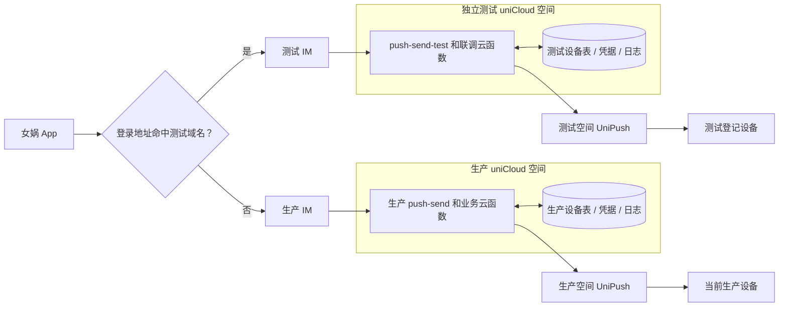

# 移动端推送环境隔离

## 两条链路和隔离边界

**测试和生产各用一个 uniCloud 服务空间。** 测试 IM 只调用测试空间的 `push-send-test`，由该函数直接使用 UniPush 发送。生产 IM 继续使用生产空间的 `push-send`。测试函数和设备表从独立目录准备，按测试 Space ID 部署和回滚。设备表、密钥、队列、定时任务、日志和告警按环境独立。测试侧故障在测试环境报错或重试。 [uniCloud 服务空间说明](https://doc.dcloud.net.cn/uniCloud/concepts/space.html)

登录地址规范化后，只有 HTTPS 源 `https://testagent.xspaceagi.com` 使用测试推送，其他地址默认生产。App 优先复用现有包名、签名和 DCloud AppID。IM 从自身部署配置选择入口，函数通过本空间的配置和凭据确立环境，设备能力在归属校验之后判断。

应用标识能否复用取决于 UniPush 双空间的实际发送授权。测试函数只向测试设备表中登记有效的 CID 投递，厂商层是否额外限制授权范围需要独立核对。

## 需要新增和修改的配置

| 位置 | 新增 | 修改 |
| --- | --- | --- |
| uniCloud 控制台 | 独立支付宝云测试 Space ID、测试空间协作者和部署权限。若已有符合隔离要求的测试空间，复用该空间。 | 测试部署项目或流水线指定测试 Space ID，检查云函数依赖、数据库操作、任务和回调目标。 |
| 测试云空间 | 部署独立的 `push-send-test`，开通测试空间 HTTPS 入口，创建 `push-device-bindings` 和唯一 CID 索引。盘点需部署的其他联调云函数、依赖、集合和定时任务。 | 设置 `PUSH_TEST_SPACE_ID=env-00jy72x2l4nj`。独立生成测试发送密钥 `PUSH_SIGN_KEY` 和登记密钥 `PUSH_TEST_BINDING_KEY`。两者使用不同值，并与线上密钥分开。确认测试投递范围后再设置 `PUSH_TEST_ENABLED=1`。 |
| 测试 IM | 接通设备登记、更新、撤销和发送版本，保存测试设备数据和补推任务。新增 `IM_UNIPUSH_BINDING_SIGN` 保存测试登记凭据。 | `IM_UNIPUSH_URL` 指向测试空间自己的 URL，`IM_UNIPUSH_SIGN` 使用测试发送密钥。核对 IM 使用测试数据库、缓存和消费队列。 |
| DCloud UniPush 和各厂商 | 对照现有控制台配置、安装包和测试证据，核对测试空间的发送能力，以及现有包名、签名、AppID 和厂商权益能否复用。 | 根据核对结果列出具体改动项，供后续测试配置使用。 |

### 测试模块与上传命令

测试模块位于 `cloud/test-push`，其中 `deployment.json` 固定使用支付宝云 `nuwax-push-test`（`env-00jy72x2l4nj`）。运行 `node scripts/deploy-test-push-cloud.mjs` 即可调用已登录的 HBuilderX CLI。脚本先核对空间名称、ID 和服务商，再逐项上传测试函数和首次建表所需资源。空间 ID 由模块配置提供，上传命令没有空间覆盖参数。主项目的 HBuilderX 空间绑定独立管理。

常规函数更新会复用测试设备表和索引。首次建表中断且索引尚未安装时，使用 `node scripts/deploy-test-push-cloud.mjs --init-index` 补齐。在已使用的表上调整结构或索引时，单独进行测试库迁移。若只需本地部署包，运行 `node scripts/prepare-test-push-cloud.mjs`。

测试 IM 将 `IM_UNIPUSH_URL` 指向测试函数 HTTPS 入口。发送和登记凭据分别通过受控方式配置。 [测试 push-send-test 入口](https://env-00jy72x2l4nj.dev-hz.cloudbasefunction.cn/push-send-test)

默认关闭原生通道。华为回归时设置 `NUWAX_VOIP_TEST_ANDROID_TRANSPORTS=android-huawei`。iOS 按实际包签名设置 `NUWAX_VOIP_TEST_IOS_APNS_ENVIRONMENTS`，可用值为 `development` 或 `production`。会议响铃由 `NUWAX_VOIP_TEST_MEETING_RING=1` 单独开启。荣耀和 vivo 的原生来电适配待接入、核验后开启，普通通知仍可按厂商实机验收。

**先验证 UniPush 双空间的实际发送。** 控制台已显示同一 AppID 关联到两个支付宝云空间。以独立测试空间的函数日志和厂商回执核实发送能力，以测试设备登记和拒发测试核实测试侧的发送范围。两边统一使用 UniPush。 [UniPush 开通与空间关联](https://doc.dcloud.net.cn/uni-app-x/uni-push/open.html)

## IM 联调契约

- 测试 IM 的设备控制接口从鉴权会话取得账号和设备归属。首次登记、CID 刷新、账号注销、设备撤销和 PushKit 绑定更新均同步到测试空间的 `push-send-test`。登记和撤销使用独立登记凭据，通过 `X-Push-Sign` 提交。发送凭据仅能投递。
- 登记请求使用 `action=registerBinding`，传 `deviceId`、`userId`、`cid`、`platform`、本次登记的 UUID `registrationId` 和可选 `previousRegistrationId`。IM 保存操作版本并以同一 UUID 重试。前序版本仅用于本环境的更新，首次建立记录可省略。换环境时，旧服务确认设备已释放后，App 才允许在新环境重新登记。需要 iOS 原生来电时另传 `transport=ios-voip`、签名的 `apnsEnvironment` 和已核验的 `voipRegistrationId`。
- 现有 `POST /api/instant-message/devices` 接收可选 `pushPreviousRegistrationId`，成功时在 `data.pushBinding` 返回网关回执 `{ registrationId, active, environment }`。无变化的 WebSocket 设备刷新保留当前版本。用户关闭推送时释放当前绑定并返回该回执。IM 记录绑定版本，归属和版本不明时停发该设备并等待重新登记。
- App 调用 `DELETE /api/instant-message/devices/{deviceId}/push-binding?registrationId=<当前版本>`，IM 验证旧会话，使用 `action=revokeBinding`、`deviceId`、鉴权得到的 `userId`、`previousRegistrationId`。网关起始发送会持有设备租约，撤销遇到并发提交返回可重试冲突。IM 将确认的释放回执作为 `data` 返回，并在本环境停发旧设备。重试同一注销操作返回相同的释放版本。App 在获得确认后才切域，回执和设备 ID 均跨退出登录保留。如果旧会话已失效且绑定仍有效，先在旧环境登录恢复登记后再切换。
- 普通消息、角标、会议和单聊 VoIP 继续使用原有信封，额外传字符串 `recipientUserId` 和 `push_bindings: [{ cid, deviceId, registrationId }]`，与 `push_clientid` 一一对应。同一批只含一个账号，入队或首次决定推送目标时保存登记版本和 `request_id`，重试沿用原值。测试函数逐设备返回 `data.results`。IM 按 `clientid` 处理部分失败，登记过期或归属不符的 403 则停止重试该目标。

## 配置闭环核对

| 环节 | 完成条件 | 当前缺口 |
| --- | --- | --- |
| 云函数与部署目标 | 测试函数校验实际 Space ID，配置缺失或空间不符时拒绝请求。单独部署测试函数、设备表和 HTTPS 入口。 | 测试函数、设备表、HTTPS 入口和隔离凭据已部署，发送开关关闭。HTTPS 已验证无签名和跨环境拒绝、测试设备登记与撤销。实际厂商直发待验证。 |
| App 动态域名 | App 的 HTTP、IM WebSocket 和原生通话使用同一个已验证登录地址。命中测试域名使用测试，其他域名默认生产。切域先撤销旧绑定，再清理旧会话、通知和角标，在新环境登录及登记。 | App 按登录地址保存登记回执，首次进入目标环境使用该域自己的登记上下文。还需核对同一安装包的原生 VoIP 域名闸门及 iOS 签名环境。 |
| IM 服务配置 | 每个 IM 实例按自身部署选定环境，使用对应的数据库、Redis、推送队列和 UniPush URL／密钥。普通通知、角标、会议、VoIP、`push-test` 与补推共用同一环境和设备校验。 | IM 已有 `IM_UNIPUSH_URL`、`IM_UNIPUSH_SIGN` 和 `IM_PUSH_OFFLINE_ENABLED`，还需接通登记／撤销密钥和发送版本契约。单改 URL 无法满足严格模式。 |
| 发送及回归 | 测试只发送给本空间已登记且有效的目标。失效设备逐台拒绝，其他有效设备继续收取。核对发送空间、函数版本、目标登记版本和厂商回执。 | 逐设备校验已由本地用例覆盖。生产仍使用现有链路，同一安装的生产 → 测试 → 生产完整互斥待接通各环境后验证。 |

联调先验证测试空间的直发入口，并用未登记的测试目标验证拒发。接通测试 IM 后，验证普通 IM、角标、会议和 `push-test`，再逐个开启来电通道。切域回归要覆盖旧队列、CID 轮换、账号相同、重复提交和撤销失败。生产仍使用原配置时，使用测试专用设备验证新链路。

## 全部厂商确认

逐渠道核对发布包、厂商控制台和已有测试证据。分别记录普通通知、角标、原生来电的配置、验收结果和证据日期。只有需要变更时才列出具体项。 [DCloud App 厂商模块](https://uniapp.dcloud.net.cn/uni-app-x/collocation/manifest-android.html) · [UniPush 开通与证书配置](https://uniapp.dcloud.net.cn/tutorial/app-push-unipush)

| 厂商 / 通道 | 逐家确认项 |
| --- | --- |
| DCloud UniPush | 同一 AppID 能否在两个支付宝云空间同时独立发送，测试授权是否可限制为测试设备，确认发送配额、VoIP 载荷映射和回执 |
| Apple APNs／PushKit | 核对现有 Bundle ID、签名权益、APNs 凭据和 VoIP topic，分别实测开发签名和 TestFlight／发行签名。 [Apple 签名环境](https://developer.apple.com/documentation/bundleresources/entitlements/aps-environment) · [Apple PushKit](https://developer.apple.com/documentation/pushkit/responding-to-voip-notifications-from-pushkit) |
| 华为 Android／HMS | 核对包名、签名指纹、普通通知、数字角标和高优先级来电权益。 [华为 Push Kit](https://developer.huawei.com/consumer/cn/hms/huawei-pushkit) |
| 荣耀 | 独立核对应用标识和签名，分别确认通知、角标和 VoIP 专用发送权益。 [荣耀推送产品说明](https://developer.honor.com/cn/kitdoc?category=%E5%9F%BA%E7%A1%80%E6%9C%8D%E5%8A%A1&docId=introduction.md&kitId=11002&navigation=guides) |
| 小米 | 核对发布签名、应用凭据、通知分类、角标行为和原生来电支持条件。 [小米消息分类](https://dev.mi.com/xiaomihyperos/documentation/detail?pId=2321) · [小米角标说明](https://dev.mi.com/xiaomihyperos/documentation/detail?pId=1573) |
| OPPO 中国区 | 核对应用和上架区域、签名、通知类别、角标及原生来电权益 |
| OPPO 国际区 | 独立确认海外应用、区域凭据、通知、角标和来电能力 |
| vivo | 核对发布签名、应用凭据、通知类别、角标和原生来电支持条件 |
| 魅族 | 核对通道接入计划、应用凭据、通知、角标和原生来电支持条件 |
| 华为 HarmonyOS | 核对鸿蒙应用、签名、IM 分类、角标刷新和应用内通话权益。 [鸿蒙场景化消息](https://developer.huawei.com/consumer/cn/doc/HarmonyOS-Guides/push-scenes-send/) |
| Google FCM | 核对海外发布目标、Firebase 应用配置、GMS 设备支持和通知表现。 [Firebase Android 文档](https://firebase.google.com/docs/cloud-messaging/android/get-started) |
| 锤子及后续新增通道 | 先确认实际接入计划、当前 SDK 支持和各项权益，再按上面的字段补记录 |

### 本次复用核对项

- **DCloud UniPush。** 记录 AppID `__UNI__8BF05E4` 的两个空间关联。核对实际发送日志的 Space ID、AppID、测试目标范围及回执，分别记录普通通知、角标、Android 原生来电和 iOS PushKit 的结果。
- **各手机厂商。** 对照当前应用标识、发布签名和通道权益，逐项核对普通通知、角标和原生来电。荣耀、vivo 分别核对锁屏无进程时的厂商投递及系统来电。iOS 核对签名对应的 APNs 环境和 PushKit 回调。

2026-11-20 在支付宝云测试空间 `nuwax-push-test`（`env-00jy72x2l4nj`）部署正式测试入口 `push-send-test`。生产空间 `push-nuwax` 使用单独的 `env-00jy6ydc5dxi`。UniPush 2.0 应用控制台列出这两个空间。旧入口 `huawei-call-pilot` 仍有独立试拨凭据，退役前须核对调用方。新增联调统一使用 `push-send-test`。 [测试空间云函数](https://unicloud.dcloud.net.cn/pages/cloud-function/cloud-function?pageid=env-00jy72x2l4nj)

## 切换与验收

1. 确认测试 Space ID、函数部署清单和厂商授权，接通测试 IM。确认测试设备已独立登记，拨测时通过 Space ID、函数版本及任务回执证明发送发生在测试空间。华为此前已经测通，隔离后只做一轮新链路回归。
2. 荣耀、vivo 在同一隔离测试空间分别验收。每家先验普通通知、角标和会议通知，再按各自已确认的权益验原生来电。来电按同一 `callId` 核对厂商实际通道、拨号前进程状态、锁屏响铃／来电界面、接听、双向音频和挂断。其他厂商沿用相同标准。
3. iOS 核对安装包签名的 `aps-environment`。同一个发行签名包切到测试业务仍使用 APNs production。以锁屏时 App 进程不存在、PushKit 回调、系统来电、接听和双向音频作为完整验收证据。
4. 生产以后具备相同归属校验后，再验同一安装生产 → 测试 → 生产双向切换。覆盖账号相同、CID 刷新、旧任务重试和撤销并发。厂商在撤销前已受理的系统通知仍可能迟到。
