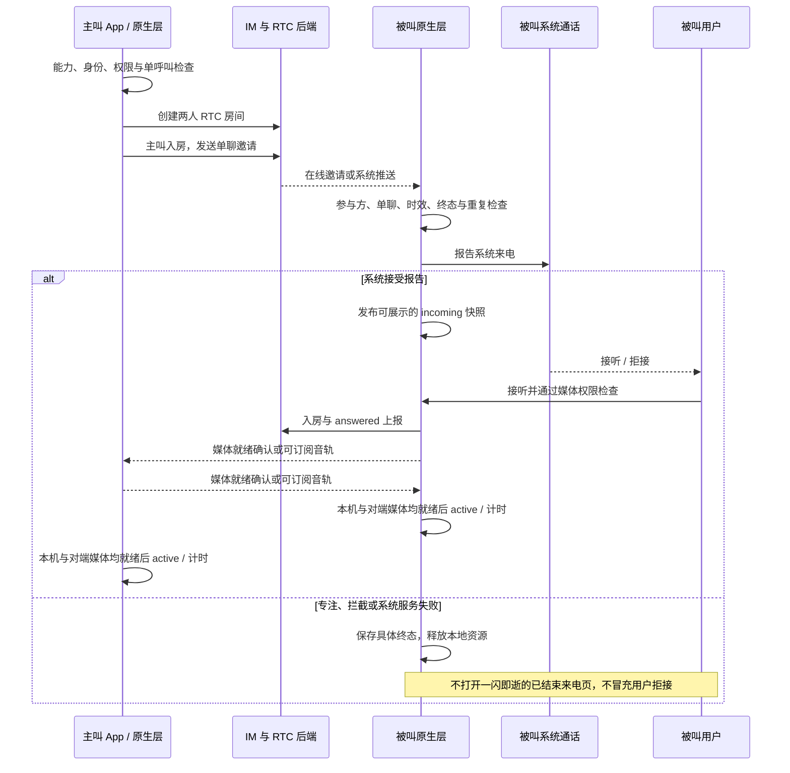

# 一对一 VoIP 客户端状态与收尾规则

2026-11-16，`mobile-voip` / `feat/nuwa-basic-2026.11-voip-calls`。

用户本轮要求先完成代码、文档和自动化检查，再继续真机调试。本轮不改变手机专注模式，不发起新呼叫，不部署生产或上传基座。此前单次实机反馈和日志差异保留在[验收记录](voip-acceptance.md)，不当作修正后的验收结果。

## 状态由谁负责

| 层 | 责任 | 不承担的责任 |
| --- | --- | --- |
| `features/voip` | 应用级单呼叫、账号/设备隔离、页面投影、权限操作、音频互斥、文案 | 页面不直接控制系统来电或 LiveKit 生命周期 |
| `uni_modules/nuwax-voip` | 独立控制连接、系统通话、媒体与后台任务，页面退出后继续持有呼叫 | 在线连接不提供进程不存在时的唤起 |
| 当前 `im-voip-v1` 后端 | 建房、消息邀请、answered/declined/ended 及 3007 事件 | 当前没有权威通话快照、原子抢接或独立忙线/系统过滤接口 |
| 系统推送 | iOS APNs VoIP、Android 获准的厂商/UniPush 路由、鸿蒙原生通话推送 | 普通 UniPush 成功不等于 VoIP 冷启动成功 |

## 一通电话的主流程



PushKit 例外：必须在网络校验前及时尝试向系统报告来电；提前接听等待业务校验，提前拒接待校验成功后再上报拒接。未经验证的推送不启动采集。Android 普通邀请按原生业务校验后进入 Telecom；鸿蒙仍须真实原生 push callId，不能把业务 callId 替代它。

业务状态为 `ringing → connecting → active → ended`。主叫的 ringing 显示呼出，被叫显示来电。`active` 需业务与媒体条件同时成立；媒体重连作为附加状态，保留已开始的计时。API 的 active 时间不提前计入本机等待媒体的时长。页面返回只最小化，页面卸载不挂断。

## 动作和结束原因

| 触发 | 本端行为 | 当前后端适配 |
| --- | --- | --- |
| 主叫取消 | 本地 cancelled，释放媒体和系统通话 | 已有 msgId 时 `/ended`，wire reason=cancel；邀请迟到成功继续补取消 |
| 被叫明确拒接 | 本地 rejected，停止响铃并释放 | 只有 ringing 的明确用户拒接才 `/declined` |
| 被叫接听 | 合并重复操作；权限完成后再次核对呼叫和账号 | 入房后 `/answered`；未取得权限不采集 |
| 任一方通话中挂断 | 本地 ended，先释放；对端离房事件停止该次通话 | 主叫可 `/ended`；被叫当前不能调用主叫专属 `/ended`，通过 RTC 离房结束对端 |
| 被叫无人接听、本地忙线、系统过滤或异常 | 保留对应本地原因，终态去重 | 不能伪造明确拒接。当前后端不能独立表达这些原因，主叫仍由自己的超时或离房检测结束 |
| 收到取消、超时、拒接 | 严格匹配 convId，优先匹配非空 callId，仅缺 callId 才回退 msgId | 消费远端事件不再次上报，避免反向回声 |
| 已接听后迟到拒接/响铃超时 | 忽略，不能终止 connecting/active，也不能写入终态污染当前呼叫 | 原子多设备裁决仍需后端补齐 |
| 另一设备先接听且本机未接听 | 本机 answeredElsewhere；该事件早于邀请也保存终态 | answered 缺少获胜 deviceId，不能据此宣称已实现原子抢接 |
| 勿扰、黑名单或系统限制 | 具体错误和本地结束原因；遵守系统策略 | 不通过普通来电页绕过系统过滤，不写成用户手动拒绝 |

### iOS 系统动作

系统注册预约、成功报告、业务终态与系统结束确认分别记录。报告失败的 UUID 不提交系统挂断动作；结束先于注册成功时，迟到成功仍须关闭。App 挂断以 `EndConversationAction` 交易为主路径，在 delegate 中调用专用 `fulfill(dateEnded:)`，不先报告 ended 把交易 UUID 提前移除。只有交易失败时使用 ended 事件兜底。系统红色挂断先完成系统动作，再处理业务和资源收尾，不等待网络。

系统本地媒体连接阶段与对端连接完成分开报告，只有对端媒体就绪才报告 connected。LCK 的列表仅属于当前管理器；空列表不能证明整机动态岛旧界面已清理。旧界面通过手机重启消除，不作为新实现修复通过的证据。

## 媒体就绪、静音和退出

三端使用可靠 RTC data topic `nuwax.voip.media-ready.v1`：

```json
{"v":1,"type":"ready","callId":"本次业务呼叫ID"}
```

仅在本机入房、媒体配置成功后发送；对端加入和重连后补发。只接受当前 Room 中真实远端参与者、正确 topic、当前 callId 且不超过 256 字节的消息。发布成功配置为静音也可宣布就绪，不能为了获取就绪音轨先偷偷解除静音。保留音轨订阅作为兼容路径；该消息不授予接听归属、不替代后端权限或允许恢复终态。RTC grant 需允许 `canPublishData`；拒绝时不得伪造就绪。

本轮同时修正了旧麦克风命令完成后误标为新呼叫事件、鸿蒙旧连接失败结束新呼叫、鸿蒙重连重复发送邀请等问题。每个异步权限、媒体、路由、后台任务和状态回调，在提交结果前核对账号代次与 callId；Room 回调还须匹配实例。结束即记录终态，停止超时与媒体任务，断开 Room、释放视频绑定、结束系统通话、清理通知与后台任务。iOS 15–17.3 还需释放自行激活的 AVAudioSession；LCK 系统音频由系统管理。

## 账号和页面边界

- 同账号另一设备的呼出不成为本机来电；主叫必须匹配 callerDeviceId。
- 登出/切账号使权限请求、建房、邀请与媒体回调失效。相同身份的凭据刷新只重绑控制连接与事件 scope，保留通话和计时。
- 旧呼叫的错误不能覆盖新呼叫；新来电系统过滤的错误可在前台提供本地化提示，但不打开无效通话页。
- UI、i18n、状态测试集中于 `features/voip`、`tests/voip`；平台策略、系统通话和媒体在插件中。宿主只使用既有生命周期、音频占用和单聊入口。

## 自动化与交付边界

```bash
pnpm voip:test
pnpm voip:ios:push:check
python3 scripts/voip-native/check-android-policy.py
pnpm i18n:audit
```

Swift 用例为 Foundation 策略与注册状态单测，Kotlin 为独立 JVM 策略单测，都不需要手机、签名或安装。修正前 VoIP 基线为 74 项通过；修正后的执行结果另记，不沿用基线数量。平台编译、签名、安装和真机验收各自记录，不以策略单测替代。

生产入口和鸿蒙验收闸门保持关闭。正式 APNs 注册/发送、厂商冷唤起、权威终态/重启补偿、原子抢接、忙线及电话房间授权仍依赖后端与厂商。详情见[实际业务接入](voip-business-integration.md)、[后端核对](voip-im-backend-review.md)、[国内厂商申请](voip-cn-provider-onboarding.md)和[验收记录](voip-acceptance.md)。
