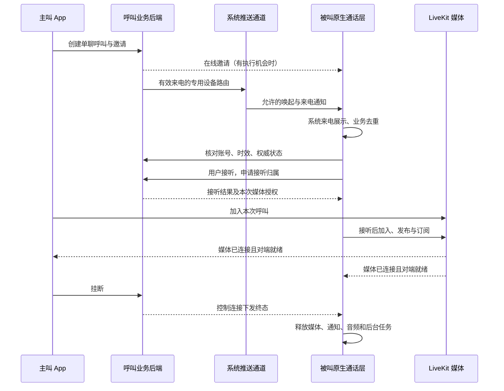

# 国内一对一 VoIP：完整链路与通道申请手册

核对日期：2026-11-16。范围：真实女娲 App 的人与人、用户与智能体一对一网络电话；不含会议、SIM 拨号、SIP/PSTN 外呼。

本文是独立的流程与申请交付线。现有调试线继续按 [系统推送分工](voip-system-push.md) 实施：普通消息 UniPush，iOS 来电 APNs VoIP，Android 保留 UniPush 原生接收与 Telecom，媒体继续 LiveKit。下文发现的厂商专用 Kit 是待评估、申请和验收的能力，不表示已接入或已开通。生产控制台、密钥、后端部署及基座上传均须另经用户确认。

## 1. 一次电话经过哪些系统



这是目标流程。当前真实业务适配 `im-voip-v1`：RTC 建房、单聊 `msgType=voip` 邀请、原生独立 IM WS 及 `/calls/answered`、`/calls/declined`、`/calls/ended`；不是已部署完整 `/calls-v1` 状态服务。原子抢接、权威终态查询及断线补偿仍待后端。细节见 [实际业务接入](voip-business-integration.md)、[后端源码核对](voip-im-backend-review.md)。

四类职责必须分开：

| 层 | 负责什么 | 本项目选择 |
| --- | --- | --- |
| 业务信令 | 谁呼叫谁、忙线、超时、接听归属、取消与结束 | 现有 IM 后端及后续电话状态增强 |
| 系统推送 | App 无执行机会时，让操作系统获得来电事件 | Android 厂商允许的通道；iOS APNs VoIP；鸿蒙原生应用内通话推送 |
| 原生通话 | 系统接听/拒接、锁屏交互、音频路由、持续通话 | Android Telecom/CallStyle；iOS LCK；鸿蒙 Call Service |
| 音视频媒体 | 麦克风、摄像头、WebRTC 连接、媒体传输 | LiveKit；不承担设备推送或呼叫裁决 |

普通 UniPush CID 注册、推送任务成功、通知出现、原生回调、系统来电展示、双向媒体，分别记录证据。任何一项都不能替代后面各项。

## 2. “App 没启动”需要区分的情况

| 手机状态 | 能否承诺来电 |
| --- | --- |
| 从未安装，或安装后从未同意隐私/登录/登记设备 | 没有可用的用户设备路由，不能来电 |
| 曾完成登记，当前在桌面或锁屏，进程存活 | 可验在线控制；仍需检验冻结、网络及系统限制 |
| 曾完成登记，进程被系统回收 | 必须依靠获准的系统推送与原生冷启动，不能依赖页面 JS 或原生长连接 |
| 用户主动强停/强退、撤销权限或关闭来电开关 | 单列操作系统限制，不保证与系统自然回收等价 |
| 断网、设备关机、登录已过期 | 不承诺实时来电；过期邀请不得恢复成新响铃 |

因此，首次启动是建立身份和设备路由的前置，之后不应要求用户一直开着 App。Android“自启动”“无限制省电”只是特定设备测试条件，不能替代厂商通道和 VoIP 权益。HBuilderX 调试服务可能自动重启进程，冷启动验收时必须排除该干扰。

## 3. 申请前统一准备的材料

由应用负责人准备一份受控材料包，每个平台按实际要求补充：

1. 企业开发者主体、应用名称、真实业务介绍、应用备案/上架资料；涉及特定资质时按对应平台当前规则办理。
2. Android 包名 `com.nuwax.app`、实际发行与调试签名的 SHA-256 指纹；iOS Bundle ID、Team ID、App ID；鸿蒙独立应用和签名信息。不能因包名相同就认为签名或权益相同。
3. 商店详情页或可供审核的下载入口、独立审核测试账号、两账号互拨步骤。
4. 单聊语音/视频入口、来电页、接听/拒接、通话设置开关、通知授权说明的截图及录屏。
5. 明确描述两种场景：人与人通话、智能体主动来电。智能体来电必须是真实可接听的双向通话，不能把普通 AI 提醒包装成电话绕过消息限制。申请类别须由厂商确认。
6. 服务结束后释放后台任务与音视频资源的说明，以及用户关闭来电、拒接、拉黑/限制联系人的产品规则。

AppID、channelId 和申请结果可进入交接清单；AppSecret、MasterSecret、P8、测试账号密码只通过受控路径交付，不进仓库、聊天或截图。本文列出官方申请邮箱供负责人操作，本轮未发送邮件或提交任何申请。

提交前为每个平台建立台账：`负责人 / 主体 / 包名与签名 / AppID / 普通 Push 状态 / 通话权益状态 / 支持系统和机型 / 测试与生产环境 / 批准工单 / 客户端版本 / 真机证据`。状态用“未申请、审核中、已批准、已接入、已验收”分开填写。

## 4. 国内 Android 厂商逐个怎么申请

先申请普通推送，再核对电话能力。UniPush 可继续聚合已有厂商普通推送；电话专用接口能否由聚合服务转发，必须得到 DCloud/个推对**具体应用、通道、SDK 版本与参数**的确认，不能由 `payload.type=voip` 推导。

| 厂商/系统 | 普通推送入口与步骤 | 电话能力与申请路径 | 核对重点 |
| --- | --- | --- | --- |
| 小米/Redmi | [小米开放平台](https://dev.mi.com/console/)创建移动应用、开通 MiPush、登记包名及对应信息，获取本应用凭据 | 单独申请 VoIP Service Kit：发至 `mipush-permission@xiaomi.com`；提供主体、应用/包名、AppID、channel 信息、场景、通话与设置截图。适用场景与内部应用证明按[申请规则](https://dev.mi.com/xiaomihyperos/documentation/detail?pId=1656)办理 | 普通推送开通不等于 VoIP；[新版 Kit](https://dev.mi.com/xiaomihyperos/documentation/detail?pId=2244)使用 MiPush RegId 和专用消息类型，须检测设备能力 |
| 荣耀 | [荣耀开发者平台](https://developer.honor.com/cn/)创建应用，开通并接入荣耀推送新通道，登记签名指纹 | 单独申请 VoIP 权益：`honorpush@honor.com`；提交应用/包名、AppID、场景、通话及开关截图/录屏；内部应用附主体证明，其他场景先咨询。[官方规范](https://developer.honor.com/cn/docs/11002/guides/notification-voip-standards) | [Kit 入门](https://developer.honor.com/cn/docs/voip/guides/dev-overview)要求 MagicOS 10.0+ 测试设备；仍须运行时判断与支持列表核对 |
| vivo/iQOO | [vivo 开发者平台](https://dev.vivo.com.cn/)创建并审核应用，在推送运营平台开通 Push、取得 AppID/AppKey/AppSecret；见[服务申请](https://dev.vivo.com.cn/documentCenter/doc/281) | 官方已有 [VoIP Service Kit](https://developers.vivo.com/product/d/voip)，覆盖系统通话 UI、音频路由和后台通话管理；通过该产品的在线提单或 `push@vivo.com` 获取当前接入/权益要求 | 本轮公开资料未核实到完整的申请资质、最低版本及冷唤起保证，必须取得厂商书面范围；Kit 的后台通话能力不能直接当作离线推送能力 |
| OPPO/一加/realme | [OPush](https://push.oppo.com/)创建应用、登记包名与信息、申请推送，按控制台配置本应用所需凭据 | 向平台工单核对真实音视频来电的消息分类、离线执行与系统来电权限；尚无本轮已核实、可直接引用的统一 VoIP Kit 申请规则 | 测试推送与正式推送的上架条件不同；不把可发普通通知写成可冷唤起系统电话 |
| 华为 Android/HMS | [AppGallery Connect](https://developer.huawei.com/consumer/cn/service/josp/agc/index.html)创建 Android 应用、登记签名指纹、开通 Push Kit，取得对应客户端/服务端配置 | 核对该 Android 应用实际拥有的来电相关权益与投递方式 | 与下节 HarmonyOS 原生权益分开，不能共用一份开通结论 |
| 魅族/Flyme | [魅族开发者平台](https://open.flyme.cn/)创建应用，在[推送平台](https://push.meizu.com/)登记包名并获取应用凭据 | 通过厂商支持确认通话类消息、进程执行机会和通知交互范围 | 本轮仅核实普通推送申请路径，未核实独立 VoIP Kit 权益，不做自动系统来电承诺 |

普通多厂商开通和 UniPush 所依赖的个推配置可对照[个推官方厂商开通指引](https://docs.getui.com/getui/mobile/vendor/vendor_open/)。各平台需要的字段不同，以当前控制台为准，不批量替换现有生产凭据。

### 上架条件与审核时间

- 个推当前[厂商条件说明](https://docs.getui.com/getui/scene/pushCondition/)区分：华为、荣耀、魅族及 OPPO 测试环境可不要求商店上架；小米、vivo 和 OPPO 正式环境需要上架。这是普通厂商离线推送条件，不能代替电话权益审批。
- 小米、荣耀的 VoIP 规则均写明约 15 个工作日内回复申请结果；回复并非必然批准。内部应用与面向公众应用必须按真实服务范围申报。
- 2026 年小米消息分类/模板已有调整，新申请须按[当前分类规则](https://dev.mi.com/xiaomihyperos/documentation/detail?pId=2321)创建 channel；真人私信、AI 交互与来电不可自行混为同一类别。
- 商店已上架、厂商 Push 已开通、通话权益已批准、客户端 SDK 已接入、真机已通过，分别留存记录。

申请邮件草稿可复用以下字段，提交时再按该厂商当前模板调整，不包含任何密钥：

```text
申请能力：应用内一对一音视频来电
企业主体：<营业执照主体>
应用：女娲Nuwax；包名 com.nuwax.app；AppID <本厂商应用 ID>
推送 channel：<本厂商要求的分类与通道>
业务：真人单聊互拨；另请确认智能体主动发起真实双向语音的适用类别
目标：桌面后台、锁屏及系统回收后收到邀请，显示系统接听/拒接
用户控制：来电开关、拒接与结束；结束后释放音频/后台资源
附件：上架或下载入口、通话与设置录屏、所需主体/场景证明
联调：审核账号通过受控渠道提供；请明确允许的 SDK、系统/机型与投递方式
```

### 小米新版专用能力对现有方案的影响

官方新版接入使用原生 MiPush RegId、对应 AppID/AppSecret 与 VoIP 消息类型，并要求查询 `FLAG_SUPPORT_CALLKIT`。UniPush CID 不能直接替代 RegId，普通云函数 payload 的 `type:"voip"` 也不等于厂商 VoIP 类型。[小米接入流程](https://dev.mi.com/xiaomihyperos/documentation/detail?pId=2247)

研究线先收集申请、支持机型和聚合服务适配结论；调试线保留当前接收器。若需要新增厂商 SDK/后端适配器，再形成有版本与回退范围的变更，不能为验证冷启动额外拉起第二套无关推送服务。

## 5. HarmonyOS 原生怎么申请

1. 为原生鸿蒙应用建立独立的应用身份、签名与 Push Token 注册，开通 Push Kit。
2. 在华为应用的“开放能力管理”中申请“推送应用内通话消息”权益，按页面模板提交场景与附件。当前官方资料有 AGC“项目设置 → 选择应用”及新“应用管理 → 基础信息”入口，以所属应用控制台为准。
3. 认真核对[当前权益材料](https://developer.huawei.com/consumer/cn/doc/doccenter-capabilities/push-apply-right)：内部企业/政府、智能安防、智能穿戴等场景按规定提供盖章证明；其他应用页面列出 B22 国内多方通信服务资质要求。这是该平台该权益的审核材料要求，女娲适用类别须由业务负责人向平台确认，不能将公共产品按内部应用申报，也不据此推导所有平台的一对一通话都需同一资质。
4. 权益通过后对接原生 VoIP 推送、原生 callId、Call Service 和后台任务；业务 callId 与原生 callId 分别保存映射。
5. 先验 ArkWeb 双向音频、系统接听、锁屏持续通话及进程回收后邀请，再开放入口。原生配置与媒体页由源码构建脚本重复生成。

华为[应用内通话规则](https://developer.huawei.com/consumer/cn/doc/doccenter-capabilities/push-voip)明确：锁屏只能语音接听；视频接听进入应用内界面。不能按 Android 普通通知或网页前台通话替代鸿蒙验收。

## 6. 苹果：APNs VoIP → PushKit → 原生通话 → LiveKit

苹果链路由 Apple Developer 身份、签名、APNs 服务端鉴权与原生框架组成；不走 Android 厂商申请邮箱，也不依赖 UniPush 将普通消息转成电话。

### 6.1 开发者与签名准备

1. 使用团队 Apple Developer 账号，核对显式 App ID/Bundle ID `com.nuwax.app`，启用 Push Notifications，配置通话所需后台模式与隐私声明。
2. 由授权管理员准备 APNs Authentication Key（P8）、Key ID、Team ID，交后端密钥管理；核对所选 key 的应用/topic 与环境授权。也可按 Apple 支持方式使用匹配 VoIP topic 的证书认证。不能仅因 DCloud 已有普通 APNs 配置就认定后端已有 VoIP 发送授权。
3. 准备匹配该 App ID 和设备的开发签名/profile。本地包从 profile 读取 `aps-environment`，与签名后 entitlement 回读比对；不按 API 域名、DEBUG 或用户输入猜环境。
4. 使用 development profile 签名的包走 sandbox，TestFlight/App Store 包走 production；Ad Hoc 等包也以签名中的 `aps-environment` 为准，不能按 Debug/Release 构建名猜测。分别登记 PushKit token。开发真机联调不以 App Store 正式上架为前提，但仍须正确账号、签名、设备及推送权限。

P8 可用于开发和生产环境，但具体 key 授权与目标 token 环境仍须匹配。私钥只在后端；详情见 [Apple APNs token 认证](https://developer.apple.com/help/account/capabilities/communicate-with-apns-using-authentication-tokens/)。

2026-11-17 已通过用户登录的 Apple Developer 页面核对：本 App 的 Push Notifications 已启用，现有 APNs Key 为 All topics / Sandbox & Production；已重新生成失效的开发 profile 并确认覆盖两台联调手机。P8 原文件的后端保管与实际发送尚待确认，生产发行 profile 未改。具体变更和本地签名选择见 [Apple 配置核对记录](voip-ios-push-handoff.md#2026-11-17-apple-developer-配置核对与开发签名更新)。

### 6.2 客户端与后端各自做什么

| 责任方 | 操作 |
| --- | --- |
| iOS 原生 | 隐私/登录闸门通过后创建 PKPushRegistry，取得 PushKit token，按包名/环境/设备/账号独立登记，处理更新和条件撤销 |
| 业务后端 | 实现待新增 `/api/instant-message/calls/devices`；设备刷新不得用普通 UniPush CID 或普通 APNs token 覆盖 PushKit token |
| APNs 适配器 | HTTP/2 请求；`apns-push-type=voip`、`apns-topic=com.nuwax.app.voip`、匹配 sandbox/production；短 expiration，去重并处理 token 失效 |
| iOS 收到邀请 | 在原生 PushKit 回调及时报告系统来电，业务网络核对并行进行；不等页面启动、IM WebSocket 或消息详情返回后才上报 |
| 用户接听 | 核对有效呼叫/接听归属与权限，再接入 LiveKit；媒体连接和对端就绪后开始计时；拒接不启动采集 |
| 结束或失效 | 控制连接与权威终态结束系统通话，释放媒体/音频会话/后台任务；取消和挂断不用追加 VoIP push 传递 |

APNs 建议 expiration 为 0 或仅数秒，避免过时来电；业务响铃时限独立计算。APNs 200 只表示受理，不能当作已响铃。完整载荷、幂等、重试与注册撤销契约见 [iOS 后端交接](voip-ios-push-handoff.md)。[Apple PushKit 来电规则](https://developer.apple.com/documentation/pushkit/responding-to-voip-notifications-from-pushkit)

### 6.3 系统版本与国内发行边界

- 当前代码保留 iOS 15 安装范围，17.4+ 走 LiveCommunicationKit；15–17.3 仅前台通话/普通通知，不注册 PushKit。LCK 的[来电上报 API](https://developer.apple.com/documentation/livecommunicationkit/conversationmanager/reportnewincomingconversation(uuid:update:))标注 17.4+，这不等于所有旧系统/地区签名组合已验收。
- Apple 新的[带 metadata 的 PushKit 回调](https://developer.apple.com/documentation/pushkit/pkpushregistrydelegate/pushregistry(_:didreceiveincomingvoippushwith:metadata:withcompletionhandler:))为 iOS 26.4+，明确支持向 CallKit 或 LCK 上报。当前桥仍使用旧回调；不能把新回调特性当成旧系统已有行为。
- Apple 官方 [WWDC26 示例](https://developer.apple.com/videos/play/wwdc2026/226/)展示 PushKit 与 LCK 的来电协作。当前收集的官方 API 资料不足以据此确认所有中国大陆 App Store 发行条件；国内商店可用性须由团队针对本 App 向 Apple Developer Support/App Review 核对，并以相同发行签名实测。未将论坛用户的“大陆禁止”描述当作正式政策，也不承诺换用 LCK 就自动解决全部地区审核要求。
- 本产品无需申请默认电话/默认拨号器，不走蜂窝拨号兜底。Apple 的[默认拨号器指南](https://developer.apple.com/documentation/livecommunicationkit/preparing-your-app-to-be-the-default-dialer-app)属于另一类能力，不能将其 EU 条件套到本次普通 App 内网络通话。

## 7. 后端与基础设施交接顺序

### 呼叫业务

- 一个业务 callId 贯穿邀请、在线事件、推送、系统映射、媒体房间与日志；消息定位 ID 保持字符串。
- 后端持久化 ringing/connecting/active/ended、递增版本、超时、忙线与原子接听归属。客户端忽略旧版本和终态后的迟到邀请。当前 IM 协议本地投影序号不能充当后端权威版本。
- 当前 IM 适配按邀请发送时间加 60 秒校验；原计划默认 45 秒。正式服务需统一下发 expiresAt，再统一客户端和推送 TTL，不能各端自行混用。
- 电话推送单独调度，避免沿用普通消息“IM 连接在线便不推送”的判断；后台冻结时在线记录可能仍在。在线与推送并发到达按业务呼叫去重。
- 取消、拒接、接听获胜者和挂断走可恢复控制连接，并提供权威查询补偿。App 重启后仅查消息详情不足以判定是否仍在响铃。

### 设备与平台适配

- 普通 UniPush CID、PushKit token、Harmony 原生 token、必要的厂商 RegId 分命名空间存储。按用户、物理设备、包名、环境、provider/channel、注册版本隔离。
- 登出/换账号撤销旧路由，轮换与失效采用条件更新；旧撤销不能清空新账号或新 token。
- 电话路由按已批准权益、系统版本和实测能力选择；未支持设备明确降级到普通通知/点击进入，不伪称自动系统来电。
- 推送只带最小呼叫定位与显示信息，不带平台登录 token、RTC JWT、任意 URL。APNs 私钥、厂商密钥及服务端 LiveKit secret 不进客户端。

### 媒体与国内网络

- `livekit-test.nuwao.com` 页面可打开只证明该入口可访问，不能证明手机媒体 UDP/TURN、后台推送或电话控制全部可用。
- 使用可从目标国内运营商访问、证书链有效的 WSS/HTTPS 媒体与业务域名；核实 LiveKit 的媒体端口、ICE 公网地址及 TURN/TLS 兜底。按实际部署版本的[官方端口与防火墙指引](https://docs.livekit.io/transport/self-hosting/ports-firewall/)配置，不能只放通控制台 HTTPS。
- 分别用 Wi-Fi 和国内蜂窝网络验证双向音频/视频、网络切换与弱网重连。RTC token 只授权本次房间和身份，不按同租户任意房间泛授权。
- 智能体必须真实加入媒体、接收用户语音并连续回复；真人或合成媒体替身仅验证媒体链路，不能替代正式智能体上下文和双向语音验收。

## 8. 谁负责、交付什么、怎样验收

| 负责人 | 交付 |
| --- | --- |
| 产品/应用负责人 | 场景与材料包、用户来电开关、申请范围、商店与主体材料、逐厂商批准记录 |
| 开发者账号管理员 | 受控 App ID/签名/profile/APNs key 授权；厂商控制台配置清单。生产变更先确认 |
| 移动端 | 功能集中在 `features/voip`、原生插件与 API 层；普通业务只保留入口/生命周期接点；真机系统展示、接听媒体及释放记录 |
| 后端同事 | 电话设备注册、专用平台路由/发送、权威状态/原子接听/补偿、媒体授权、脱敏发送回执 |
| 测试/联调 | 每个平台、机型、系统版本、签名渠道的证据矩阵；不能由浏览器或前台 Demo 替代 |

每条链路按顺序验收：

1. 设备登记回执正确，确认账号、包名、环境与通道。
2. 后端有效邀请 → 专用平台发送回执 → 原生到达，关联同一 callId。
3. 前台、桌面后台、锁屏、系统自然回收分别出现系统接听/拒接。受控回收与主动强停另列，不互相替代。
4. 接听后确认两端真实双向声音，视频另验；只看到计时不算听感通过。
5. 拒接/超时/取消/忙线/重复迟到推送/多设备抢接；网络切换、权限拒绝、蓝牙与蜂窝电话打断。
6. 锁屏双向音频持续 30 分钟；挂断后媒体采集、通知、音频焦点和后台任务全部释放。
7. 用真实发行签名再验一次，关闭 HBuilderX 干扰；随后才评审按平台/厂商开放生产能力。

### 2026-11-16 实际进度

- 现有调试分支已合入最新 `feat-2026.11`，合并提交 `32882b435` 在 GitHub/GitLab 一致。APNs 本地改动与本文尚未作为生产变更提交/部署。
- 74 项 VoIP 测试、15 项 Swift 推送测试通过；HBuilderX 5.34 Android/iOS App 资源导出与本地完整基座构建通过。两机已覆盖到真实 App 1.3.6；运行资源、环境、联系人及电话证据分别记录在[验收记录](voip-acceptance.md)。
- 测试环境鉴权正常，新增 `/calls/devices` 仍为 404；只读核对 `nuwax-im/feat-video-meeting@26dd3491` 未发现该接口或 APNs 专用 sender。iOS 冷启动来电仍需后端交付。
- Redmi 既往进程存活时后台/锁屏系统来电通过；去除调试服务干扰后的进程回收呼入未通过。当前没有 Xiaomi 配置，不能把这一结论扩展为其他已配置厂商也失败。
- 本轮未申请/修改厂商权益、Apple key、生产控制台或后端部署；未上传基座。研究线没有自动切换调试线架构。

下一步并行推进：现有真实 App 继续联调并记录执行层；负责人按厂商清单准备申请；后端先补 APNs 注册/发送与权威终态，再完成冷启动和多设备验收。
