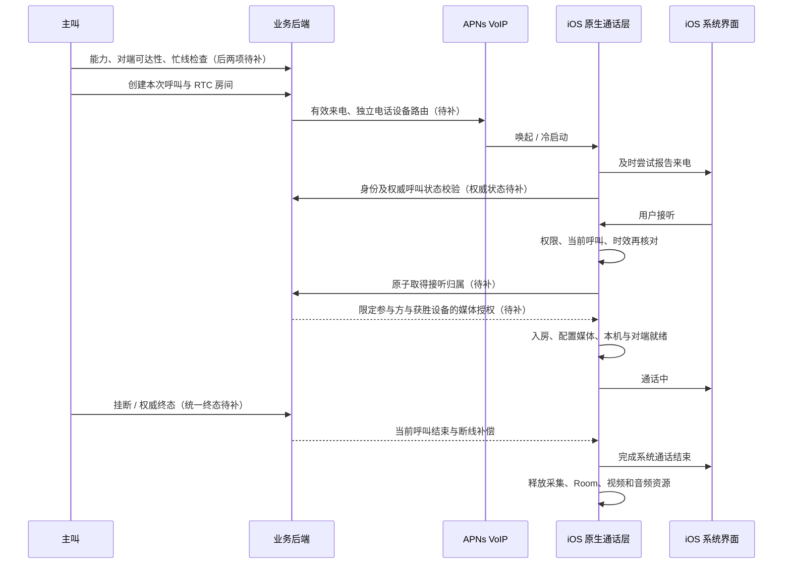

# iOS 一对一电话产品完整性检查

检查日期：2026-11-17。工作树 `mobile-voip`，分支 `feat/nuwa-basic-2026.11-voip-calls`，检查对象包含当前未提交修改。按用户要求先完成代码和产品流程检查，真机调试后置。

**结论：本轮补齐可独立完成的 iOS 客户端缺口，并生成测试环境真实 App；完整电话产品仍需后端和真机验收。** 新增首次系统接听权限引导、路由选择与同步、音频中断/暂停、重连上限和本机通话记录/回拨。专用 APNs 发送、原子接听和权威终态仍是前置缺口，见[后端待配合清单](voip-backend-required.md)。代码或 IPA 构建成功不代表进程不存在时的来电链路已通。

2026-11-17 对照 PC Web 再核对：**会议 RTC 与在线一对一呼叫已可复用，现有测试 IPA 已接这套接口，可先做两台 iPhone 在线互拨**。不要求先实现规划中的另一套 `/calls` CRUD；冷唤醒和完整产品增强另按对应场景推进。会议 RTC token refresh 已有实现，未定的是平台登录凭据的原生续期，见[当前接口核对](voip-im-backend-review.md#2026-11-17-对照-pc-web-会议后的结论)。

## 1. 检查范围及责任边界

| 代码 | 检查内容 |
| --- | --- |
| `features/voip/callManager.uts`、`callState.uts`、`callErrors.uts` | 单呼叫、状态、权限等待、账号刷新、页面与错误隔离、计时 |
| `features/voip/components/chat-actions.uvue`、`screens/call.uvue` | 真实单聊入口、呼出/来电/连接/通话/结束、返回通话、操作反馈 |
| `servers/voip.uts`、`servers/voipIm.uts` | 能力、建房、测试与业务协议分流、后端实际契约 |
| `uni_modules/nuwax-voip/utssdk/app-ios` | PushKit、LCK、LiveKit、音频/视频、权限、系统动作、加密持久化 |
| `App.uvue`、`features/voip/integration.uts`、`utils/im/imPushClient.uts` | 登录/退出、显示/隐藏、普通推送与电话接入边界 |
| 插件 `Info.plist`、`config.json`、`scripts/voip-native/device/prepare-ios.py`、`ios_push_config.py` | 后台模式、最低版本、原生启动、签名环境元数据、可重复生成 |
| `tests/voip` | 业务生命周期、媒体异步隔离、PushKit 载荷、APNs 注册、系统登记与终态策略 |

实现继续归聚于 VoIP 功能目录与原生插件。普通消息使用 UniPush；iOS 电话邀请使用独立 APNs VoIP。后端代码仅作契约只读参考；本轮不修改后端、生产配置或手机设置。用户追加授权后，本地生成供两台 iPhone 使用的独立测试 IPA，不上传、不部署、不自动安装。

## 2. “没有启动”必须分开判断

| 场景 | 标准产品应有的行为 | 当前结论 |
| --- | --- | --- |
| 对端未安装 App | 后端返回不可达或明确采用消息邀请，不伪装成已通知到手机 | 当前能力查询没有电话设备可达性/安装状态的权威声明，待后端 |
| 已安装，但从未打开、同意隐私或登录 | 没有用户与电话设备路由，不能接收本账号电话 | 应作为正常不可达场景，不绕过隐私与登录初始化 |
| 曾登录并登记，当前 App 前台 | 在线邀请进入原生层；用户接听后才允许被叫采集 | 有接入代码；本批系统收尾修正待重新编译和验收 |
| App 在后台或锁屏，进程存活 | 系统来电，不依赖聊天页面或其 WS 是否连接 | 原生控制可在有执行机会时工作，不能替代系统推送 |
| App 被系统挂起 | APNs VoIP 取得执行机会，再原生报告系统来电 | PushKit 接收有代码；正式专用发送与本批送达证据缺失 |
| App 被系统回收、当前无进程 | APNs VoIP 唤起原生宿主，恢复有效身份并建立新呼叫 | 核心 P0 缺口，不能用退到桌面或重新打开 App 后补收替代 |
| 手机重启后尚未首次解锁 | 不泄露账户或凭据；明确系统保护数据的可用边界 | 当前 Keychain 使用 AfterFirstUnlockThisDeviceOnly，无法保证此时恢复身份 |
| 重启且已首次解锁，App 未手动打开 | 对此前仍有效的已登记身份走原生冷启动链路 | 有原生恢复入口；仍受 APNs、凭据有效性和权威状态前置约束 |
| 用户从多任务界面强退 | 单独核实该 iOS/签名环境的系统行为 | 未验收，不能把普通后台通知的规则直接套用为 PushKit 结论 |
| 用户退出、切账号或被服务端注销 | 不允许旧账号继续接听、采集或登记；后端撤销旧路由 | 原生清理有实现；可靠撤销及失效身份拒投须后端保证 |
| 勿扰、专注、黑名单或系统限制 | 遵守系统过滤，给出准确结果，不冒充用户手动拒接 | 错误分类已补；不通过应用来电页绕过系统规则 |
| 断网、关机或超出响铃时限 | 明确不可达/未接，过期推送不能恢复响铃 | 本地时限及终态有实现；持久化结果、补偿与未接记录待补 |

Apple 的 [PushKit 处理说明](https://developer.apple.com/documentation/pushkit/responding-to-voip-notifications-from-pushkit)说明未运行时可通过 VoIP 推送取得执行机会；[配置说明](https://developer.apple.com/documentation/pushkit/supporting-pushkit-notifications-in-your-app)要求启动时建立 registry，并将专用 token 登记给服务端。它们不是当前后端已发送或当前设备已被唤起的证明。

## 3. 正常接打流程及尚缺的裁决

以下为完整产品的目标顺序，带“待补”的步骤不能声称已有实现。

当前 `im-voip-v1` 实际为主叫建房、入房后发 IM 邀请；接听后 `/answered`，明确拒接 `/declined`，主叫取消/超时 `/ended`。通话中被叫挂断主要依赖 RTC 离房。不能将这些接口等同于完整权威呼叫服务；详见[生命周期规则](voip-call-lifecycle.md)。

## 4. P0：进入完整产品验收前必须关闭

| 缺口 | 代码/契约依据 | 必须完成的结果 |
| --- | --- | --- |
| APNs VoIP 登记、专用发送未闭环 | `NuwaxVoipApnsRegistration`、`/calls/devices`；2026-11-16 源码及测试环境核对仍未就绪 | 后端保存独立 token/包名/环境，发送正确 VoIP topic，保留受理与原生送达关联证据 |
| 没有权威终态和重启/断线补偿 | `businessInvitation()` 查询的是消息详情；原生本地版本不是服务端版本 | 冷启动先确认呼叫仍有效；取消/接听/结束在失联和重启后可查询、不可复活 |
| 多设备原子抢接、账号忙线未实现 | 当前 answered 事件不含获胜 deviceId；本地只保护单个设备 | 服务端只能裁决一个获胜设备，其他端停铃；被叫忙线不能伪造成拒接 |
| RTC 房间与参与方授权不足 | 现有 RTC 服务使用租户房间及 platform identity，原生当前接受房间中的远端媒体就绪 | 绑定具体主被叫、获胜设备及授权媒体；无关用户不能入房或让呼叫被误判接通 |
| 冷启动凭据过期缺少原生可用的续期/交换协议 | Keychain 保存 accessToken，原生 URLSession 不经过页面请求层 | 已有效登记用户在允许范围内获得短期通话授权；过期、撤销、退出必须失败并清理，不能要求先打开页面才恢复 |
| 新客户端尚未完成真机验证 | 本批首次系统接听权限处理及资源释放已有代码、策略测试和本地包；旧包证据不能覆盖新逻辑 | 用本次 IPA 做真实双账号互拨、系统按钮与应用状态对照和完整收尾验收 |

后端与生产环境以此前日期的核对记录为依据，本轮没有重新探测或部署。后端同事交付后须重新核实版本与环境，不能沿用旧 404 或本地 mock 作为届时结论。

## 5. 本轮代码已经修正的边界

以下修正已纳入本轮代码与构建；系统行为仍须本次 IPA 真机验证：

1. 系统成功接受来电报告后才发布可展示的 incoming 快照；过滤失败不打开瞬间结束的来电页。勿扰、拦截、系统限制与服务失败分开显示。
2. 被叫只有 ringing 时的明确拒接才调用 `/declined`。超时、忙线、系统过滤和网络异常保留各自原因；消费远端结束不反向重发。
3. 系统挂断及时使用 `EndConversationAction.fulfill(dateEnded:)`。未成功报告的 UUID 只保留终态；不对它提交不存在的系统通话结束交易。App 结束不再先移除 UUID 后又提交结束交易。
4. 重复 PushKit 必须经过系统报告尝试，不能因在线路径已登记而提前返回；仅将已归属本管理器的“UUID 已存在”识别为预期重复，保留原呼叫。
5. PushKit 等待鉴权/业务查询期间也有独立截止时间。业务验证再慢也不能无期限维持未经确认的系统来电；结束先于报告成功时，迟到成功仍关闭。
6. 已知终态按原账号上下文进入加密 Keychain，恢复时有格式验证、去重及最近 128 条上限；账户清理一起移除。该缓存只补本机已知事实，不能补回进程不存在时漏收的服务端终态。
7. 权限等待中的重复接听合并，返回后再次检查身份、callId 和 ringing 状态。旧错误、媒体操作及就绪回调不能改动新呼叫；相同身份刷新 token 保留通话与计时。
8. 严格匹配 convId；非空 callId 冲突时不回退 msgId。connecting/active 忽略迟到拒接和响铃超时；其他设备已接听先于邀请时也保留终态。
9. 只有本机媒体与对端就绪才投影 active 并启动应用计时。静音可以通过本次呼叫的可靠媒体就绪消息完成握手，不通过偷偷解除静音取得就绪音轨。
10. 通话结束后迟到的系统音频激活不重新启用 LiveKit 引擎；被叫 ringing 阶段不允许激活采集。后台视频操作重新核对身份、Room 和实际前台状态。扬声器切换失败不再报告成功。
11. 原生请求 401、控制鉴权拒绝和会话替换按当前身份清理通话上下文，避免失效会话继续持有资源；这属于失败处理，不是已实现登录续期。
12. 原生正在校验的冷启动来电预留单呼叫位置；若页面尚未知情就发起另一通电话，原生拒绝冲突呼出，并按该呼出的 callId 返回 busy，再交回已存在的来电状态。
13. 首次系统接听在验证业务邀请后按权限状态处理：已授权直接继续；前台未决定时申请；后台未决定时通过普通本地通知引导解锁进入 App，并只在系统 action 截止前重试。拒绝/超时释放系统会话，不伪装成用户明确拒接。权限拒绝页提供系统设置入口，麦克风拒绝时不继续请求摄像头。
14. 监听原生前后台、音频路由、中断和媒体服务重置；支持系统暂停 action、应用与系统静音同步、蓝牙/耳机/扬声器路由选择及变化回传。只有当前呼叫获得系统音频许可且没有暂停/中断时启用引擎；媒体服务重置安全结束。挂断不恢复旧录音。
15. LiveKit 重连从首次回调以单调时钟计时，最长 30 秒，重复回调不延长；恢复或结束取消计时，旧 Room/账号回调不能结束新呼叫。超时给出连接失败原因并释放资源。
16. 验证过的本机通话进入按 origin/账号隔离的 Keychain 记录（最多 100 条），终态不能复活；进程恢复时将未收尾记录标记中断。iOS 单聊加号面板增加记录入口，支持未接标识、时长、重新能力校验后回拨及清空。此功能不代表服务端权威历史或跨设备未接补偿。

17. 拒绝呼出权限后可由用户选择进入系统设置；原生登录失效和会话被替换有本地化提示。相同身份刷新 token 时仍尊重系统暂停/音频中断状态。
18. 媒体连接与采集的每个异步等待后再次核对当前 Room、callId、任务取消与账号代次；QA 签名宿主在任何原生网络请求前拒绝遗留生产 origin 的会话恢复。

## 6. P1：标准电话产品仍需补齐的体验

| 项目 | 当前缺失/局限 | 验收方式 |
| --- | --- | --- |
| 未接来电、通话记录、回拨 | 本机记录和回拨已有实现；完整 VoIP 消息卡片、其他设备结果及无进程漏收补偿待后端；LCK 系统最近通话仍关闭 | 取消、无人接听、拒接、系统过滤、通话时长各有正确结果；退出页面后可回拨 |
| 蓝牙/耳机/扬声器 | 选择器、路由监听和实际选择回传已实现，真实配件待验 | AirPods、蓝牙断连、有线耳机、系统路由切换及音视频默认输出一致 |
| 蜂窝电话、Siri 和其他音频打断 | 暂停 action、音频中断/失活、状态反馈和当前呼叫恢复规则已有代码，系统时序待验 | 来电打断时停止采集；结束后按系统许可恢复；不能误恢复旧录音 |
| 重连的产品级上限 | 已实现 30 秒不续期截止及终态清理，网络切换待验 | Wi-Fi/蜂窝切换、弱网、静音状态、断网、SDK 最终断开都能结束或恢复，挂断始终可用 |
| 关闭来电、联系人限制、拉黑、频控 | 当前能力查询主要核对真人单聊，没有完整电话偏好与后端推送门禁 | 关闭后不再被电话推送唤起；拉黑和频控由服务端执行，前端隐藏不能替代 |
| 视频边界 | 有视频采集与后台关闭，锁屏及音频接听视频来电仍缺本批证据 | 锁屏不启动视频；语音接听视频来电按当前协议降级；退后台关摄像头，回前台遵守用户选择 |
| iOS 15–17.3 产品范围 | 已接入 PushKit/CallKit 兼容路径，尚未完成完整真机矩阵 | 验收前不能对这些系统承诺后台、锁屏或未启动时系统接听 |
| 正式构建就绪与诊断 | APNs 注册状态主要在开发工具，缺交付所需的服务端关联与脱敏指标 | 可定位邀请、APNs 受理、PushKit、系统报告、接听、媒体及释放；失败能区分系统策略/授权/服务不可用 |
| 页面尚未恢复时的音频互斥 | 应用层已用事件暂停录音/TTS/消息播放，原生系统音频有接管；JS 尚未恢复时各旧媒体模块的实际停止时序尚无证据 | 从正在录音、TTS 或消息播放的状态退后台，再从系统来电接听；不能同时采集旧录音，也不能挂断后自动恢复旧录音 |
| 国内媒体网络 | 只有 wss 地址的安全检查不代表媒体可用 | 验证实际 RTC/TURN、证书、UDP 与 TCP/TLS 回退、国内运营商和锁屏长时音频 |

## 7. 修正后的验收顺序

先按现有已可用接口完成在线接打；APNs 冷唤醒和完整产品依赖按场景补齐，再分别验收，不把全部复杂场景叠在一通电话中：

1. 本地状态/注册/终态回归；HBuilderX 与原生构建、签名及资源一致性单独检查。
2. iOS 前台两账号：呼出、来电、接听、拒接、取消、超时、双向挂断。每次核对应用状态、系统动作、计时和全部资源释放。
3. 首次权限、拒绝后引导、专注/黑名单、另一设备接听、双向同时拨号、重复与迟到事件。
4. 前台/桌面/锁屏/挂起/系统回收无进程分别验收；再单列用户强退、重启后首次解锁前后。
5. 蓝牙与蜂窝电话打断、网络切换、长时锁屏双向音频、视频降级及后台摄像头边界。

冷启动每通需记录拨号前确实无进程，且没有 HBuilderX 自动重启干扰；用同一次呼叫关联后端状态、APNs 请求、PushKit 回调、系统报告、接听媒体和结束释放。APNs 受理成功、WS 在线、CID 正常或手机重启后界面消失，均不能替代这条证据。

## 8. 本轮检查结果

- VoIP 功能测试：最终执行结果见[验收记录](voip-acceptance.md#2026-11-17-ios-产品流程代码检查)。
- Swift Foundation 策略/注册/载荷测试：覆盖重复 PushKit 报告预约、终态恢复、原生来电占位及迟到音频激活；最终数量见验收记录。
- Swift 原生模块 iOS 15 最低版本、LiveKit 2.19.0 类型检查与模拟器链接通过；完整真实 App 经 HBuilderX 5.34 导出和本地 iOS 签名构建。具体包及验收层级以验收记录为准。
- i18n 全仓审计仍有既有问题，VoIP 新增提示覆盖仓库实际四种语言。详细结果在本工作树忽略目录 `out/voip-ios-audit-20261117/`。
- 本轮没有安装或实机拨号；手机专注模式和生产配置保持现场。测试构建的 origin/VoIP 放行在忽略目录的源码副本中生成，仓库生产默认地址与入口闸门继续保持关闭。

参考：[实际接入](voip-business-integration.md)、[APNs 后端交接](voip-ios-push-handoff.md)、[原生/业务生命周期](voip-call-lifecycle.md)、[历史验收记录](voip-acceptance.md)。
