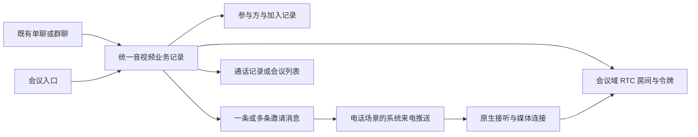

# 通话、群通话与会议的业务关系

日期：2026-11-17。按用户提出的复用方向梳理；后端只读基线为 `nuwax-im/feat-video-meeting@0fa014fc86712a09bb9e321e24b5aa2dc4fc2ea0`。以下明确区分已有实现与建议增强。本次不修改后端，不开启群通话、录制、投屏等新功能，也不改动生产配置。

## 统一方向

一对一通话、群通话和普通会议复用会议域的媒体会话创建、RTC 房间、令牌、参与者及记录基础设施。一对一是通话场景下人数为 2 的业务会话；业务类型仍须显式区分，不能仅凭房间里当前有几个人判定。两个人参加的普通会议仍然是会议。

**保存通话记录与是否录音无关。** 优先扩展现有会议主记录和参与者关系，保存一对一通话的接通、未接、拒接、取消等结果；App 本机记录是缓存与离线补偿，不再承担服务端正式历史的职责。是否显示在“通话记录”还是“会议记录”，由业务类型和产品入口决定，不要求分别建立一套存储。

共用业务主线为：确定发起上下文和参与方 → 幂等创建业务记录 → 按需创建 RTC 房间 → 发出邀请 → 接听／加入 → 媒体就绪 → 离开／结束 → 服务端落最终结果 → 同步聊天消息和历史列表。

“统一音视频业务记录”指复用并增强现有会议记录模型，不是本次另建一个系统。会议域的录制文件／转写归属能力保留，当前移动端电话交付不需要因此开启录制。

## 当前已经复用与尚未补齐的部分

| 环节 | 当前源码 | 目标 |
| --- | --- | --- |
| 建房／令牌／媒体 | 移动端 `servers/voipIm.uts` 已调用 `/meetings/rtc/rooms`，上限 2；三端原生连接 LiveKit | 继续使用同一会议 RTC 服务，不新增媒体服务器 |
| 普通会议记录 | `MeetingRtcApplicationService.createRoom()` 仅 `origin=1` 调用 `beginRoomMeeting()`，建房时保存记录 | 保持已有会议行为 |
| 一对一记录 | `origin=2` 或不传时不在建房阶段落记录；`createCallMeeting()` 由开启录制路径创建 `origin=2` 记录 | 对有效通话邀请建立同一体系内的通话记录，初始 `recordStatus=0`；不依赖录制 |
| 参与方 | `im_meeting_member` 按 meetingId/userId 去重，已有房间记录才可绑定成员 | 复用人维度关系，并补“被邀请但未加入”的结果，避免漏掉被叫未接记录 |
| 邀请与结果 | `voip` 邀请消息会持久化，answered／ended／declined 主要广播 3007 事件；事件不补发 | 用同一业务记录持久化权威结果，消息、实时事件和列表引用该记录 |
| 客户端历史 | 当前 iOS 本机 Keychain 只保存该机观察到的通话 | 接服务端统一记录；本机仅缓存和补偿，不宣称全量／跨设备历史 |

主要依据为后端 `docs/15-三条链路-私聊群聊普通会议接口全流程.md` §3.10、§9.2，`CreateRoomRequest.origin`，`MeetingRecordApplicationService.createCallMeeting()`／`bindRoomMember()`。这些实现证明可以复用记录基础，但**现有接口尚未自动保存所有一对一记录**。

## ID 与保存关系

| 对象 | 含义与关系 |
| --- | --- |
| convId | 长期聊天会话。一段聊天可关联多次通话；同一会话每次拨号不重新建聊天 |
| meetingId | 现有记录的服务端主键，建议作为共用记录的主键；前端按字符串处理 |
| callId | 本次电话的稳定业务标识，关联来电、状态、系统 UUID 和推送；与 meetingId 显式映射，不强制二者格式相同 |
| roomName／rtcRoomId | RTC 运行资源标识；业务记录在房间已回收或从未成功建立时仍存在，不能用房间存活代替记录 |
| msgId | 邀请消息标识。一对一通常一条；群通话同一业务记录可能关联群卡片和多条定向邀请，不能用单一 msgId 代替整次会话 |
| userId 与 deviceId | 参与者以人去重，接听设备另行裁决。会议允许的多端席位规则不能直接代替电话的单设备抢接归属 |

从已有单聊／群聊发起时复用当前 convId。从联系人直接拨打时复用现有 `apiImCreateP2pConversation()`：同一对用户幂等取得同一个会话，而不是每通电话新建会话或临时群。普通会议从会议入口发起可以没有聊天会话，不强制创建群。

群内静默卡片与发给个人的定向邀请，可能属于不同聊天会话。共用记录关联的是源群和整次音视频会话；每条邀请仍保留其实际消息 convId/msgId，用于消息权限校验。不能拿个人邀请所在的单聊覆盖源群关系。

所有雪花 ID 在客户端保持字符串，沿用现有序列化约定，不经 Number 转换。

## 复用流程时保留场景规则

| 规则 | 一对一电话 | 群通话／会议 |
| --- | --- | --- |
| 参与方 | 后端从单聊成员确认主被叫；最多两人，令牌绑定合法参与方 | 按群成员／邀请／会议权限确认参与者；容量由场景决定 |
| 邀请方式 | 沿用 voip 邀请和有限响铃窗口，使用专用系统来电路由 | 当前后端群通话使用 meeting_invite，群内 silent 卡片加定向邀请；不能直接改为全群电话响铃 |
| 接受邀请 | 多设备原子裁决获胜设备，其他设备停铃 | 加入／忽略同步邀请处理；会议允许的席位策略独立配置 |
| 一人离开 | 任一有效参与方挂断应结束这一通电话 | 单个成员离开通常不结束整场；最后一人离开或房主结束时收尾 |
| 未接结果 | 必须保留拒接、忙线、主叫取消、超时等最终事实 | 加入前／退出后的状态按会议邀请与参会规则处理 |
| 计时 | 双方媒体就绪才开始实际通话计时 | 沿用会议开始与成员参会时长，不能混用拨号等待时间 |

因此建议在同一应用服务内按场景选择策略，复用创建、授权、记录和资源清理。不要把当前一对一接口只改人数就当作群通话完成，也不把通话改报 `origin=1` 来绕过“不录制不落库”的缺口。

## 记录保存的具体要求

1. **幂等与时点**：有效邀请被服务端接受时就具备业务记录，按租户及稳定 callId／请求幂等键去重。拨号权限检查失败、从未成功邀请的本地操作，不应给对方制造“未接来电”。重试不新增记录，用户明确重拨才是新一次电话。
2. **一份最终事实**：主记录复用既有来源、媒体类型、会话、参与者和时长，增强电话状态、结束原因、邀请／接听／媒体就绪时间及设备归属。现有会议 `status` 是粗粒度生命周期，不能直接塞入 ringing／connecting／active 等不同状态而破坏旧接口；可增加通话投影或相应扩展字段。
3. **未加入也有结果**：被叫未进入 RTC 房间仍应能查到被邀请及最终结果。现有只在入会时绑定成员的行为不足以支持未接历史，需要扩展现有参与方关系或配套邀请结果；不得通过伪造 joinTime 实现。
4. **消息与列表同源**：聊天里的通话卡片显示最终结果和接通时长；通话列表、会议列表和多端状态读取同一权威记录。3007 是通知手段，断线补查记录不能依赖它曾经送达。
5. **列表筛选与分页**：现有 `GET /meetings` 只提供 beforeId／limit。若增加通话视图，服务端需提供等价的场景筛选／分页；不能客户端筛完一页混合会议就误以为通话列表已结束。
6. **个人删除语义**：现有会议主持人删除可影响全体，电话“删除我的记录”应仅影响本人历史展示，不删除对方的通话记录。复用底层关系时仍要区分这两个操作。
7. **缓存迁移**：现有本机历史继续保留兼容；服务端记录可查询后按稳定映射合并去重。不把本地推断的 timeout／失败批量上传为服务端权威结论，也不制造第二套长期历史。
8. **资源与记录分离**：挂断释放房间、媒体和系统来电，记录继续保留；记录时长为 0 的未接／拒接同样有效。后台清理及失联超时由服务端最终收敛。

## 对现有接入的影响与后端交接

移动端继续保持 `features/voip` 功能聚合，HTTP 由 `servers/` 统一承接；补服务端历史后在适配层映射，通话页面不直接耦合会议表或查询接口。当前单聊限制和生产闸门不因本设计自动放开。

后端优先复用 `im_meeting`／`im_meeting_member`、会议应用服务、RTC provider 和既有列表／详情权限。在此基础上补不录制通话记录、未加入参与方、电话终态、设备抢接及个人历史隐藏。接口可在既有会议／通话入口扩展，不要求另建独立 Call 服务、媒体服务或重复记录表；具体扩展方式由后端统一维护。

验收至少覆盖：不录制的接通记录、未接／拒接／取消／忙线记录、两端及多设备一致、重复请求仅一条、历史邀请不再响铃、删除自己的记录不影响对方、房间回收后记录仍存在，以及群定向邀请关联到同一次业务会话。普通会议和已有录制／文件权限回归也需保留。

这一复用解决业务记录和编排，**不替代系统来电投递**。iOS App 无进程时仍需 APNs VoIP → PushKit → 原生通话；Android 沿用 UniPush 厂商路径。iOS 当前 P0 和权限引导见 [通话准备方案](voip-call-readiness.md)。本轮仅完成关系核对与交接设计，未修改后端或将统一记录宣称为已实现。
