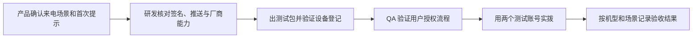
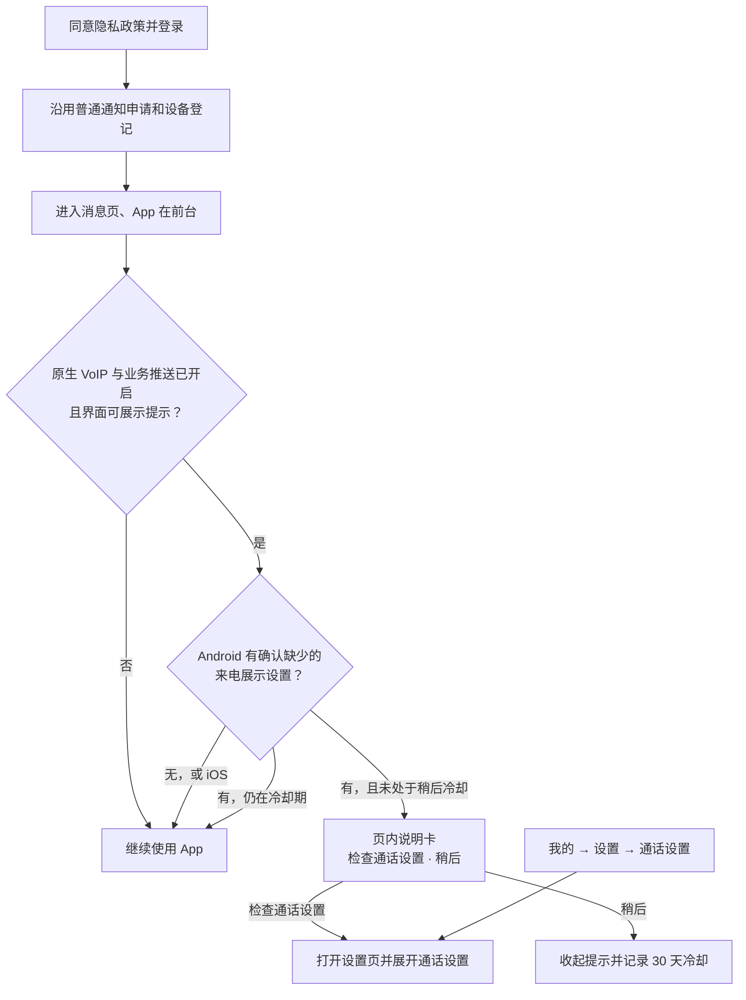
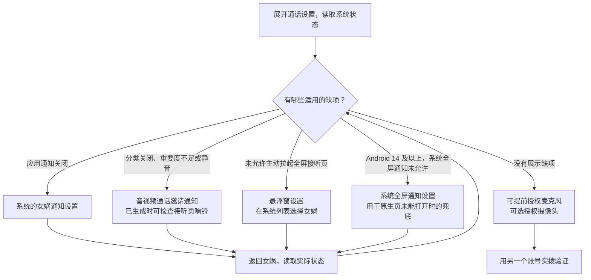
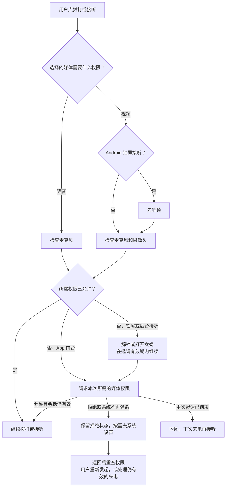
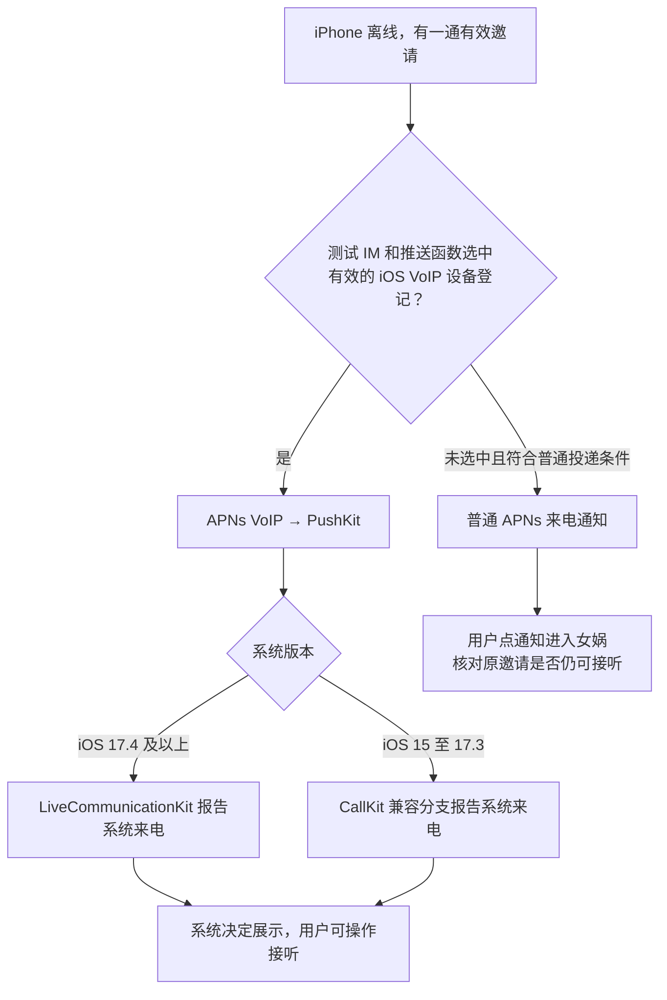
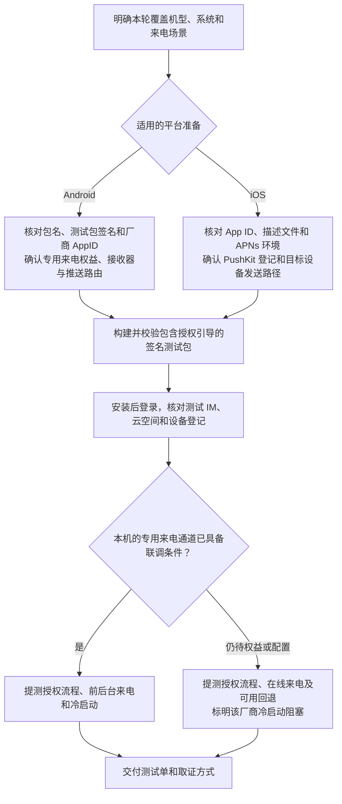
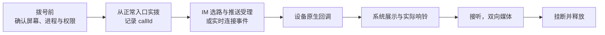

# VoIP 授权、提测与验收流程

适用于女娲 Android 和 iOS 的一对一语音、视频通话。使用现有账号和原生 VoIP 开关。手动「通话设置」及媒体授权流程已接入，本文的**首次进入消息页提示卡**是产品设计，按实际装机版本决定是否纳入本轮提测。

## 用户如何授权

**产品介绍用语**

> 想在锁屏或使用其他 App 时收到来电，可以在「我的 → 设置 → 通话设置」检查来电提醒。每次只处理一项，返回女娲后会更新状态。接打语音需要麦克风，使用视频时再授权摄像头。

### 首次提示的时机

- **触发条件。** 普通通知申请结束且消息页可操作后才显示卡片。隐私弹窗、系统授权、响铃、拨号或通话期间延后，待下一次进入空闲的消息页再判断。同一登录会话最多主动提示一次。提示记录按本机、账号和环境隔离。
- **触发范围。** 自动提示只依据 Android 可查且用户能够处理的缺项。普通通知流程复用现有入口，媒体权限留在拨打、接听或手动设置。用户主动关闭推送业务开关时保留选择。厂商权益待批、推送未登记或系统状态无法读取时，在设置里显示实际状态。
- **文案。** 标题「设置来电提醒」。正文「检查来电设置，减少锁屏或切到其他 App 时错过来电的情况。」按钮「检查通话设置」「稍后」。登录和返回前台阶段读取状态，系统设置由点击操作打开。

### Android 来电展示逐项设置

清单优先标出系统通知、来电分类、悬浮窗和适用的全屏通知，用户可以跳过单项。系统页面打不开时回退到应用通知或详情设置。返回后按实测权限显示状态。勿扰、静音和铃声音量只提示，厂商自启动和电池策略按具体机型排查。Android 14+ 的全屏通知和主动拉起原生接听页分别验证。 [Android 全屏通知说明](https://source.android.com/docs/core/permissions/fsi-limits) · [通话设置详情](voip-call-readiness.md)

### 主动拨打、被动接听与媒体授权

希望锁屏语音直接接通的用户可以提前开麦克风。App 通话页收到视频邀请时也可选择语音接听。iOS 在通话设置显示媒体授权和 PushKit 登记状态，设备通过 App 和服务侧完成登记。专注模式可能影响系统是否展示。 [通话生命周期](voip-call-lifecycle.md#账号和页面边界) · [iOS PushKit 登记](voip-ios-im-cloud-handoff.md#iphone-向测试-im-登记什么)

### iOS 17.4 前后与普通通知回退

iOS 17.4 是 **LiveCommunicationKit（LCK）** 来电界面的最低版本。女娲保留的 iOS 15–17.3 兼容分支可用 **CallKit** 向系统报告来电，也可以由 PushKit 接收 VoIP 推送。两个原生框架都由系统决定最终是否展示接听界面。 [Apple LCK 来电 API](https://developer.apple.com/documentation/livecommunicationkit/conversationmanager/reportnewincomingconversation%28uuid%3Aupdate%3A%29) · [Apple CallKit 来电示例](https://developer.apple.com/documentation/callkit/voip-calling-with-callkit)

上图对应当前测试选路。测试函数按目标设备的有效来电登记选路，iOS 版本用于原生层选择接听框架。系统拒绝展示或专用发送失败要分别记录，目前不能假定会立刻补发一条普通通知。 [当前设备选路](../../uniCloud-alipay/cloudfunctions/push-send-test/index.js) · [女娲 iOS 原生分支](../../uni_modules/nuwax-voip/utssdk/app-ios/NuwaxVoipBridge.swift)

**中国大陆 App Store 的产品口径待发行确认。** 腾讯云的大陆接入方案选用 iOS 17.4+ 的 LCK 系统来电，并为低版本保留普通 APNs 横幅，点击后进入 App。女娲可参考这个方案。提测时把旧系统 CallKit 兼容验证和大陆发行包的普通通知回退分开。大陆发行包是否启用旧系统 CallKit，需要结合实际签名、包配置和审核确认。若决定旧系统仅走普通通知，还需明确设备登记与发送策略，以及点通知后在 App 内接听的行为。这条发行分流属于待实现和验收项。 [腾讯云大陆接入方案](https://cloud.tencent.com.cn/document/product/269/111743) · [女娲发行边界](voip-cn-provider-onboarding.md#63-系统版本与国内发行边界)

## 研发如何提测

平台权益在确定覆盖机型时开始核对，所需厂商审批与客户端开发并行。用实际测试签名和对应部署做联调。发行前核对实际分发渠道要求，并用生产签名和对应发送环境复验。 [厂商申请手册](voip-cn-provider-onboarding.md#3-申请前统一准备的材料) · [Android 测试包](voip-android-qa-package.md) · [iOS 测试包](voip-ios-qa-package.md) · [测试推送环境](im-test-push-acceptance-checklist.md)

**提测单应带以下信息**

| 信息 | QA 用途 |
| --- | --- |
| 分支和提交、App 版本、基座版本、签名 APK／IPA、包校验值 | 确认系统设置跳转和通知渠道确实在机上包里。注明「消息页首次提示卡」是否包含在本包。 |
| 测试域名、IM 部署版本、测试云空间及函数版本 | 区分测试和生产推送。 |
| 主叫、被叫两个不同测试账号，设备登记结果 | 从正常 Web 或 App 入口实拨，并与被叫的有效登记关联。 |
| 目标机型与系统、发行渠道、厂商权益与接入状态、当前阻塞 | iOS 15–17.3 和 17.4+ 分别写明预期的通知通道与接听框架。 |

## QA 如何验证

先用**干净授权状态**跑首次授权、拒绝和返回复查，再用**已知授权状态**验证实际来电。按本轮覆盖的 Android 厂商和系统版本分组，单列 Android 14+ 的全屏通知。iOS 按 CallKit 和 LiveCommunicationKit 的覆盖范围留证。每轮只变一个条件，例如悬浮窗、来电分类或勿扰。拨号前记录屏幕和进程状态，冷启动用例先保持无人触屏，等到确认是否自动展示后再接听。

| 用例 | 操作与观察 |
| --- | --- |
| 首次进入和跳过 | 隐私未同意、未登录或 VoIP 未开放时不触发 VoIP 授权。手动入口按开关显示。含提示卡的包再验证通知申请结束后显示、点击可展开设置、稍后冷却、切号隔离、已有权限或通话中不弹。 |
| 手动授权正反例 | 先核对缺项。每次只开启一项并返回，检查状态变化和下一项。分别验证取消、拒绝、系统不再弹窗、深链回退和人为撤销后重查。关闭应用通知、降低来电分类重要度、分类静音分别记录。 |
| 语音和视频授权 | 新装语音只检查麦克风。视频增加摄像头。分别验证拒绝、首次锁屏语音接听、已授权锁屏语音接听，以及 Android 锁屏视频解锁后接听。 |
| 前台、未锁屏后台且有进程 | 前台分别停在主叫聊天、其他聊天和普通子页。确认同一通只展示一次。后台记录实时连接或实际推送来源，核对系统通知入口。 |
| 锁屏且有进程 | 记下亮屏、铃声、接听页或通知、是否可以从锁屏操作。进程存活证据和无进程结果分别记录。 |
| **未锁屏、无进程** | Android 分别实拨语音和视频，确认推送到达且设置允许时能否自动打开全屏接听页。 |
| **锁屏、无进程** | Android 分别核对语音原生直开和视频系统通知。iOS 核对 PushKit 回调、系统来电、接听和媒体。Android 拨号前确认主进程及推送子进程，记录应用未被强停。 |
| iOS 旧系统兼容与普通通知 | iOS 15–17.3 的测试包单列 PushKit 和 CallKit 上报及展示。普通通知回退单列通知到达、点击进 App、有效邀请可接听、已取消或过期邀请不可恢复。iOS 17.4+ 单列 LCK 上报和展示。 |
| 系统来电兜底和干扰条件 | Android 分别测试悬浮窗关闭、Android 14+ 全屏通知关闭和勿扰。关闭悬浮窗验证系统通知兜底，保持悬浮窗允许可单独验证系统全屏通知关闭时的原生直开。iOS 核对专注模式，并在业务推送和登记仍有效时单独验证关闭普通通知后的系统来电。 |
| 去重、收起与收尾 | 接听页已显示时，同一通不重复弹系统横幅。收起后从通知栏或支持的 App 页面返回，媒体继续。分别测两端挂断、拒接、取消、超时、另一个设备接听与资源释放。 |
| 主动退出和重启 | 系统回收、上滑移除任务、Android 强行停止、重启后首次解锁前后单独记结果，有进程或普通通知结果不写为原生冷启动通过。 |

### 按一通真实来电对账

用同一个 `callId` 关联从主叫到被叫的记录。离线轮次补记云函数请求号、厂商任务或消息 ID、原生回调时间和进程变化。记录结果时分别填写**设置流程、投递、展示、接听、媒体、收尾**。语音由两端确认彼此听见，视频另核对两端画面。云端受理只记投递侧受理，普通通知到达记为回退到达。只有设备在目标状态下自动展示、接听后双向媒体可用、挂断后资源正常释放，才把该机型的原生冷启动接听场景记为通过。

首次提示卡本轮只完成设计。现有权限清单和具体来电验收以机上版本及其证据为准。 [已有设备验收记录](voip-acceptance.md) · [iOS 实拨对账](voip-ios-im-cloud-handoff.md#按一条真实邀请对账)
