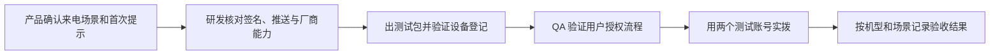
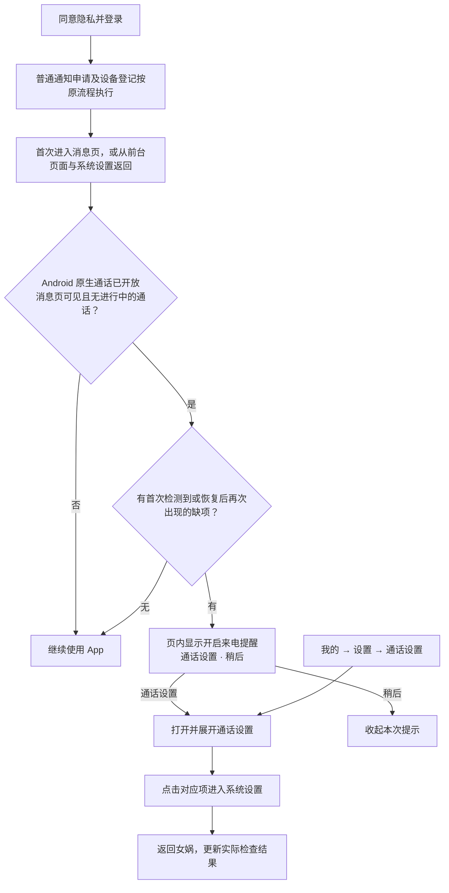
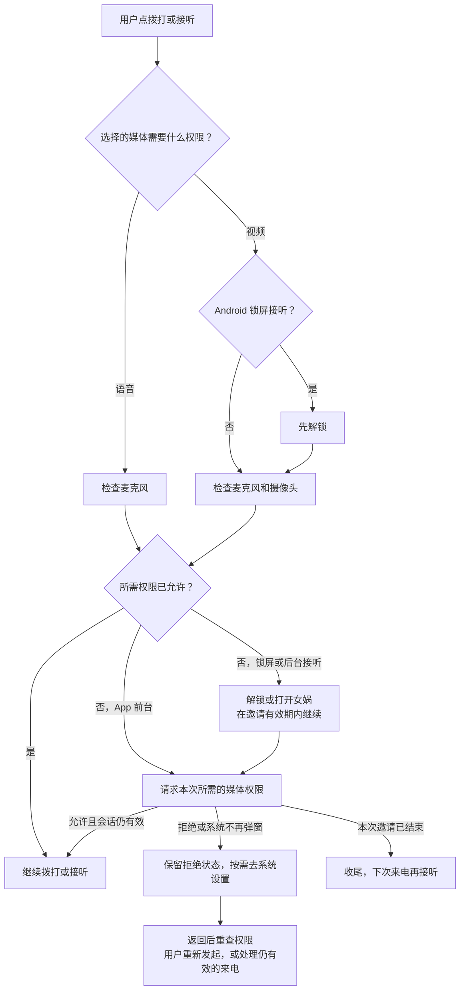
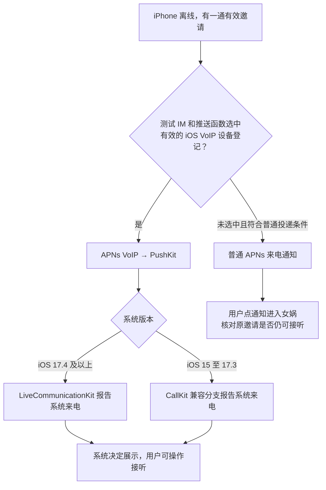
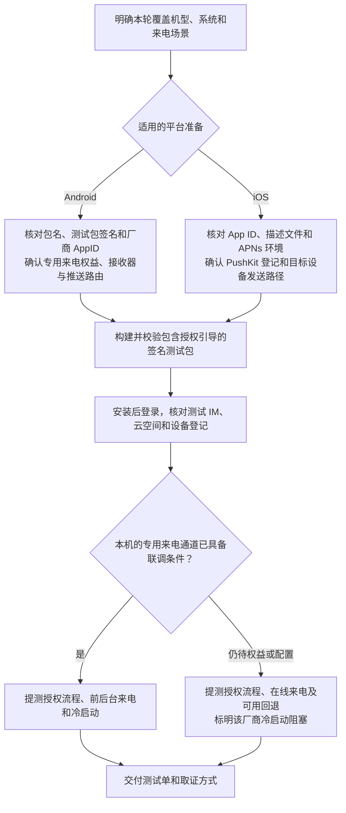
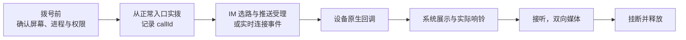

# VoIP 授权、提测与验收流程

适用于女娲 Android 和 iOS 的一对一语音、视频通话。使用现有账号和原生 VoIP 开关。当前源码已接入 Android 消息页来电提醒、手动「通话设置」和媒体授权流程。新增提示及复查规则待随测试包装机验证。

## 用户如何授权

**产品介绍用语**

> 想在锁屏或使用其他 App 时收到来电，可以在「我的 → 设置 → 通话设置」检查来电提醒。每次只处理一项，返回女娲后会更新状态。接打语音需要麦克风，使用视频时再授权摄像头。

### 首次进入消息页与后续复查

- 已知用户关闭业务推送时不主动提示。来电卡片嵌在消息页，不额外弹系统授权。设置检查在首次进页、再次进页、回前台或通话结束后执行。
- 按安装保存每一项最后一次确认的状态。已有相同缺项时不重复打扰，用户后来新关掉权限，或某个此前未知的缺项变得可检测时，再提示一次。确认状态变为已设置后，后续撤销也会重新提示。未知状态不会覆盖上一次已知状态。
- 点击「通话设置」直接展开清单，点「稍后」继续使用。手动入口收起时仍标出确认存在的缺项。麦克风和摄像头按拨打与接听场景申请，也可提前手动设置。

### Android 来电展示逐项设置

```mermaid
flowchart TD
    A["展开通话设置，读取系统状态"] --> B{"有哪些适用的缺项？"}
    B -->|应用通知关闭| C["系统的女娲通知设置"]
    B -->|分类关闭、重要度不足或静音| D["音视频通话邀请通知<br/>已生成时可检查接听页响铃"]
    B -->|未允许主动拉起全屏接听页| E["悬浮窗设置<br/>在系统列表选择女娲"]
    B -->|Android 14 及以上，系统全屏通知未允许| F["系统全屏通知设置<br/>用于原生页未能打开时的兜底"]
    B -->|检测到系统后台运行受限| P["应用详情 → 电池设置"]
    B -->|没有展示缺项| G["可提前授权麦克风<br/>可选授权摄像头"]
    C --> R["返回女娲，读取实际状态"]
    D --> R
    E --> R
    F --> R
    P --> R
    R --> B
    G --> T["用另一个账号实拨验证"]
```

清单优先标出系统通知、来电分类、悬浮窗和适用的全屏通知，用户可以跳过单项。系统页面打不开时回退到应用通知或详情设置。返回后按实测权限显示状态。勿扰、静音和铃声音量只提示，厂商自启动和电池策略按具体机型排查。Android 14+ 的全屏通知和主动拉起原生接听页分别验证。 [Android 全屏通知说明](https://source.android.com/docs/core/permissions/fsi-limits) · [通话设置详情](voip-call-readiness.md)

### 缺项影响判定

| 缺项或状态 | 影响阶段 | 提示或验收 |
| --- | --- | --- |
| 设备没登记、发送端没就绪、厂商专用通道未开通或路由未命中 | 无进程时可能收不到推送，系统也没有来电可展示 | 研发查目标设备登记、推送受理、设备原生回调。iOS 展开清单显示登记与推送服务状态。Android 通用 SDK 配置只表明集成状态。 |
| Android 检测到系统禁止后台运行 | 退桌面后的进程调度和收取来电可能受影响 | 消息页提示，设置页打开应用详情，返回后重读。常规电池优化和厂商自启动按具体机型排查。 |
| Android 系统通知关闭，或来电分类关闭／重要度不足 | 影响通知兜底和本 App 直开接听页的判断，推送进程可能已经被唤醒 | 优先检查应用通知与来电分类。收到 push 后仍无接听页时单列展示问题。 |
| Android 悬浮窗关闭、Android 14+ 全屏通知关闭 | 分别影响主动拉起原生页和系统通知全屏。可用路径仍按系统策略展示，可能仅有横幅或通知入口 | 每轮只关闭一项并分别验证，再验两项都关。通知其余条件与实际回退形态也要记录。 |
| 通知分类静音、独立接听页响铃分类静音、系统静音／勿扰 | 可能只影响声音。Android 本 App 也会在勿扰时跳过主动拉起接听页 | 对照进程变化、界面和声音，检查实际系统设置。部分 ROM 的锁屏显示或后台弹窗开关由用户按机型检查。 |
| 未允许麦克风或摄像头 | 来电可先展示。接通语音需要麦克风，视频另需摄像头 | 首次锁屏接听缺麦克风，按系统流程解锁并完成授权。视频邀请可选语音接听。 |
| iOS 普通通知关闭，或使用专注模式 | 普通 APNs 回退的提醒可能不可见。PushKit 登记和系统接听分别由其自身链路处理 | 通话设置可检测普通通知被关闭并指向系统设置。实拨时核对专用 APNs 投递，单列专注模式与普通通知回退。 |
| 鸿蒙原生的应用内通话消息权益、登记或 Call Service 未就绪 | 原生后台来电及系统接听受影响 | 独立按实际签名和测试包验证，业务入口仍遵循本平台的发布开关。 |

### 主动拨打、被动接听与媒体授权

希望锁屏语音直接接通的用户可以提前开麦克风。App 通话页收到视频邀请时也可选择语音接听。iOS 在通话设置显示媒体授权和 PushKit 登记状态。已登记但服务端未声明可发送时，显示「已登记，推送服务待就绪」。专注模式可能影响系统是否展示。 [通话生命周期](voip-call-lifecycle.md#账号和页面边界) · [iOS PushKit 登记](voip-ios-im-cloud-handoff.md#iphone-向测试-im-登记什么)

### iOS 17.4 前后与普通通知回退

iOS 17.4 是 **LiveCommunicationKit（LCK）** 来电界面的最低版本。女娲保留的 iOS 15–17.3 兼容分支可用 **CallKit** 向系统报告来电，也可以由 PushKit 接收 VoIP 推送。两个原生框架都由系统决定最终是否展示接听界面。 [Apple LCK 来电 API](https://developer.apple.com/documentation/livecommunicationkit/conversationmanager/reportnewincomingconversation%28uuid%3Aupdate%3A%29) · [Apple CallKit 来电示例](https://developer.apple.com/documentation/callkit/voip-calling-with-callkit)

上图对应当前测试选路。测试函数按目标设备的有效来电登记选路，iOS 版本用于原生层选择接听框架。系统拒绝展示或专用发送失败要分别记录，目前不能假定会立刻补发一条普通通知。 [当前设备选路](../../uniCloud-alipay/cloudfunctions/push-send-test/index.js) · [女娲 iOS 原生分支](../../uni_modules/nuwax-voip/utssdk/app-ios/NuwaxVoipBridge.swift)

**中国大陆 App Store 的产品口径待发行确认。** 腾讯云的大陆接入方案选用 iOS 17.4+ 的 LCK 系统来电，并为低版本保留普通 APNs 横幅，点击后进入 App。女娲可参考这个方案。提测时把旧系统 CallKit 兼容验证和大陆发行包的普通通知回退分开。大陆发行包是否启用旧系统 CallKit，需要结合实际签名、包配置和审核确认。若决定旧系统仅走普通通知，还需明确设备登记与发送策略，以及点通知后在 App 内接听的行为。这条发行分流属于待实现和验收项。 [腾讯云大陆接入方案](https://cloud.tencent.com.cn/document/product/269/111743) · [女娲发行边界](voip-cn-provider-onboarding.md#63-系统版本与国内发行边界)

## 研发如何提测

此前一轮无进程唤醒的提测范围为 **华为 Android 和 iOS**；当时 vivo、红米用于前台、后台有进程及其他适用场景。这是那轮的设备范围，不是产品支持范围。所有已具备原生来电推送唤醒能力的 Android 设备都应遵循下述统一来电展示目标；各厂商的通道开通、实际送达及设备验收分别记录。

2026-11-26 确认的跨平台目标：支持来电推送唤醒的 Android 设备在无进程、解锁或锁屏时收到有效邀请后，应恢复来电并尝试展示原生全屏接听页；iOS 17.4 及以上走 PushKit 和 LiveCommunicationKit 系统来电，在支持灵动岛的设备上核对系统来电及灵动岛的展示和交互。iOS 的具体界面由系统根据设备、状态和设置决定。Android 各厂商的投递与后台展示限制、iOS 的系统展示以及实际机型覆盖，均须逐机验证，不能把统一目标写成已经通过。

平台权益在确定覆盖机型时开始核对，所需厂商审批与客户端开发并行。用实际测试签名和对应部署做联调。发行前核对实际分发渠道要求，并用生产签名和对应发送环境复验。 [厂商申请手册](voip-cn-provider-onboarding.md#3-申请前统一准备的材料) · [Android 测试包](voip-android-qa-package.md) · [iOS 测试包](voip-ios-qa-package.md) · [测试推送环境](im-test-push-acceptance-checklist.md)

**提测单应带以下信息**

| 信息 | QA 用途 |
| --- | --- |
| 分支和提交、App 版本、基座版本、签名 APK／IPA、包校验值 | 确认系统设置跳转和通知渠道确实在机上包里。注明「消息页首次提示卡」是否包含在本包。 |
| 测试域名、IM 部署版本、测试云空间及函数版本 | 区分测试和生产推送。 |
| 主叫、被叫两个不同测试账号，设备登记结果 | 从正常 Web 或 App 入口实拨，并与被叫的有效登记关联。 |
| 目标机型与系统、发行渠道、厂商权益与接入状态、当前阻塞 | iOS 15–17.3 和 17.4+ 分别写明预期的通知通道与接听框架。 |

## QA 如何验证

先用**干净授权状态**跑首次授权、拒绝和返回复查，再用**已知授权状态**验证实际来电。按本轮覆盖的 Android 厂商和系统版本分组，单列 Android 14+ 的全屏通知。iOS 按 CallKit 和 LiveCommunicationKit 的覆盖范围留证。每轮只变一个条件，例如悬浮窗、来电分类或勿扰。拨号前记录屏幕和进程状态，冷启动用例先保持无人触屏，等到确认是否自动展示后再接听。

| 用例 | 操作与观察 |
| --- | --- |
| 首次进入和跳过 | 隐私未同意、未登录或 VoIP 未开放时不触发 VoIP 授权。手动入口按开关显示。Android 有确认缺项时显示页内卡，点通话设置直接展开，点稍后收起。同一权限状态切 Tab、重启或切账号不重复。无缺项或通话中不显示。 |
| 权限撤销和后台限制 | 先回到消息页记录已设置。逐次关闭通知、降低来电分类重要度、关闭悬浮窗或全屏通知，并单独开启 Android 系统后台限制。返回验证新缺项及时提示、手动清单同步、恢复后提示消失，再次撤销可提示。厂商私有项无法读回时记录用户真实设置。 |
| 手动授权正反例 | 先核对缺项。每次只开启一项并返回，检查状态变化和下一项。分别验证取消、拒绝、系统不再弹窗、深链回退和人为撤销后重查。关闭应用通知、降低来电分类重要度、分类静音分别记录。 |
| 语音和视频授权 | 新装语音只检查麦克风。视频增加摄像头。分别验证拒绝、首次锁屏语音接听、已授权锁屏语音接听，以及 Android 锁屏视频解锁后接听。 |
| 前台、未锁屏后台且有进程 | 前台分别停在主叫聊天、其他聊天和普通子页。确认同一通只展示一次。后台记录实时连接或实际推送来源，核对系统通知入口。 |
| 锁屏且有进程 | 记下亮屏、铃声、接听页或通知、是否可以从锁屏操作。进程存活证据和无进程结果分别记录。 |
| **未锁屏、无进程** | 已具备原生来电唤醒能力的 Android 按厂商实拨语音和视频，核对推送、进程启动和全屏接听。iOS 核对 PushKit 到达、系统来电、支持机型的灵动岛和 App 恢复。 |
| **锁屏、无进程** | 已具备原生来电唤醒能力的 Android 按厂商分别核对语音全屏接听、视频解锁后接听；拨前确认主进程和推送子进程均不存在，且应用未被强停。iOS 核对 PushKit 到达、锁屏系统来电、接听及媒体，解锁后在支持机型核对灵动岛。 |
| iOS 旧系统兼容与普通通知 | iOS 15–17.3 的测试包单列 PushKit 和 CallKit 上报及展示。普通通知回退单列通知到达、点击进 App、有效邀请可接听、已取消或过期邀请不可恢复。iOS 17.4+ 单列 LCK 上报和展示。 |
| 系统来电兜底和干扰条件 | Android 分别测试悬浮窗关闭、Android 14+ 全屏通知关闭和勿扰。关闭悬浮窗验证系统通知兜底，保持悬浮窗允许可单独验证系统全屏通知关闭时的原生直开。iOS 核对专注模式，并在业务推送和登记仍有效时单独验证关闭普通通知后的系统来电。 |
| 去重、收起与收尾 | 接听页已显示时，同一通不重复弹系统横幅。收起后从通知栏或支持的 App 页面返回，媒体继续。分别测两端挂断、拒接、取消、超时、另一个设备接听与资源释放。 |
| 主动退出和重启 | 系统回收、上滑移除任务、Android 强行停止、重启后首次解锁前后单独记结果，有进程或普通通知结果不写为原生冷启动通过。 |

### Android 解锁、无进程时出现来电横幅

2026-11-26 收到华为 Android 截图：屏幕已解锁，来电显示“邀请你通话”和接听／拒接横幅；截图与原生 CallStyle 一致，但不能单独证明具体安装包、推送来源或页面启动结果。该场景要求自动展示全屏接听页，当前问题尚待目标机复现。

当前源码的后台直开逻辑在 Telecom 登记成功后执行，**不按 Android 厂商区分**；解锁时语音、视频均允许尝试，仍要求悬浮窗授权、通知已启用、来电渠道重要度至少为 HIGH 且勿扰过滤关闭。2026-11-23 的 `1c518e36a` 放宽了解锁后台来电的触发条件，排查时须核对 APK 和其中的原生基座是否包含该提交，不能只看 App 业务资源版本。系统通知的全屏 Intent 在设备使用中也可能显示横幅；华为历史设备曾将通知的实际重要度降级，不能据此推断本次同因或其他厂商的结果。

复测使用包含本次诊断的可调试包，从正常入口拨号前确认已解锁、主进程和推送子进程均不存在且未强停，记录设备、系统、APK／基座版本、悬浮窗、通知渠道和勿扰状态。逐项核对 `NuwaxVoip` 日志：

- `telecom call registered` 后的 `background call activity skipped: ...` 表示对应条件未满足，具体原因分别记录为呼叫状态、已展示、已有请求、悬浮窗、通知渠道或勿扰过滤等。
- `unlocked incoming call activity requested` 表示已发起打开请求。`incoming call activity declined: ...` 表示启动抛异常。`incoming call UI not visible after activity request` 表示等待约 750 毫秒后仍未检测到接听界面可见。前台流程若尝试回退到 App 内通话页，会再等待约 500 毫秒。这条日志涵盖原生和 App 内界面，复测时结合系统 Activity 日志和实际画面判断。
- `native call activity visible` 表示原生页已进入可见生命周期；通知日志和系统通知状态用于核对回退。如果来电已结束或页面先变为可见，等待协程可能取消，不一定出现 750 毫秒诊断。

这些阶段日志仅在可调试包输出。普通通知、系统强停和真实冷启动分别留证，设备未复测前不登记通过。

### 按一通真实来电对账

用同一个 `callId` 关联从主叫到被叫的记录。离线轮次补记云函数请求号、厂商任务或消息 ID、原生回调时间和进程变化。记录结果时分别填写**设置流程、投递、展示、接听、媒体、收尾**。语音由两端确认彼此听见，视频另核对两端画面。云端受理只记投递侧受理，普通通知到达记为回退到达。只有设备在目标状态下自动展示、接听后双向媒体可用、挂断后资源正常释放，才把该机型的原生冷启动接听场景记为通过。

消息页提示、权限撤销后的再提醒及新增后台限制检测已在源码实现，本次尚未随新安装包验收。 [已有设备验收记录](voip-acceptance.md) · [iOS 实拨对账](voip-ios-im-cloud-handoff.md#按一条真实邀请对账)
