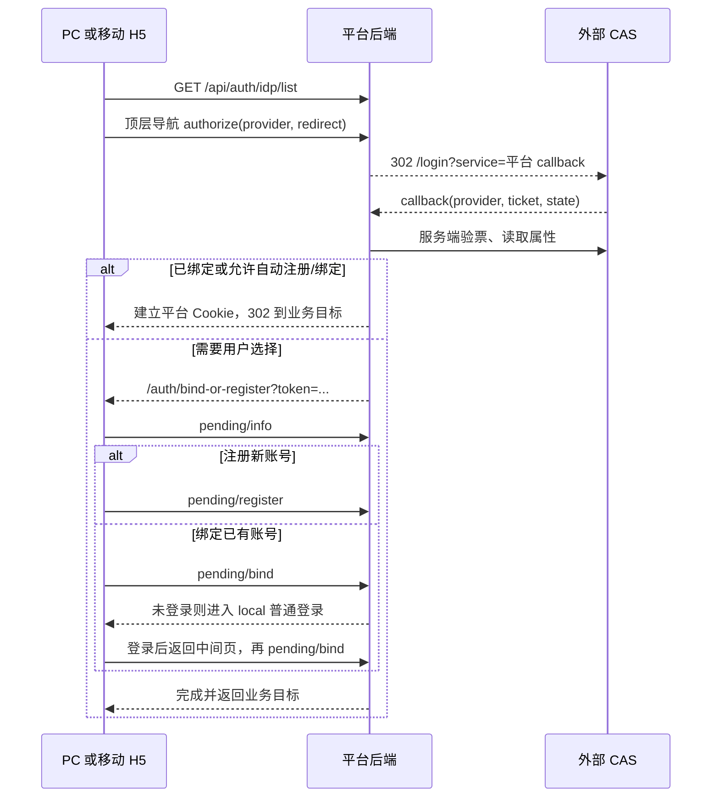

# 移动端 CAS 接入评估与实施细则

更新日期：2026-10-13。当前状态：**按用户最新要求，仅做文档梳理与后端确认，暂停代码实施、联调和发布。** 请优先使用[移动端联合登录后端确认清单](mobile-idp-backend-confirmation-checklist.md)逐项确认接口、业务规则、应用配置和验收条件。

此前已有移动前端草稿，按用户要求与测试、文档一起保存到专用分支 `feat/nuwa-zhuoda-2026.10-idp-login`。分支基于已验证的 `0b1ad26b707fa8003850ffc4483e7cc6e8deda29`；本次只整理提交，不新增业务实现。第 14 节保留此前实现与验证记录，不代表已上线或正式交付。第 8 节新增接口仍为备选提案；后端确认后先更新文档，恢复开发以用户后续指令为准。

## 1. 结论与建议范围

**移动端应复用 PC 已有的统一 IdP 后端，而不是另写一套 CAS 验票和用户匹配逻辑。H5 可以沿用 Cookie 登录；原生 App 需要补齐浏览器认证结果与 App Bearer 会话之间的交接。**

建议分阶段交付：

1. **共同准备**：冻结现有接口、身份关联规则、移动回跳和会话交换契约，准备手机可访问的真实 CAS 测试环境。
2. **移动 H5**：接入 CAS 入口、成功/失败回跳、绑定已有账号、注册、普通登录逃生和退出。这一阶段不需要复制 PC 管理后台。
3. **Android / iOS App**：按提供方分流。CAS/通用网页 SSO 使用系统认证窗口与一次性交换码；微信、飞书若纳入范围，优先通过官方移动 SDK 唤起对应客户端授权，并将 SDK 返回的授权码提交平台后端。CAS 浏览器通道先评估复用现有 OAuth2 授权码/PKCE 能力，不满足官方 App 会话要求时再补移动事务接口。两类通道均纳入冷启动、进程重建、切域和取消处理。
4. **账号设置与其他平台**：提供已绑定身份查看、绑定、解绑；鸿蒙和微信小程序分别验证平台能力后开放。

H5 本轮已复用 `CAS / OAUTH2 / WECHAT` 的现有浏览器授权接口；微信按 UA 选择 OA/QRCODE，名称来自 PC 配置，不硬编码提供方 ID。微信/飞书的原生授权补充见第 6.1 节，不能据“支持 OAuth2”就认定原生 SDK 已接入。原生 App 当前不展示未接通的联合登录入口。CAS 功能属于通用认证能力，原则上落通用产品线，再按项目规则合入桌搭线；原生适配与自定义基座依赖使用条件编译隔离，不把桌搭专属能力反向合入 basic。

## 2. 本次核对基线与证据边界

| 对象 | 核对基线 | 说明 |
| --- | --- | --- |
| PC Web | `/Users/apple/workspace/nuwax`，`feat-2026.9.30`，`06098d00e4ad72400c3cf0d73142e3842f0c874d` | 开始和结束检查工作区均干净；已阅读实际页面、服务、导航、类型、绑定面板、管理页及测试 |
| 移动端 | `/Users/apple/workspace/nuwax-mobile`，`feat/nuwa-zhuoda-2026.09.30`，`0b1ad26b707fa8003850ffc4483e7cc6e8deda29` | 开始检查工作区干净；现状结论针对该本地版本 |
| 测试后端 | [OpenAPI](https://test-nvwa-api.xspaceagi.com/v3/api-docs)，当日读取 1207 个路径 | 核对接口和 DTO；接口出现在文档中不代表所有身份场景已验收 |
| 测试前台 | `https://testagent.xspaceagi.com` | 匿名读取 IdP 列表、后端中间页 HTML，并检查 CAS 授权第一跳；未登录真实 CAS 账号、未注册/绑定/解绑账号、未修改配置 |
| 需求与专项对接文档 | [8 月需求](https://xspaceagi.feishu.cn/wiki/Dmvqwr0api83PCkt7ZGc8UUgnle)、[三方登录前端对接文档](https://testagent.xspaceagi.com/repo/doc/DCmphdX8GiJPzGze) | 使用 ego-browser 读取；专项文档显示修改于 2026-09-28，明确微信手机浏览器唤起、平台 Cookie 登录与后端中间页 |
| PC 在线配置 | [登录方式管理](https://testagent.xspaceagi.com/system/config/auth-method) | 使用 ego-browser 查看列表及 CAS、微信、飞书编辑表单；没有保存、启停、删除或修改任何配置 |
| 本地后端仓库 | `nuwax-backend@34506747…`（5 月）、`agent-platform@68aab409…`（9 月） | 搜索到的是旧 CAS 配置，未找到本次统一 IdP 实现；不能据此确认线上验票、state 存储、会话寿命和账号匹配的内部实现 |

实施前接口及 PC 核对（移动构建与测试另见第 14 节）：

- `GET /api/auth/idp/list` 返回 `0000`，有 CAS（当日 provider ID 为 `5`）、OAuth2 和微信，`autoRedirectIdpId=null`。**ID 是环境数据，代码不能写死为 5。**
- CAS `authorize` 返回 HTTP 302，到内网 HTTP CAS 登录地址；其 `service` 指向业务域 `/api/auth/idp/callback`，带 `provider/state`。未跟随到内网认证页。这只证明发起链路，不证明验票成功或手机可达。
- `/auth/bind-or-register` 返回后端 HTML，实际脚本调用 pending 三接口；绑定未登录时硬编码跳 `/login?local=1&redirect=…`。
- 授权第一跳没有观察到 `Set-Cookie`，不能据 PC 历史注释认定 state 一定存在 Cookie 中；其存储和校验机制应由后端确认。
- PC 定向回归 **8 个文件、168 项测试通过**，覆盖 IdP 纯函数、桌面导航、登录导航、认证请求、绑定列表边界、管理表单。未进行真实 CAS 闭环或移动端构建/设备验收。

工程准备还需处理一项本地差异：当前移动工作副本仍显示 `origin=GitHub`、`gitlab=内网`，与本轮提供的“单远端 origin=内网”规范不一致。专用分支从当前已验证的迭代基线建立，本地 `release/nuwa-zhuoda` 尚未包含后续迭代，未向产品线合入。本次没有改远端、拉取或推送；此前只读查询内网远端时未找到两个 `release/nuwa-*` 分支。合入前需要确认通用产品线基线和实际远端，不能直接沿旧配置发布。

## 3. PC、平台后端、外部 CAS 的职责

| 参与方 | 职责 | 移动端复用方式 |
| --- | --- | --- |
| PC 管理后台 | 配置 provider、CAS 服务地址/字段映射、启停、自动跳转、自动注册/绑定 | 沿用该后台；App 只读取公开登录方式，不拉 secret 或管理配置 |
| PC / 移动前端 | 展示入口、协议确认、授权发起、业务返回路径、失败提示、账号身份管理 | 对齐规则；分别适配 Cookie 与 Bearer |
| 平台后端 | 生成和校验授权上下文，向 CAS 验票，映射属性，查找/关联平台账号，创建平台会话 | 原样复用身份逻辑；新增移动事务与会话交接，不把验票搬进 App |
| 外部 CAS | 认证用户，回传 service ticket，向平台后端提供验票与用户属性 | 登记平台后端回调 service；不把 App 的 scheme 直接登记为现有 CAS 回调 |

必须区分四种凭证：CAS `ticket`、平台 Cookie `ticket`、中间页 `pending token`、App `ACCESS_TOKEN`。新增的一次性交换 `code` 又是独立凭证，不能互相当成登录 Token 保存。现有 `_ticket` 临时票据也是另一条业务免登链路。

### 3.1 PC 现有业务链路



图中的验票/账号处理属于接口表达的后端职责，并非本轮已检查其实现。实际验票版本、校验端点和匹配顺序列入后端确认项。

### 3.2 已实现的 PC 规则

- **登录方式列表**：免登录读取；读取失败静默回落普通登录，列表未就绪前暂缓展示表单，减少自动跳转闪屏。
- **多提供方**：CAS、OAuth2、微信；微信在 `MicroMessenger` 环境显示 OA，其他环境显示 QRCODE。该 UA 规则不等价于小程序原生微信登录。
- **手动发起**：协议确认、重复点击保护、整页导航到后端 authorize，不能用普通 JSON 请求替代。
- **自动跳转**：使用 `autoRedirectIdpId`；出现 `local`、`idpError`、`desktopIdpReturn` 时不自动跳转。
- **业务回跳**：IdP 回跳仅接受本站相对路径；数字历史偏移会转为暂存业务路径；非法地址回首页。
- **后端中间页**：`/auth/*` 不注册为 SPA 页面；PC 普通登录后有整页返回后端页面的处理。
- **错误**：`idpError` 以文本呈现，失败后允许普通登录。
- **身份绑定**：列表、可绑定项、绑定导航、解绑确认、失败重试；加载失败不会误显示“无绑定”。回跳使用 `setting=account-bind` 恢复面板。
- **退出政策**：当前调用 `/api/user/logout`；普通退出落 `/login?local=1`，不联动 CAS 全局退出。应用详情页退出存在另一条 `redirectToLogin(currentPath)` 分支，不能把“所有 PC 退出路径都带 local”当作既成事实。
- **桌面增强**：Electron 通过 `hostBridge.auth` 同步 Cookie、适配 direct/gateway；移动 uni-app x 没有该宿主桥，不能直接移植。

管理规则中，新增默认停用、停用取消自动跳转、租户内自动跳转唯一、禁止删除仍有绑定的 provider、唯一登录方式且未设密码时拒绝解绑，均由后端作为最终约束。`autoRegisterBind=1` 的文档语义是信任 IdP 的邮箱/手机号并自动关联或注册，App 不自行按用户名合并账号。

## 4. 现有接口清单

以下路径均相对当前**平台业务域**，不是直接请求外部 CAS。JSON 业务成功码为字符串 `0000`。302/HTML 接口与 JSON 接口必须分别处理；OpenAPI 对部分跳转接口只声明 200，实际授权第一跳已观察到 302。

### 4.1 登录、回调与首次关联

| 编号 | 方法与路径 | 参数 / 返回 | 当前调用方 | 移动接入处理 |
| --- | --- | --- | --- | --- |
| L1 | `GET /api/auth/idp/list` | 返回 `items[]`、`autoRedirectIdpId` | PC 与移动 H5 登录/绑定面板 | 已接；游客可读、5 秒超时、失败回落普通登录 |
| L2 | `GET /api/auth/idp/authorize` | `provider` 必填；`redirect` 本站相对路径；302 | PC 顶层导航 | H5 直接复用；App 经移动事务发起，不能直接把 scheme 填给 redirect |
| L3 | `GET /api/auth/idp/callback` | `provider`；CAS `ticket` 或 OAuth2/微信 `code`；`state`；失败可含 `error/error_description`；302 | IdP → 平台 | 后端拥有；App 不调用验票接口、不把 service ticket 存为 Token |
| L4 | `GET /auth/bind-or-register` | 页面实际读取 `token`、`bind=1`；HTML | 平台后端渲染 | 复用页面，并补移动成功、失败、取消和普通登录落点 |
| L5 | `GET /api/auth/idp/pending/info` | query `token`；返回 `AuthIdpPendingVo` | L4 页面 | H5 可继续由后端页面处理；原生化中间页属后续可选优化 |
| L6 | `POST /api/auth/idp/pending/register` | JSON `{token}`；返回 `LoginResDto`；受租户注册开关约束 | L4 页面 | 复用账号规则；原生事务完成仍必须产生交换结果 |
| L7 | `POST /api/auth/idp/pending/bind` | JSON `{token}`；需平台登录态；返回字符串 Map，实际页读取 `data.redirect` | L4 页面 | 没有登录态则先普通登录，返回时自动再绑一次；自动再绑失败不能无限跳登录 |
| L8 | `GET /api/user/getLoginInfo` | 当前用户 | 两端已有 | H5 验证 Cookie；App 验证新 Token 后再进入业务 |

关键 DTO：

```text
AuthIdpLoginListVo
  items: [{ id:int64, type:CAS|OAUTH2|WECHAT, name, icon?, wechatMode?:QRCODE|OA }]
  autoRedirectIdpId: int64|null

AuthIdpPendingVo
  providerName, providerType, icon, userName, avatar,
  hasEmail:boolean, hasPhone:boolean, redirect:本站相对路径

LoginResDto
  token:string, expireDate:date-time, resetPass:integer, redirect:string
```

`pending/register` 已声明返回 `LoginResDto`，因此不能笼统说“所有三方接口均不返回 Token”。**当前缺口是已绑定直接登录、自动注册/绑定、手动关联等全部分支一致的 App 安全交接契约**；现有 authorize/callback 是浏览器跳转接口，没有声明 App Token 响应。

### 4.2 用户身份管理和退出

| 编号 | 方法与路径 | 参数 / 约束 | PC | 移动 |
| --- | --- | --- | --- | --- |
| U1 | `GET /api/user/identity/list` | 已登录；返回绑定关系 `id`、`idpId`、`idpType`、名称、脱敏外部标识、时间 | 已接 | 已接；App 的 Bearer 支持仍需真实接口联调确认 |
| U2 | `GET /api/user/identity/bind/{providerId}` | 已登录；query `redirect`；302 后绑定到当前账号 | 已接 | 同源 H5 已接；App 浏览器没有原生 Bearer，须由绑定事务固定账号身份 |
| U3 | `POST /api/user/identity/unbind/{identityId}` | 路径使用绑定关系 ID，**不是 provider ID**；唯一方式且无密码时拒绝 | 已接 | 已接；确认后调用，失败保留列表并展示后端原因，成功重新加载 |
| U4 | `GET /api/user/logout` | 平台会话退出 | 已接 | 已接；非小程序两处退出补 local 逃生，原生事务失效待原生方案实施 |
| U5 | `GET /api/auth/idp/logout` | OpenAPI：CAS 会话联动退出 IdP；浏览器跳转 | 当前产品政策未使用 | 首期不启用；不得与普通退出混用 |

单点登录与单点退出是不同需求。保留 CAS 会话后，用户再次主动点击 CAS 可能免输密码，这是预期行为；要阻止的是“刚退出就被自动跳转重新登录”。

### 4.3 管理端配置接口：复用 PC，不在移动端重做

| 方法与路径 | 请求 / 规则 |
| --- | --- |
| `GET /api/system/idp/list` | 返回配置列表；`config` 脱敏，`callbackUrl` 只读 |
| `POST /api/system/idp/create` | `type/name/icon/sort/autoRegisterBind` 和相应配置段；新增默认停用 |
| `POST /api/system/idp/update` | 同上加 `id`；类型不可变，secret 不传表示不修改 |
| `POST /api/system/idp/updateStatus` | `{id, enabled:0|1}`；停用联动取消自动跳转 |
| `POST /api/system/idp/auto-redirect` | `{id}`；`id:null` 取消，租户内唯一 |
| `POST /api/system/idp/delete/{id}` | 有用户绑定时拒绝 |

CAS 配置为 `casConfig:{serverUrl, fieldMapping?}`，映射 key 是 `userName/nickName/email/phone`。`callbackUrl` 应取管理端返回值登记到 CAS，不能按移动路由臆造。PC 权限码为 `auth_method_query/add/modify/delete/enable` 对应的下划线命名。

### 4.4 已有基础接口与容易混用的旧接口

| 方法与路径 | 用途 | 本次处理 |
| --- | --- | --- |
| `GET /api/tenant/config` | 租户登录/注册/验证码开关、站点信息 | 已接；与 IdP 列表共同决定 UI；旧字段 `casLoginUrl/casValidateUrl/casClientHostUrl/authType` 不作为新 IdP 唯一依据 |
| `POST /api/user/passwordLogin` | 普通密码登录，返回 `LoginResDto` | 保留；作为关联已有账号及 CAS 故障时的入口 |
| `POST /api/user/codeLogin` | 验证码登录/注册 | 保留；与密码登录统一收尾及后端中间页跳转 |
| `POST /api/user/mp/codeLogin` | 小程序原生微信 code 登录 | 与统一 IdP 的微信 OA/QRCODE、CAS 是不同链路 |
| `POST /api/user/password/set` | 首次设置密码 | 保留；需明确 CAS-only 账号是否要求设置，不能简单照搬验证码登录 `resetPass==0` 分支 |
| `POST /api/user/ticket/create` | 当前移动代码把已有 ACCESS_TOKEN 放入 body，换临时票据 | 已登录 App → 业务网页的方向；不是已证明可用的 CAS Cookie → App Token 交换 |
| `GET /api/ticket/redirect` | `ticket/redirectUrl`，票据认证后导航 | 不作为新 App 交换码接口；若后端建议复用，先补用途、寿命、重放和受众约束 |
| `GET /api/user/casLogin` | 旧 CAS 回调，`ticket/service/state` | 最新 OpenAPI 仍保留；新功能优先统一 IdP。旧私有化版本需独立兼容约定，不能同时发起两套登录 |

### 4.5 平台已有的 OAuth2 授权服务器：先评估能否复用

这组接口是“平台给外部客户端授权”，与“CAS/OAuth2 提供方给平台登录”方向相反，不能因都叫 Token 就混用。但它已经具备部分 App 所需的授权码基础，应优先评估。

| 方法与路径 | OpenAPI 已声明的能力 | 尚不能据此确认的内容 |
| --- | --- | --- |
| `GET /api/oauth2/authorize` | `client_id/redirect_uri/response_type/scope/state/code_challenge/code_challenge_method`，授权码与 302，支持 PKCE | 是否允许官方 App 公共客户端；未登录时是否能完整经 CAS/pending 再继续授权 |
| `POST /api/oauth2/token` | `authorization_code/refresh_token/client_credentials`，有 `code_verifier` 参数 | 是否支持不携带 client_secret 的 App；授权码 Token 能否调用移动现有 `/api/user/*`、业务 API 与 IM，还是仅限 `/api/oauth2/*` 门面 |
| `GET/POST /api/oauth2/userinfo` | 查询授权用户公开信息 | 不自动等价于 `/api/user/getLoginInfo` 的业务会话和权限 |
| `POST /api/oauth2/revoke` | 撤销令牌并清理用户对客户端的授权 | 与平台 logout、CAS 会话和其他设备会话的关系 |

**复用判断门槛**：公共客户端 + 强制 PKCE S256 + 精确登记的 App 回调 + 完整 CAS/pending 续接 + 现有业务/IM 可接受的用户会话 + 可撤销/可恢复生命周期。全部满足则优先接标准 OAuth 授权码流程，减少第 8 节自定义接口；只满足部分时，优先复用后端已有授权码/PKCE 存储和校验模块，补最小的业务会话适配。

移动包内不能内置 `client_secret`。也不能用 `client_credentials` 的应用身份替代用户登录。OpenAPI 虽把 token 参数列为 query，实际接入需与后端确认使用表单/body/认证头，避免 secret、verifier 或 Token 进入 URL 日志。

2026-10-13 补读需求中关联的 [平台 OAuth2 接入登录流程](https://agent.nuwax.com/static/file-preview.html?sk=84b8aebba4524e86a007350d33c666a3)：该文档按**接入方服务端**兑换令牌编写，使用表单或 Basic 认证传递 `client_secret`，并要求密钥不下发 App；回调地址登记为绝对 HTTP(S) URL、禁止 fragment。它描述的是 `oa-` 不透明访问令牌与开放接口 scope，不能据此替代移动现有业务 Token。该文档变更记录截至 9 月 20 日，仅列两个开放接口，而最新 OpenAPI 已有 PKCE 参数及更多开放接口，存在版本差异：可确认文档没有给出原生公共客户端接入合同，**不能据旧文档断言最新后端不支持 PKCE 或更多 scope**。

## 5. PC 与移动功能对照

“已实现”只指核对到的代码或接口；移动当前状态包含专用分支中的前端草稿，不代表部署或验收完成。当前只推进文档确认，真实账号/设备验收另列。

| 功能 | PC Web | 移动当前状态 | 需要如何实现 |
| --- | --- | --- | --- |
| 普通密码、验证码登录 | 已有 | 已有 | 保持原流程，抽统一登录完成函数 |
| 图形验证码与租户开关 | 已有 | 已有 | 普通登录继续使用；CAS 凭据表单由 IdP 提供 |
| 企业服务域切换 | 桌面宿主提供 | 已有域名预检、切域、清 Token | IdP 列表/事务按业务 origin 隔离；切域废弃旧异步结果 |
| IdP 列表与 CAS 按钮 | 已有 | H5 已实现，App 不开放 | 已接现有 L1/L2；原生待会话交接合同 |
| 自动跳转及 local/idpError | 已有 | H5 已实现 | 协议确认、可用 provider 校验、5 分钟自动尝试去重、缓存页恢复不再自动发起 |
| H5 CAS Cookie 会话 | 已有 | 成功回跳和 Cookie 校验已实现，真实 IdP 未验收 | 同源顶层授权、`/m/` 回跳、用户信息校验；补后端错误与 pending 移动上下文 |
| App CAS → Bearer | Electron 是 Cookie 桥 | 未实现 | 后端移动事务、一次性 code 交换、原生认证适配 |
| 新身份绑定/注册选择 | 后端页与 PC 普通登录协作 | 已支持可信 pending 续接，后端页面仍跳 PC 登录 | 后端保留移动上下文；移动不复制后端注册/合并账号逻辑 |
| `LoginResDto.redirect` | PC 有消费分支 | 密码/验证码/验证码登录后重置密码已统一消费 | 只允许同源 pending 页面或内部业务路径 |
| 已绑定身份管理 | 已有 | 各端列表、解绑已实现；新增绑定仅同源 H5 | App 新增绑定继续依赖原生事务；显示前往网页设置的说明 |
| 主动退出防自动重登 | 普通出口已有 local | 非小程序两处出口已带 local | 沿用平台退出，未启用 CAS 全局退出 |
| 4010/4011 | 已有 | 已补能力读取/回跳失败自行处理及旧请求保护 | 当前会话业务请求保持踢登录；旧域名、Token 或会话代次不再误清新会话 |
| 深链和冷启动回调 | Web URL / 桌面桥 | launch 只按 Token 分流 | 认证回调优先于首页分流，处理进程重建和重复回调 |
| 内嵌/离线 H5 | PC 有独立宿主逻辑 | 已有 `authRequired` → 原生登录桥 | 由原生负责 CAS，成功后沿现有容器机制更新会话 |
| CAS 全局退出 | 有后端接口，产品未接 | 未接 | 本期保留平台退出；另行定义 SLO 才开启 |
| 微信小程序 CAS / 鸿蒙认证适配 | 不适用 | 未实现 | 独立平台验证，未支持时保留原登录，不展示不可用入口 |

现有通用 webview 会创建 `_ticket`、注入资料库登录状态，不能直接拿来承载外部 IdP。若采用内嵌方案，必须新建认证专用容器，不对 IdP 注入平台 Token、Cookie 脚本或通用业务桥。

## 6. 方案比较与取舍

| 方案 | 可复用程度 | 必须新增 | 评价 |
| --- | --- | --- | --- |
| 移动 H5 顶层跳转 | 复用 PC authorize/callback/Cookie/中间页 | `/m/` 路由、错误落点、绑定续接 | **推荐先交付**；完整闭环仍依赖后端移动落点适配 |
| App 内嵌专用 web-view + 交换码 | 可复用认证网页，UTS 页面改动较直接 | 受控回调页、消息验真、后端交换码 | CAS-only 受控企业可作为备选；SSO Cookie 共享、IdP 容器限制及多端行为需实测 |
| App 系统认证窗口 + 交换码 | 复用后端身份逻辑及浏览器登录页 | 原生 UTS 适配、回调、后端移动事务 | **推荐 CAS/通用网页 SSO 方案**；微信/飞书走第 6.1 节提供方适配，不能一律使用网页 |
| 系统认证窗口 + 平台现有 OAuth2 授权码 | 已有 authorize/token/PKCE 声明 | 官方公共客户端、业务会话/IM 兼容性及 CAS 续接确认，必要时补适配 | **优先验证的后端复用路径**；满足第 4.5 节门槛后优于另建交换协议 |
| 复制 PC Electron Cookie 桥 | 无对应宿主 | 重新实现 Cookie 同步并改 App 鉴权 | 不推荐；与现有 Bearer 模型不一致 |
| App 直接提交 CAS 账号密码 / 自行验票 | 很低 | 自建身份逻辑 | 不采用；移动端不持有 IdP secret，也不负责账号匹配和验票 |

系统认证窗口建议：iOS 使用 `ASWebAuthenticationSession`；Android 采用可用的 Auth Tab / Custom Tabs，并提供不支持 Auth Tab 时的适配。uni-app x 侧通过 `uni_modules` UTS 插件封装。平台能力、最低系统版本与当前 HBuilderX 5.15/离线 SDK 的编译兼容性须先做小范围验证，不把新文档列出的能力视为本机已可用。

依据：[Apple 认证会话文档](https://developer.apple.com/documentation/authenticationservices/aswebauthenticationsession)、[Android Auth Tab](https://developer.chrome.com/docs/android/custom-tabs/guide-auth-tab)。[RFC 8252](https://datatracker.ietf.org/doc/html/rfc8252) 推荐原生 OAuth 使用外部认证用户代理和 PKCE；本方案借用该安全模型保护**平台到 App 的交接**，不声称 CAS 协议本身提供 PKCE。

[uni-app x web-view](https://doc.dcloud.net.cn/uni-app-x/component/web-view) 提供消息和加载事件，但网页消息不是身份可信证明；Web 端该组件底层为 iframe，H5 不使用 iframe 完成 CAS。小程序的域名、跳转和消息时机约束需专门验证，不能照搬 App 的实时回调假设。

### 6.1 补充：微信、飞书的原生 App 授权与 CAS 不同

2026-10-13 根据用户提出的手机唤起体验补充。此前将所有原生联合登录统称为“系统认证窗口”不够准确；该建议应限定在 CAS/通用网页 SSO，授权入口必须按**运行环境 + 提供方能力**分流。

| 场景 | 建议交互 | 适配要求 |
| --- | --- | --- |
| Nuwax App → 微信 | 官方 OpenSDK 拉起微信，用户确认后返回 Nuwax App，并带回授权 code | 注册并审核移动应用登录能力；配置各端包信息、签名/回调；不能直接把网站 QRCODE 或公众号 OA 当作移动 SDK 登录 |
| Nuwax App → 飞书 | 官方移动授权 SDK 拉起飞书，确认后返回 Nuwax App，并带回授权 code | 在飞书应用启用移动应用登录，配置 iOS/Android 应用信息和 SDK 回调；普通 AppLink“打开飞书”不等于完成授权 |
| Nuwax App → 企业 CAS | 系统认证窗口打开企业 SSO，认证后受控回到 App | CAS 本身不保证存在可唤起的手机应用；若某企业 IdP 提供专用客户端，再按其能力适配 |
| 微信/飞书内打开移动 H5 | 使用对应的网页授权/端内免登能力 | 与原生 App SDK 路径分别实现；小程序原生微信 code 登录仍是另一条路径 |
| 手机外部浏览器打开 H5 | 使用官方支持的移动网页授权和唤起能力 | 受浏览器、应用安装状态及提供方配置限制，不能承诺任意网页 URL 都会自动唤起 App |

官方依据：[微信移动应用微信登录开发指南](https://developers.weixin.qq.com/doc/oplatform/Mobile_App/WeChat_Login/Development_Guide.html)明确说明 SDK 拉起微信并回传 code；[飞书移动应用登录概述](https://open.feishu.cn/document/common-capabilities/sso/mobile-app/mobile-app-overview)及[同体系 Lark 移动登录流程](https://open.larksuite.com/document/uAjLw4CM/uYjL24iN/mobile-app/mobile-app-overview)说明启用移动登录能力、SDK 拉起客户端并返回授权码。各端具体配置、SDK 版本和登录能力开通状态需分别验证。

原生 SDK 通道建议流程：

```text
Nuwax App 创建平台登录事务
  → 调用微信/飞书移动 SDK（携带关联事务的 state）
  → 唤起对应客户端，用户确认授权
  → SDK 返回 provider 授权 code / 取消 / 拒绝
  → App 经 HTTPS 将 code 和事务信息提交 Nuwax 后端
  → 后端使用对应移动应用凭证验证，取得并关联外部身份
  → 返回 Nuwax Token，或进入待注册/关联状态
  → 复用 App 会话收尾
```

这里的 **provider code 与第 8 节的平台交换 code 不同**。原生 SDK 回调可以经受控后端完成接口直接建立平台会话，不要求再绕一次浏览器 302，也不自行要求微信/飞书 SDK 支持平台自定义的 PKCE。安全能力应按提供方官方协议实现；平台仍需校验事务、state、应用凭证、账号归属、有效期与重放。

因此还需补入以下实施项（尚未实现）：

1. **公开能力合同**：当前 L1 只有 `id/type/name/icon/wechatMode`，其中微信仅 `QRCODE/OA`，`OAUTH2` 也没有公开区分飞书的字段，不能据按钮名称猜测 SDK。管理端已经有 `oauth2Config.provider/clientId`，但登录页游客不能调用管理接口获取它。建议从同一份后台配置返回受支持的客户端/授权方式、提供方标识及必需的公开 SDK 配置，例如 `authModes`、`oauthProvider`、按客户端选择的公开 AppID。字段为提案，secret 永不下发；不要求用户另建一套移动端管理后台。
2. **后端 SDK 完成接口**：提供接受 provider code 的原生登录/绑定完成能力，统一复用身份查找、注册/绑定与平台 Token 签发。当前 GET callback 的 302 合同不等价于此接口；需确认是否可扩展，避免重复身份逻辑。若需人工关联，返回绑定本次事务的 pending 状态，贯穿完成/取消。
3. **微信跨端身份**：移动 AppID 与 PC 网站/公众号配置不是可直接互换的凭证。不同 AppID 下的 openid 不能直接视为同一用户；按官方 UnionID 适用条件与已有绑定关系做平台归一，条件不满足时显式关联，不能按昵称合并。
4. **原生工程**：为微信、飞书分别封装 UTS SDK adapter，检测安装与版本、区分取消/拒绝/失败、处理冷/热回调；新增原生 SDK 后重打对应基座。可与已有微信支付模块协调 SDK 和回调分发，避免重复引入或互相截获。
5. **未安装与不可用**：微信按其移动 SDK 支持边界提示安装或提供其他登录方式，不承诺自动回退成网站扫码登录。飞书仅在官方允许且真实验证可用时提供网页回退；用户主动取消不得自动换入口再次拉起。
6. **验收增量**：同手机一键唤起与返回、未安装/旧版本、取消/拒绝、SDK code 重放、移动/PC 登录到同一平台账号、切企业域、绑定冲突和支付回调回归。微信、飞书需单列排期，不能计入原 CAS 浏览器方案的既有工作量。

### 6.2 用户提供文档与 PC 在线配置的复核结论

**PC 页面已经是统一配置入口，移动端复用这里的 provider 和身份规则。缺口集中在客户端能力下发、授权返回与 App 会话交接，不是要求重做 CAS/微信/飞书配置。**

| 核对项 | 实际证据 | 实施判断 |
| --- | --- | --- |
| 配置入口与实例 | 在线列表有 CAS、微信网站扫码、微信公众号、飞书和 GitHub | App 通过公开列表按当前企业域读取启用项；ID、名称、顺序不写死 |
| CAS 配置 | 表单有服务地址、用户名/昵称/邮箱/手机号映射、自动注册/绑定 | 复用配置与后端验票；仍需明确浏览器成功后如何返回 App 并获得业务 Token |
| 微信配置 | 表单仅有“网站扫码 / 公众号授权”、AppID、AppSecret；OpenAPI `WeChatConfigDto.mode` 同样只说明 QRCODE/OA | 已有 PC/H5 两种配置；未看到移动 OpenSDK 登录应用形态或原生授权完成合同 |
| 微信手机唤起 | 专项对接文档 1.1 和 OpenAPI `AuthIdpLoginItemVo.wechatMode` 明确写了手机普通浏览器会唤起微信；1.3 明确成功写 Cookie、再跳网页 | 纠正“打开网页就一定不能唤起微信”的理解；这是文档描述的网页流程，未做手机实测，也不等于已支持返回 Nuwax 原生 App |
| 飞书配置 | 表单有提供方“飞书”、Client ID、Client Secret；只读回调为平台 `/api/auth/idp/callback?provider=…` | 复用现有应用配置；飞书开放平台是否已启用移动登录、包标识/回调是否登记，以及后端是否支持 SDK code，仍待确认 |
| 首次关联 | 文档已说明 pending 注册/绑定、自动注册/绑定、解绑限制 | 不重复询问这些已说明的基本规则；需要补的是它们在原生事务中如何完成并返回 |
| 原生会话 | 最新公开接口仍描述 authorize/callback 302、pending 页面；未找到专门的 SDK code 换业务 Token 或浏览器一次性码交接合同 | 只能结论为“未在所查文档中找到”，不能直接断言后端代码完全没有实现；先请后端给现有接口或最小扩展方式 |

需求页中的“连接器 OAuth”属于已登录用户连接外部服务；`/api/connector/oauth/exchange` 返回连接结果，不是平台用户登录 Token。另一个“第三方接入女娲 OAuth2”方向相反，复用条件见第 4.5 节。这两组接口不能因存在 `code/state/exchange` 字段就替代统一 IdP 登录。

### 6.3 可直接交给后端的确认清单

完整问题、优先级、责任分工和回复模板已独立整理为[移动端联合登录后端确认清单](mobile-idp-backend-confirmation-checklist.md)。以下保留关键问题摘要，后续确认以独立清单逐项记录，当前不据此继续开发。

已确认 PC 统一配置及网页三方登录已实现，配置继续沿用 `/system/config/auth-method`。请只补充以下原生接入信息，已有实现提供接口与示例即可，无需默认新建第 8 节全部接口：

1. **微信/飞书 SDK code 完成登录**：App 唤起对应客户端并收到 `code/state` 后，调用哪个接口？能否返回现有 App 使用的 `LoginResDto.token`？请覆盖已绑定、自动注册/绑定、首次手动关联三类结果，以及 state 的创建和验证方式。
2. **公开配置与应用形态**：登录页如何由 `id` 判断“飞书原生 / 微信原生 / 浏览器 CAS”？现有公开列表没有 OAuth 提供方细分或 SDK AppID。请确认可从现有配置下发哪些公开字段，以及微信移动应用是否需要新增配置形态。不要下发 Secret。
3. **官方 App 配置状态**：微信移动登录、飞书移动应用登录是否已开通？现有后台 AppID/Client ID 能否用于原生登录？对应 Android 包名/签名、iOS Bundle ID/回调与关联域是否已登记？只需公开配置和登记状态，不需在聊天中提供私钥或 Secret。
4. **CAS 浏览器 → App 的交接**：支持哪条现有安全交接链路？若复用 `/api/oauth2/authorize` + `/token`，请确认无需 App 持有 Secret 的公共客户端、PKCE、回调方式，以及签发令牌对现有业务接口和 IM 的兼容性；否则提供一次性码兑换业务 Token 的接口。
5. **移动失败与关联续接**：当前文档成功为 Cookie + redirect，失败与普通登录指向 PC `/login`。如何保留 App/H5 上下文，在取消、超时、冲突、pending 注册/绑定后回到正确客户端？原生绑定如何固定发起时的平台账号？

开发依赖边界：公开列表、返回路径校验、普通登录逃生与退出防自动重登可与原生合同解耦，但按当前要求均暂停新增实施。原生 SDK/浏览器授权最终联调依赖以上合同。不能通过拼接自定义 scheme、读取浏览器 Cookie 或把授权 code 存为 ACCESS_TOKEN 来绕过交接。H5 完整验收仍依赖移动失败/中间页落点修正。

## 7. H5 实施细则

### 7.1 登录入口和返回路径

1. 在现有租户配置加载旁读取 L1。设置约 5 秒的可配置请求超时；失败/空列表保留普通登录，旧后端 404 不阻断登录。
2. 同源普通浏览器展示 CAS、OAuth2、当前 UA 对应的微信方式；App/内嵌 H5 不开放浏览器 Cookie 入口。只允许自动跳到当前平台确实支持且在列表中的 provider；未知类型不展示、不盲跳。
3. 手动 CAS 点击遵守现有协议勾选；自动策略不能绕过首次必要的协议交互。`local/idpError/本次取消或超时` 均阻止再次自动跳转。
4. 使用浏览器顶层导航到当前业务域 L2。例如返回目标为 `/m/#/pages/message/message`，必须整体 `encodeURIComponent` 后放入 query；其中 `#` 不可裸放在 authorize URL 里。
5. 用统一的 `resolveMobileAuthReturn` 处理 H5 和 App 的不同目标：规范化当前 origin 的 `/m/#/` 地址，只接受 `/pages/` 或 `/subpackages/pages/` 内部业务路径前缀与参数（不是逐个注册路由的白名单）。数字偏移、非法编码、控制字符、`//`、反斜杠、外域或认证循环落点回默认主页。
6. 现有 H5 `getCurrentPageFullPath` 可给出绝对 URL；仅在 origin 与当前部署一致时将其规范化为相对路径，不能直接提交给只接受相对路径的 L2。
7. `/auth/` 认证续接是单独的可信后端路径类型，不与普通业务路径共用一个“什么都接受”的 redirect。当前 PC `navigateAfterLogin` 对接口返回绝对 URL 的处理不能不加校验照搬。

### 7.2 后端需要补的 H5 上下文

- 现有成功 `redirect` 可表达 `/m/` 目标，但**失败的 `/login?idpError=…` 和中间页绑定用的 `/login?local=1…` 仍指向 PC**。后端增加经过白名单约束的 `clientContext` 或等价服务端上下文，贯穿授权、callback、pending 和普通登录续接。
- 移动普通登录落点建议 `/m/#/subpackages/pages/login/login?local=1&redirect=<后端中间页>`；错误落点保留原目标，以文本展示 `idpError`。hash 内 query 与顶层 query 分别解析，不能直接照抄 PC 的 `window.location.search`。
- 已绑定、自动注册/绑定、pending 注册、pending 绑定四条成功路径全部回到同一移动目标。过期、拒绝、冲突和取消也需回移动错误页。
- 普通密码/验证码完成后先处理可信的后端续接，再处理业务目标；业务目标仍保留在事务中。中间页 `bind=1` 的自动提交失败不得重新无休止跳登录。
- Cookie 由服务端签发；使用 `/api/user/getLoginInfo` 验证，不依赖 `document.cookie` 能否读取。需要验证 Cookie 的 Domain、Path（API 通常在 `/api/`）、SameSite 和 Secure 实际行为。

### 7.3 域名和开发环境

- H5 正式部署保持 `{业务域}/m/` 与 API 同源。企业切域后，应进入目标企业部署的 `/m/` 登录；若目标未部署移动页，要明确提示，不能假定跨域 Cookie 会自动生效。
- 当前 H5 开发和 App 内嵌 H5走 Bearer，不能用 localhost H5 直接证明生产 Cookie CAS 可用；优先在同源测试 `/m/` 验收。开发代理如需承载完整 CAS，应与后端确认回调/Cookie 配置。
- App 内嵌/离线 H5 已支持 `authRequired` 交接，保持该路径进入原生登录；不要在聊天容器中再启动第二条 H5 CAS 流程。

## 8. App 端后端契约提案（目前未确认存在）

本节针对 CAS/浏览器认证通道；微信/飞书 SDK 通道见第 6.1 节。最新 OpenAPI 未见以下移动事务接口；已有 OAuth2/PKCE 接口见第 4.5 节，但不能仅凭接口声明认定其 Token 就是移动现有业务会话。**先确认复用路径；下面是复用条件不满足时的补充设计，不是已确定必须新增的四个接口。** 接口命名可由后端调整，能力、参数约束和行为须先冻结，不能把下面路径当作已上线接口。

### 8.1 建议接口

| 提议接口 | 请求 | 返回 / 行为 |
| --- | --- | --- |
| `POST /api/auth/idp/mobile/transactions` | `{providerId, clientId, mode:login|bind, state, codeChallenge, codeChallengeMethod:S256}`；bind 必须带当前 Bearer | `{transactionId, authorizeUrl, expiresAt}`；服务端绑定租户、provider、客户端、回调白名单、PKCE challenge、mode；bind 还固定发起账号 |
| `GET /api/auth/idp/mobile/authorize?launchTicket=…` | 浏览器导航；一次性短期 launchTicket，无长期 Token | 进入同一套 IdP 授权服务和现有平台 callback；固定事务上下文，不另写 CAS 逻辑 |
| `POST /api/auth/idp/mobile/exchange` | `{transactionId, code, codeVerifier}`，发往创建事务时的业务域 | login 返回兼容 `LoginResDto` 的平台会话；bind 返回绑定结果，不替换当前账号会话 |
| `POST /api/auth/idp/mobile/cancel` | `{transactionId, codeVerifier}` 或等价不可猜测的取消凭证 | 幂等取消；不能只凭公开 transactionId 取消任意人的登录 |

浏览器成功返回已登记的 App 回调 URI，参数仅包含 `transactionId/code/state`；失败返回相应事务与可映射的错误码。现有 L2 的 `redirect` 仍保持站内相对路径限制，由新增移动通道使用服务端白名单回调，不开放任意 scheme/外域跳转。

### 8.2 必须达成的安全和生命周期语义

- `codeVerifier/state` 用原生安全随机源生成；state 用于回调关联，PKCE 用于证明兑换者是发起方。CAS 自身的授权 state 与 App 的 state 分开管理。
- 事务和 code 均绑定当前业务 origin/tenant/provider/client/mode。兑换原子消费、短寿命、不可重放；建议事务 5 分钟、code 60 秒作为讨论初值，由后端确认。
- App 回调优先使用可验证的 HTTPS App/Universal Links；企业多域部署需评估关联文件维护。若使用注册 scheme，则使用反向域名命名、严格校验 scheme/host/path 并保留 PKCE；最终 URI 由 App 包标识和后端注册表共同确定。
- 不在 URL、网页消息、日志或埋点传平台长期 Token、Cookie、密码或 verifier。浏览器启动链接只含 launchTicket，回调 code 也需日志脱敏。
- 绑定事务以创建时验证的原生账号为准，不能让浏览器里残存的另一个平台账号决定绑定对象；用户须看到将绑定的账号，服务端处理重复/冲突。
- 四种成功分支（已绑定、自动关联/注册、pending 注册、pending 绑定）都必须完成同一个移动事务。不能仅给“新用户注册”增加返回 Token。
- pending 页面保留移动事务上下文；需要登录已有平台账号时在同一认证浏览器内走 Cookie 登录，再继续绑定，最后交回 App。若后续改为原生 pending 页面，须另行确定接口状态与令牌作用域。
- 登录中切换企业、取消、退出、超时或发起新事务，旧事务和晚到回调不得保存 Token。新建事务前递增 generation，所有异步结果先核对 origin 与 generation。
- 进程被回收后，如要恢复兑换，verifier 和最小事务信息须放 Keychain/Keystore 等受保护存储；若本期不做恢复，就显式判旧事务失效并要求重新开始，不能只存 transactionId 假装可恢复。
- exchange 网络超时存在“服务端已消费，客户端未收到”情况。上线前选定有界、同请求绑定的重试取回机制，或提示重新发起并回收孤立会话；不能无条件反复兑换一次性 code。
- 绑定完成仅刷新身份列表；普通登录才安装新会话。没有 Token 的 App 成功响应视为失败，不发送登录成功事件。

### 8.3 原生客户端状态机和会话收尾

```text
idle → loadingProviders → ready → starting → authorizing
                                              ↓
                                   callbackReceived → exchanging
                                                        ↓
                                  verifyingSession → completed

任一中间状态 → cancelled / failed / expired → ready（禁止立即自动重试）
```

1. 登录按钮防并发；事务上下文保存 `origin/providerId/clientId/transactionId/state/verifier/returnTarget/generation/expiresAt`。
2. UTS 插件统一暴露 `startAuthSession / cancelAuthSession / onAuthReturn`，平台特有浏览器与回调逻辑放适配层。
3. 冷启动回调先进入认证协调器；`pages/launch/launch.uvue` 等待回调恢复完成，再按登录态分流。`App.onShow` 只是恢复生命周期，不能看到“回前台”就认定登录成功。
4. 校验 callback URI、state、事务有效期、origin 和 generation，通过后向原业务域兑换。
5. 成功后使用统一收尾函数：验证 Token/用户信息、处理明确要求的设置密码步骤、安装会话、同步用户语言、刷新必要配置，然后恢复内部目标或进入消息主页。
6. `saveAccessToken` 已关联 `ACCESS_TOKEN_ORIGIN` 并通知 IM；应在验证完成后触发，避免先通知 IM 用未验证的新 Token 连接。可在服务层提供候选 Token 的用户查询能力，不必先写全局 storage。
7. 失败只清理本次未完成事务；绑定失败保留当前账号。登录成功替换账号时才通过现有会话失效事件清理旧 IM、会话缓存和常驻 H5。

## 9. 文件级实施清单

下表涵盖整个接入范围，包含待后端合同明确后才能实施的原生工作；实际已落地文件见第 14 节。请求全部放 `servers/`，页面不直接写 `uni.request`。

| 位置（移动仓库相对路径） | 操作 | 实施内容 |
| --- | --- | --- |
| `types/interfaces/authIdp.uts` | 新增 | provider/list/identity/pending/mobile transaction DTO；统一解析可空字段；int64 ID 避免 JS Number 精度损失 |
| `servers/authIdp.uts` | 新增 | L1、U1/U3 与确定后的移动事务接口；页面不解析跳转响应为 JSON |
| `utils/authIdp.uts` | 新增 | URL 构造、平台能力过滤、自动跳转规则、安全返回路径 |
| `utils/idpAuthFlow.uts` | 新增 | 事务状态机、generation、取消/超时/冷启动续接、兑换 |
| `utils/authSession.uts` | 扩展 | 统一完成/清理会话；复用 origin 与 IM 事件机制 |
| `utils/authNavigation.uts` | 扩展 | H5 后端续接 / App 内部页面分开导航；local/idpError/原目标透传 |
| `subpackages/pages/login/login.uvue` | 修改 | IdP 列表、错误展示、上下文、切域刷新；承接验证码登录完成和后端续接 |
| `subpackages/pages/login/components/login-form/login-form.uvue` | 修改 | CAS 按钮与协议确认；密码登录改走统一收尾，避免与父页面两套逻辑分叉 |
| `subpackages/pages/login/components/idp-login-buttons/` | 新增 | provider 品牌名称/图标、失败占位、加载/禁用状态 |
| `servers/useRequest.uts` | 小范围修改 | 新增明确的认证失败处理策略；IdP 列表/受控交换失败由协调器处理，避免 4010/4011 打断流程；业务请求继续统一拦截 |
| `constants/config.uts` | 配合 | 切域时清理本次 IdP 缓存/事务；默认 origin 和当前 origin 分清 |
| `uni_modules/nuwax-native-auth/` | 新增（App 方案） | iOS/Android 认证会话封装、安全随机/必要的临时受保护存储；鸿蒙预留独立适配 |
| `App.uvue`、`pages/launch/launch.uvue`、`manifest.json`、`pages.json` | 修改 | 原生回调分发、启动优先级、回调登记、页面注册；支付回调不受影响 |
| `pages/mine/mine-content.uvue` | 修改 | 账号绑定入口；退出携带 local 逃生，取消 IdP 事务 |
| `subpackages/pages/account-bind/account-bind.uvue` | 新增 | U1 列表、绑定动作、解绑确认、唯一登录方式拒绝提示、加载失败重试 |
| `subpackages/pages/app-details/history-conversation-popup/history-conversation-popup.uvue` | 修改 | 第二处退出入口接统一退出处理，并保留合法业务返回目标 |
| `constants/i18n-locales/*` / 本地默认文案机制 | 修改 | 所有已支持语言增加 CAS、取消、超时、绑定冲突等文案 |
| 后端 IdP controller/service 与中间页模板 | 修改 | 移动上下文、成功/失败落点、移动事务、exchange/cancel、绑定账号约束 |

补充实现注意点：

- 移动 `useRequest` 的业务失败多数 `resolve` 返回，需要显式检查 `code`，不能照抄 PC“await 无异常就成功”。
- `skipAuth` 目前只是控制鉴权头，不代表不执行 4010/4011 跳转；不要用它替代认证失败策略。IdP 列表也需加入明确的公开接口处理，不能在登录页自身产生循环。
- 当前请求层根据显式 `baseUrl` 判断部分 Vox 行为。CAS 事务如果固定 origin 发请求，要避免被误归为 Vox，从而改变鉴权失败处理。
- `UTSJSONObject`/class 的 Android 序列化与解析遵循现有服务层写法；不把后端对象直接强转成不可实例化的 interface。
- 两处退出均要保留企业域名；H5 的服务端 Cookie 若未成功失效，不能仅清 storage 就宣称后端会话已注销。
- 若新增原生 UTS 模块，须重新生成 appResource 并重打对应自定义基座；仅修改业务 uvue/uts 时无需重打基座。

## 10. 开发前需要冻结的事项

| 优先级 | 责任方 | 待冻结内容 | 未完成时影响 |
| --- | --- | --- | --- |
| P0 | 后端 + 移动 | 优先核验第 4.5 节 OAuth2 公共客户端、PKCE、业务/IM Token 兼容性；再确认是否需第 8 节移动契约与令牌寿命 | 原生 App 无法完整闭环，或产生重复建设 |
| P0 | 后端 | state 生成/存储/校验、CAS 验票版本与服务 URL 一致性、失败回调、pending 有效期 | 无法形成可靠联调验收 |
| P0 | 后端 + PC/H5 | `/m/` 成功/错误/普通登录续接、上下文贯穿 pending | 首次关联或失败会返回 PC 页 |
| P0 | 测试 / 环境维护 | 手机与平台后端均可达 CAS；提供已绑定、新身份、冲突、禁用/注册关闭样本 | 当前内网 HTTP 配置不足以证明移动可用 |
| P0 | 产品 + 后端 | `autoRegisterBind` 匹配优先级、邮箱/手机号冲突处理、CAS-only 是否强制设置密码 | 可能误关联或进入不必要的设置密码步骤 |
| P0 | 移动 + 后端 | App clientId、回调 URI、包标识、域名关联、取消与兑换重试策略 | 原生回跳/重放防护不完整 |
| P1 | 产品 | 首期平台范围及绑定管理是否与登录同期；建议 H5 → Android/iOS → 其他端 | 用于拆分排期，不阻止接口梳理 |
| P1 | 后端 | 是否要求 CAS 服务端单点注销通知使 App 已签发 Token 失效 | 属额外 SLO/会话撤销需求，不能从“支持 CAS 登录”推定已支持 |
| P1 | 仓库维护 | 对齐实际远端、产品线和开发分支 | 避免基于旧分支/错误远端交付 |

测试 CAS 当前为内网 HTTP，需要先确认手机网络和客户端网络策略；正式环境优先 HTTPS。不要把关闭全局证书校验或放开全部明文域名当作接入方案。

## 11. 验收清单

| 组别 | 必须覆盖的用例 | 通过标准 |
| --- | --- | --- |
| 能力发现 | 空列表、404、5xx、超时、配置禁用、未知类型、自动项不支持 | 普通登录可用，无空白页和重定向循环 |
| 登录发起 | 协议未确认、重复点击、自动跳转、local/idpError、用户取消 | 每次只有一个事务；失败/取消后可重新操作 |
| CAS 成功 | 已绑定身份、自动关联已注册账号、自动注册、MFA（租户启用时） | 进入正确租户和账号，完整回到原业务目标 |
| 首次关联 | 手动注册、绑定已有账号、验证码/密码方式、注册关闭、pending 过期 | 移动登录与后端页能往返；无账号合并越权和循环 |
| 关联冲突 | 身份已绑定别的用户、邮箱/手机号冲突、provider 停用、账号禁用 | 后端拒绝且移动显示可恢复错误，不自行覆盖绑定 |
| H5 Cookie | `/m/` hash/query 编码、Cookie HttpOnly/Path、刷新、多标签、跨域企业入口 | API 可验真实会话，失败留在移动登录，返回不落 PC 首页 |
| App 交换 | 空 Token、code 过期/重复、错误 verifier/state、伪造回调、跨租户回调、兑换响应丢失 | 不安装错误会话；可恢复且没有无限自动重试 |
| App 生命周期 | 前后台切换、用户关闭认证窗口、杀进程后回调、冷/热启动、重复 callback | 回调只处理一次；启动页不覆盖认证收尾 |
| 切域与退出 | 登录中 A 切 B、绑定中退出、迟到 A 回调、两个退出入口、4010/4011 并发 | 不保存 A Token 到 B，不自动重登；本地会话与 IM/H5 清理一致 |
| 身份管理 | 列表失败、空列表、绑定回跳、重复绑定、解绑失败后重试、最后一种方式不可解绑 | 不误判空态；不换号；不乐观删除失败的绑定项 |
| 回归 | 原密码/验证码/小程序微信登录、图码、企业域、iOS 支付回调、聊天容器、IM 重连 | 原有路径保持可用 |
| 平台验收 | Android 真机、iOS 真机和模拟器分别验证；其他端单列 | 构建成功不等于真实 CAS/MFA/SSO 验收通过 |

测试方法：纯函数覆盖路径、编码、状态转换和 late result；服务层覆盖实际请求与业务码；同源 H5 使用真实 CAS；App 使用 HBuilderX 编译、目标基座和真实设备。**不使用 Vite 或 npm Web 构建代替 uni-app x App 编译。**

## 12. 实施顺序、工作量和上线条件

当前暂停实施，以下仅保留供后续评估的初估人日，不是启动开发或排期承诺；以接口冻结、真实 CAS/账号可用、现有 iOS 构建环境正常为前提。后端回复后需重估复用程度与剩余工作量。

| 阶段 | 交付物 | 初估 |
| --- | --- | --- |
| A：契约与环境 | 冻结接口、身份规则、回调与测试数据，完成原生能力小验证 | 联合 1–2 人日 |
| B：H5 | 登录入口、自动策略、移动回跳、中间页续接和退出 | 前端 2–3 + 后端 1–2 人日 |
| C：App 后端 | 事务、所有成功分支接入、兑换/取消、绑定模式与测试 | 后端 3–5 人日 |
| D：Android/iOS | UTS 适配、冷启动、状态机、会话收尾、基座和设备验证 | 移动 4–6 人日 |
| E：身份设置 | 绑定列表、绑定/解绑和错误恢复 | 移动 1–2 人日 |
| F：联合验收 | 上述矩阵、弱网/切域/重放、灰度验证 | 联合 2–3 人日 |

合计约 **14–23 人日**，按需补专用移动事务估算；若第 4.5 节可直接复用，应重新缩减后端工作量。各阶段存在并行空间，但 C/D 联调依赖 A，原生插件与旧系统兼容问题另计。鸿蒙、小程序 CAS 的正式交付不含在该初估中。

上线门槛与回退：

- 移动功能按平台与服务域提供可关闭的能力开关，默认仅对完成验收的组合开放；不要为移动灰度修改共享租户的全局自动跳转，影响 PC 用户。
- 原生服务端在 `clientId` 层控制接入与会话签发；客户端隐藏按钮只是 UI 回退，不替代服务端控制。
- 回退后普通密码/验证码/小程序微信登录仍可用；已发起事务过期或取消，迟到回调不得重新开启登录。
- 保留旧后端兼容：L1 不存在时不暴露新入口；不凭旧 CAS 字段拼接一套无法验收的替代流程。
- PC 回归覆盖 authorize/callback/pending/绑定/普通退出，确认新增移动上下文不改变无上下文的 PC 行为。
- H5 和 App 分别记录发布版本、真实 IdP、测试账号类型、设备/系统、登录/重启/退出证据，再标记该端“完成”。

## 13. 代码核对索引与本轮验证

PC 根目录：`/Users/apple/workspace/nuwax`。

| 源文件 | 关键位置 |
| --- | --- |
| `src/services/authIdp.ts` | 13–99：管理六接口、登录列表、身份列表/解绑 |
| `src/types/interfaces/authIdp.ts` | provider、CAS/OAuth2/微信配置、登录列表与绑定关系 DTO |
| `src/utils/authIdp.ts` | 29：UA 过滤；66：安全返回路径；78/88：授权/绑定 URL；102：自动跳转 |
| `src/pages/Login/index.tsx` | 203 附近：普通登录收尾；314–410：IdP 列表、自动跳转、协议和点击保护 |
| `src/utils/loginNavigation.ts` | 27–46：后端认证页面整页导航 |
| `src/utils/idpNavigation.ts` | 桌面授权与 Cookie 桥交接，不能直接移植到 uni-app x |
| `src/utils/businessAuth.ts` | PC Cookie / 本地开发 Bearer 区分 |
| `src/layouts/Setting/AccountBind/index.tsx` | 读取边界、可绑定项、解绑与回跳 |
| `src/layouts/DynamicMenusLayout/User/index.tsx` | 49–70：当前退出接口和 local 逃生分支 |
| `src/pages/SystemManagement/SystemConfig/AuthMethod/` | 配置表单、启停/自动跳转、字段转换与校验 |
| `specs/release0930-desktop-idp.md` | PC 现行桌面方案、平台退出政策与验证边界 |

移动根目录：`/Users/apple/workspace/nuwax-mobile`。下表记录**实施前**源码核对位置，实施后的变更见第 14 节；行号可能随修改移动。

| 源文件 | 关键位置 |
| --- | --- |
| `servers/account.uts` | 租户/用户信息、普通登录、退出；无统一 IdP 服务 |
| `types/interfaces/login.uts` | 27–32：已有 redirect 字段；190 附近：旧 CAS 配置字段 |
| `subpackages/pages/login/login.uvue` | 206 附近：个人/企业切域；273 附近：验证码成功；346 附近：读取 redirect |
| `subpackages/pages/login/components/login-form/login-form.uvue` | 580–615：密码登录保存 Token 和返回目标，未消费响应 redirect |
| `utils/authSession.uts` | Cookie/Bearer 条件、origin 标记、IM 会话事件 |
| `utils/authNavigation.uts` | 登录去重、原生/离线 H5 登录交接 |
| `utils/common.uts` | 586：现有 redirectTo，H5 location.replace / App 页面跳转 |
| `servers/useRequest.uts` | 250–375：公开接口豁免、4010/4011；App 外部登录 URL 回原生登录页 |
| `pages/launch/launch.uvue` | 仅按 ACCESS_TOKEN 分流，未处理认证深链 |
| `pages/mine/mine-content.uvue` | 548 附近：平台退出与本地清理 |
| `subpackages/pages/app-details/history-conversation-popup/history-conversation-popup.uvue` | 175 附近：另一处退出逻辑 |
| `subpackages/pages/webview/webview.uvue` | 业务票据与注入逻辑，不能直接复用作 IdP 认证容器 |

本轮 PC 验证命令（168 项通过）：

```bash
pnpm exec vitest run \
  src/utils/authIdp.test.ts \
  src/utils/idpNavigation.test.ts \
  src/utils/loginNavigation.test.ts \
  src/utils/authNavigation.test.ts \
  src/utils/businessAuth.test.ts \
  src/services/common.authFlow.test.ts \
  src/pages/SystemManagement/SystemConfig/AuthMethod/utils.test.ts \
  tests/accountBindLoadBoundary.test.tsx
```

这份清单可作为前后端任务拆分和联调基线；第 8 节属于待确认设计，第 10 节是正式开发的依赖项，第 11 节逐项完成后才可宣称移动 CAS 接入完成。

## 14. 此前实现与验证记录（2026-10-13）

以下记录来自用户要求暂停实施之前，相关草稿现按用户要求保存到专用分支，未部署。保留这些记录用于说明分支内容；不把本地模拟测试当作原生登录或线上验收结论。

### 14.1 已有本地移动前端草稿

| 范围 | 实际文件 | 已完成行为 |
| --- | --- | --- |
| 接口与 DTO | `servers/authIdp.uts`、`types/interfaces/authIdp.uts` | 公开 provider、已绑定身份、解绑、登录态校验；仅调用已经确认的接口；class 映射保留字符串 int64 |
| H5 登录入口 | `components/idp-login/idp-login.uvue`、`utils/idpNavigation.uts` | 同源非内嵌浏览器动态展示 PC 配置；协议确认、自动策略、local/idpError 逃生、5 分钟自动尝试去重、bfcache 恢复 |
| 回跳与返回路径 | `utils/authIdp.uts`、`subpackages/pages/auth/idp-return.uvue` | 整体编码嵌套 hash/query；校验平台 Cookie 后返回业务页；失败可重试/普通登录；拒绝外域、控制字符和认证循环 |
| 普通登录续接 | `utils/loginNavigation.uts`、登录表单/页面、重置密码组件、`utils/authSession.uts` | 密码/验证码及验证码后重置密码统一收尾；支持响应或原始 query 中的可信 pending；切换普通登录不丢 pending；生产 H5 使用 Cookie，其他宿主保存 Bearer |
| 账号绑定设置 | `subpackages/pages/account-identity/account-identity.uvue`、`pages/mine/mine-content.uvue` | 已登录入口；列表、确认解绑、后端拒绝提示、失败保留列表、成功刷新；H5 增加绑定导航；原生显示网页设置说明 |
| 请求与会话隔离 | `servers/useRequest.uts` | `skipAuthRedirect` 只用于能力查询/受控回跳；正常 4010/4011 仍踢登录；旧 origin、旧 Token、旧会话代次响应不能清新会话 |
| 退出/语言/路由 | 两处退出入口、四份 locale、`pages.json` | 非小程序退出增加 local；16 个新增文案覆盖简中、繁中、香港繁中、英文；回跳页仅注册到 H5 |

没有添加假的 native code exchange 接口，没有把授权 code 当作 ACCESS_TOKEN，也没有把 PC 微信网站配置默认视为原生微信登录配置。

### 14.2 验证结果

- 定向回归：**6 个文件、83 项通过**，包含公开数据解析、UA 过滤、协议和自动跳转条件、安全返回、pending 续接、导航调用、会话过期/切域/重新登录竞态及既有图形验证码接口回归。
- H5：通过本机 **HBuilderX 5.26** 内置编译器执行完整 production build，产物放临时目录，未修改已跟踪的 H5 部署产物。
- Android：HBuilderX CLI `launch app-android --compile true` 编译成功，74 个页面；没有据此宣称安装包或真机授权通过。
- iOS：已尝试模拟器编译，停在现有 `nuwax-stream-pcm-player` 插件依赖 `DCloudUTSExtAPI-Swift.h:10417` 的 `unsupported Swift architecture`；因此 iOS 编译/运行尚未通过。
- 多语言：审计当前代码与 HEAD 基线均报告 169 项，归一化行号后的问题集合相同，**本轮零新增**；全仓多语言审计仍不通过。
- ego-browser + Android 浏览器 UA + 本地模拟接口：已验证协议阻拦、手动授权后校验与原页面恢复、自动授权只在同意后发生、连续返回不重复自动授权、local/idpError 阻止自动跳转、错误文本不作为 HTML、provider 接口失败保留普通登录、回跳校验失败可退普通登录、身份读取失败不显示空列表、解绑拒绝保留身份、解绑成功刷新列表及 int64 身份 ID。模拟授权只执行本地 302，**未调用真实微信/飞书/CAS，也未修改线上配置或用户绑定**。

回归命令：

```bash
pnpm exec vitest run tests/authIdp.test.ts tests/authRequestScope.test.ts \
  tests/loginNavigation.test.ts tests/idpNavigation.test.ts \
  tests/imageCaptcha.test.ts tests/accountImageCaptcha.test.ts
```

本地页面验证辅助服务已保存为 `tests/fixtures/idp-server.mjs`。使用 HBuilderX 完整 H5 编译输出目录启动，监听 `127.0.0.1:18765`，无线上 API 转发；`/_fixture` 仅在此本地服务中控制失败场景。浏览器需使用移动 UA（项目现有 HTML 会把桌面 UA 的 `/m/` 导回 PC 根路径）。测试结束已关闭浏览器测试空间和服务。

```bash
node tests/fixtures/idp-server.mjs /absolute/path/to/HBuilderX/web-output
# http://127.0.0.1:18765/m/#/subpackages/pages/login/login?local=1
```

### 14.3 还没有完成，以及下一步由谁实施

| 未完成项 | 所需输入 / 后续行动 |
| --- | --- |
| 原生微信/飞书登录 | 后端回答第 6.3 节：code/state 换业务 Token、公开提供方类型/AppID、首次手动关联结果；平台配置负责人确认移动登录资格、包名/签名、Bundle ID、回调/关联域；移动端随后实施 SDK、回调分发、取消、冷启动和自定义基座 |
| 原生 CAS 登录 | 确认可复用的 public client + PKCE + 业务 Token 兼容性，或提供移动事务合同；随后实施系统认证窗口与一次性兑换，不能仅打开 PC 网页后算完成 |
| H5 失败与首次关联完整闭环 | 后端修正目前指向 PC `/login` 的失败/中间页普通登录路径，保留 `/m/` 上下文；移动前端已能处理合法 pending 续接 |
| 真实身份与设备验收 | 手机可达的 CAS、真实测试账号、移动应用配置就绪后，执行第 11 节；当前 CAS 配置为内网 HTTP 地址，尚未验证手机可达 |
| iOS 工具链验证 | 先解决已有 Swift 架构错误，再继续 iOS 编译、签名基座和真机验收 |
| 合入与上线 | 已单独保存草稿；后续需对齐实际远端/产品线基线，再安排联调和合入；本次未推送、合并或部署 |

当前阶段仅为文档梳理和后端确认。已有本地草稿暂存，整体接入未完成；收到后端回复先更新文档，不自动恢复代码实施或真实验收。
