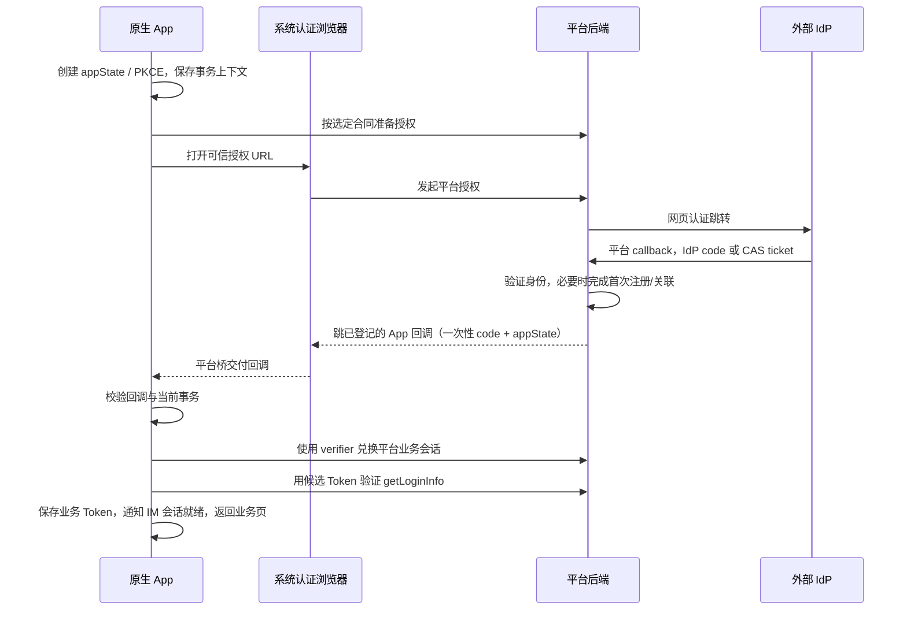
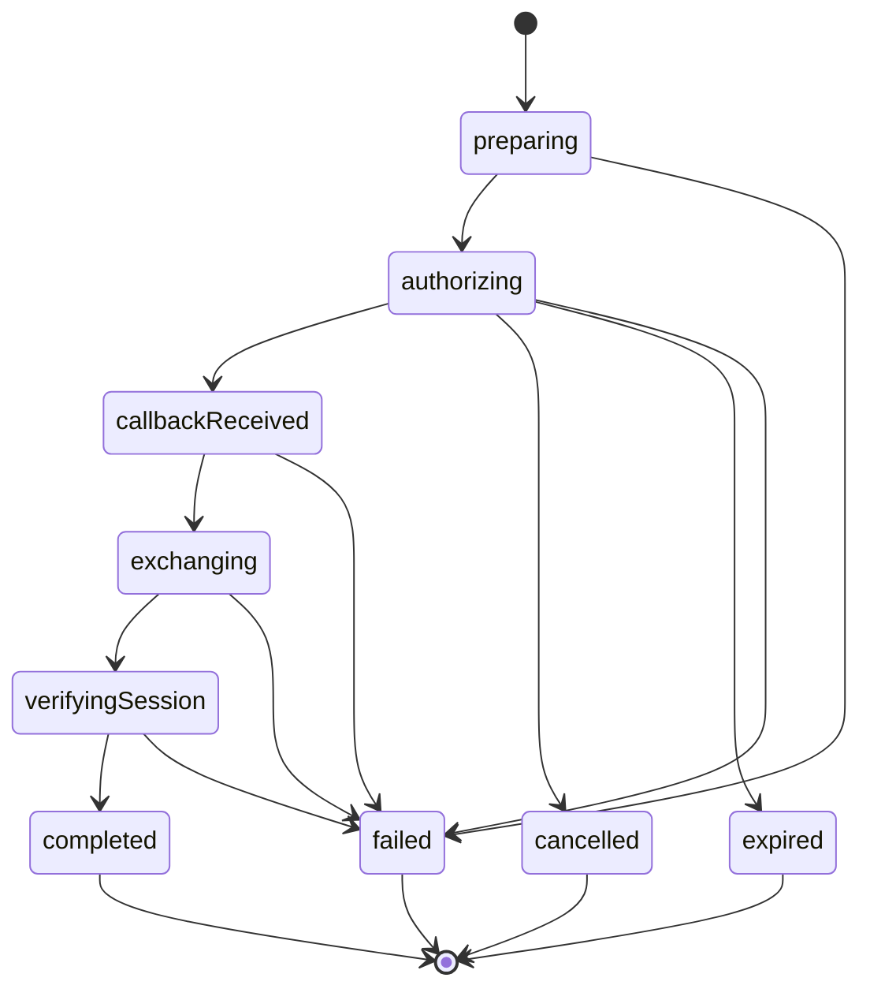

# 移动端联合登录总方案与原生 App 接入计划

更新：2026-10-27。H5 实现基线：`cccd851ff`。当前按用户要求完成方案梳理；原生业务代码、后端扩展、应用登记及发布均未实施。测试环境行为由用户验证。

## 1. 当前完成范围与“原生预留”的含义

**H5 已实现，原生只有可复用基础，尚无完整的原生授权流程或桥接接口。** 原生后续接入可以复用提供方配置、解析、普通登录与会话管理；不能通过打开 H5 开关就完成原生登录。

| 能力 | 当前状态 / 源码 | 原生处理 |
|---|---|---|
| 提供方类型、ID、名称等数据模型 | 已有：[authIdp.uts](../../types/interfaces/authIdp.uts) | 可复用；原生授权能力字段需扩展 |
| 公开列表与游客请求 | 已有：[servers/authIdp.uts](../../servers/authIdp.uts) | 可复用列表；Cookie 验证接口封装只适用于 H5 |
| H5 提供方与自动策略 | 由服务端 `items/autoRedirectIdpId` 决定，前端不维护类型/ID 白名单，也不以本地参数停用自动认证 | 原生会话交接合同和实际平台能力另行确认 |
| 列表解析、返回路径约束、旧请求隔离 | 已有：[utils/authIdp.uts](../../utils/authIdp.uts) | 可复用部分纯逻辑；不能用 `AuthLoadScope` 代替完整原生事务 |
| H5 授权导航及回调页 | 已有：[idpNavigation.uts](../../utils/idpNavigation.uts)、[idp-return.uvue](../../subpackages/pages/auth/idp-return.uvue) | 浏览器导航与 Cookie 回调不用于原生 |
| 原生入口闸门 | `canUseBrowserIdp()` 在非 H5 返回 `false`；登录组件也按 H5 条件编译 | 保持关闭，完成原生链路后另接原生入口 |
| App 业务 Token 保存及 Bearer 请求 | 原有：[authSession.uts](../../utils/authSession.uts)、[useRequest.uts](../../servers/useRequest.uts) | 在取得并验证平台业务 Token 后复用 |
| 系统认证窗口、原生回调、PKCE、一次性码兑换、冷启动恢复 | **未实现** | 本方案后续阶段新增 |
| 微信/飞书原生 SDK 登录 | **未实现** | 独立阶段；支付插件、H5 后端微信配置不代表已经支持 |

历史分支 `feat/nuwa-zhuoda-2026.10-idp-login` 的 10 月 13 日草稿和后端确认清单仅作历史参考；其中的暂停状态、旧远端配置、旧测试数及拟议接口不能代替本文的当前结论。本文与 [H5 接入说明](mobile-h5-idp-login.md) 是当前入口。

## 2. 产品范围和分期

| 阶段 | 交付目标 | 允许开放的能力 | 完成条件 |
|---|---|---|---|
| H5 当前阶段 | 西财优先；先在测试环境验证 Cookie SSO | CAS、通用 OAuth2；微信默认关闭 | 用户验证真实授权、业务回跳、失效会话及普通登录回退 |
| N0 契约与基座准备 | 冻结原生会话交接方式，完成平台回调登记 | 原生入口继续关闭 | 第 12 节阻塞问题有实际合同，平台桥可以编译及接收测试回调 |
| N1 Android/iOS 原生网页 SSO | CAS、适合浏览器授权的 OAuth2 | 仅支持完整链路的平台/提供方 | 热启动、冷启动、取消、首次关联、过期、切域及业务/IM 会话验收 |
| N2 原生身份管理 | 查看、绑定、解绑外部身份 | 独立开关；不作为 N1 登录的必需 UI | 最后一种登录方式限制、绑定账号固定、失败重试验收 |
| N3 微信/飞书等原生 SDK | 按实际移动应用资质接入 | 明确 SDK 能力与公开 AppID 后逐项开启 | 已安装/未安装、拒绝、取消、跨端同一账号、真实签名包验收 |
| N4 鸿蒙与小程序 | 分别适配系统浏览器/SDK及小程序登录限制 | 平台验证前关闭 | 各自完整会话链路验收，不能套用 Android/iOS 的通过结论 |

本文不要求现在新增这些功能代码，也不要求先开通第三方资质。H5 登录能力与原生开关独立，原生未就绪不能影响西财 H5 使用。

## 3. 已知后端能力与接口边界

依据：本轮已读取的 PC Web `workspace/nuwax` 源码与测试环境 [OpenAPI](https://test-nvwa-api.xspaceagi.com/v3/api-docs)。文档存在接口，只能证明接口声明，不能证明原生适用性或所有分支已验收。业务请求的 origin 仍取 App 当前服务域，不能把 OpenAPI 站点当作业务域。

| 已知接口 | 用途 | 原生尚需明确 |
|---|---|---|
| `GET /api/auth/idp/list` | 公开 `items`、`autoRedirectIdpId`；item 有 `id/type/name/icon/wechatMode` | 原生平台能力、浏览器/SDK 模式、公共客户端配置 |
| `GET /api/auth/idp/authorize` | `provider`、本站相对 `redirect`；浏览器授权 | 现有 `redirect` 不能直接改传 App scheme；原生上下文承接方式 |
| `GET /api/auth/idp/callback` | IdP code/CAS service ticket 的后端处理 | 回原生 App 时如何交付一次性码，成功/失败/pending 如何保留上下文 |
| `/auth/bind-or-register`、`pending/info`、`pending/register`、`pending/bind` | 后端首次注册/关联流程 | 原生事务如何贯穿普通登录、设密码、注册和绑定 |
| `GET /api/user/getLoginInfo` | 验证当前平台用户 | 兑换 Token 的受众和业务会话兼容性 |
| `/api/user/identity/list`、`bind/{providerId}`、`unbind/{identityId}` | 外部身份管理 | Bearer 适用性、发起账号固定、原生返回方式 |
| `/api/oauth2/authorize`、`/api/oauth2/token` | 已声明授权码、PKCE及令牌兑换 | 是否支持无 Secret 的官方 App 公共客户端；所得 Token 是否能用于现有业务/IM |
| `/api/oauth2/revoke` | OAuth2 令牌撤销 | 不据此推定可以撤销现有 App 业务 Token |
| `GET /api/user/logout`、`GET /api/auth/idp/logout` | 平台普通退出、IdP 联动退出的不同入口 | 原生默认退出策略及会话撤销范围；不自行启用 CAS 单点注销 |

`pending/register` 的声明已有 `LoginResDto`，包含 `token/expireDate/resetPass/redirect`；不能笼统认定“所有三方登录接口都不返回 Token”。但单个注册分支有 Token，仍不能证明已绑定用户、自动关联、人工绑定及 SDK 登录的原生交接已经完整。

## 4. 会话交接的方案选择

### 4.1 先验证现有 OAuth2 公共客户端能否复用

优先复用平台已有的授权码与 PKCE 能力，**只有以下条件全部确认，才选择方案 A**：

1. 官方 App 可以登记为公共客户端，不需要在包内放 `client_secret`，强制使用 PKCE S256，回调地址精确登记。
2. `/api/oauth2/authorize` 未登录、IdP 登录、首次注册/绑定、普通登录续接结束后，都能回到原授权请求，而不是丢到首页。
3. 兑换结果是现有 App 可以直接使用的平台业务会话，或已有明确的业务会话二次交换接口；不能仅凭 `/api/oauth2/userinfo` 成功就接入业务。
4. 过期、刷新、撤销、取消、切域及重复兑换的行为均有合同，且兼容旧 PC/H5。

方案 A：`App → 平台 OAuth2 authorize → 平台 IdP/首次关联 → App 授权码回调 → token（携带 verifier）→ 平台业务会话验证`。App 不直接向外部 CAS 验票，也不把外部 IdP 的 Token 当平台 Token。

### 4.2 不满足条件时补平台移动事务

若 A 无法交付 App 业务会话，选择方案 B：平台在现有 IdP 逻辑外增加薄的移动事务与一次性码兑换层，继续复用已有账号匹配、注册和绑定规则。**以下是能力合同提案，方法/路径尚未确定，不是当前已存在的 API。**

| 能力 | 最小输入/输出与约束 |
|---|---|
| 创建授权事务 | 输入 provider ID、客户端/平台、已登记回调 ID、appState、PKCE challenge/method；输出事务 ID、可信授权 URL、过期时间、取消凭证（如采用） |
| 网页登录与首次关联 | 事务在后端绑定业务域/租户、provider、客户端、回调及 login/bind 模式；保留到所有中间页结束 |
| 完成回调 | 仅返回一次性 `code`、`appState` 及必要的事务 ID，或明确错误；不在 URL 放业务 Token、刷新凭证、Cookie 或 verifier |
| 兑换结果 | HTTPS POST 到事务发起时保存的业务域；带 code、verifier、客户端及事务标识；原子消费并返回平台业务登录结果 |
| 取消/过期 | 提供有权取消该事务的凭证与幂等语义；若无独立取消接口，后端必须有确定过期与旧事务隔离策略 |

推荐只实现选定的一条交接链，不同时维护两套默认通路。后端给出已有实现时优先适配，不要求机械新建上述接口。两种方案的最终选择记录在第 12 节 B01。

### 4.3 推荐原生链路

图中的“准备授权/兑换平台业务会话”取决于 A/B 最终合同，不能按图反推已有接口。服务器自身的 IdP state 与 App 交接用的 appState 是不同层次，后端都须关联当前事务。

## 5. 原生模块拆分及拟定接口

下表均为待新增/扩展项；这些文件和接口尚未创建。

| 模块 | 责任 | 与现有代码的边界 |
|---|---|---|
| `utils/nativeIdpFlow.uts` | 编排开始、回调、兑换、会话验证、取消与业务返回 | 复用提供方解析及安全业务路由；不修改 H5 浏览器导航语义 |
| `utils/nativeIdpTransaction.uts` | 状态机、事务代数、过期、并发和安全恢复 | `AuthLoadScope` 仅保护局部异步加载，不能覆盖进程重建 |
| `servers/authIdp.uts` 扩展或独立服务 | 选定合同的请求封装、候选 Token 验证 | 网络请求继续集中到 servers；不在页面里直接 `uni.request` |
| `uni_modules/nuwax-native-auth` | 系统认证窗口、回调收取、加密随机/摘要及安全事务存储 | 三端分别实现；与支付插件的 URL 分发互不吞事件 |
| 登录页原生入口 | 按平台能力显示、协议确认、加载与取消、普通登录逃生 | 不把 H5-only 的 `canUseBrowserIdp()` 直接改成原生 true |
| `App.uvue` 启动/回前台适配 | 最早注册原生桥，收取初始回调并去重 | `onShow` 只表示回前台，不表示授权成功；单靠 `onShow` 不兑换 Token |

拟定桥面向统一流程暴露：`getCapabilities()`、`startAuthorization(request)`、`cancel(requestId)`、`getInitialCallback()`、`subscribeCallback(listener)`。这是设计边界，不是可调用的现有 SDK。

- request 至少含 `requestId/authorizeUrl/expectedCallback`；桥只允许打开编排层确认的授权地址。
- callback 为 `success(uri)`、`cancelled`、`failed(errorKind)`；success 仅表示收到回调 URI，最终登录仍以兑换和用户验证为准。
- 初始回调与运行中事件进入同一个处理函数，同一事务只消费一次；业务流程在桥注册完成后才能显示入口。
- 源码支持与安装包桥版本均参与 capability 判断；新业务代码遇到旧自定义基座，必须回落普通登录。

## 6. 公开能力与开关设计

当前 H5 直接采用服务端 `items/autoRedirectIdpId`，已移除静态类型/ID 白名单及前端自动开关。原生平台开关、SDK AppID、能力版本等字段**尚无后端合同**，以下为扩展语义建议，不固定字段名：

| 信息 | 应表达的内容 | 缺失时的行为 |
|---|---|---|
| 客户端能力版本 | 服务端支持的原生交接协议版本 | 原生入口关闭；H5 继续旧协议 |
| 提供方平台能力 | H5 / Android / iOS / Harmony 各自启用状态 | 当前平台视为不支持 |
| 授权模式 | 浏览器 SSO / 微信 SDK / 飞书 SDK | 不根据 name/icon 或 `OAUTH2` 类型猜测 SDK |
| 公共客户端参数 | client ID、已登记回调标识、允许 scope，或移动事务入口 | 参数不全不发起；永不从管理接口读取 Secret |
| SDK 公开参数 | 与当前移动应用匹配的公开 AppID及模式 | 不借用网站/公众号/支付 AppID |
| 原生自动项 | 按客户端/平台选择的 provider ID，或明确兼容租户自动项 | 只在所有能力过滤后自动跳；不支持时显示普通表单 |

入口开放条件为：**本地策略允许 ∩ 后端允许当前平台 ∩ 当前包桥/SDK支持 ∩ 回调及交换配置完整**。远端开关可以收紧本地允许范围，不能把缺少桥或未审核资质的功能强制打开。

微信阶段 N3 前保持原生微信关闭；H5 服务端的 `WECHAT` 配置只影响公众号/网站授权，不连带开放 SDK。灰度按租户、平台、客户端版本和 provider 配置，不通过修改全租户自动跳转仅给 App 灰度。

## 7. 原生事务、PKCE与会话生命周期

### 7.1 事务绑定与状态

每笔事务至少记录：请求 ID、发起业务 origin/租户、provider ID、客户端/平台、login/bind 模式、精确回调地址、原业务页、appState、verifier、到期时间和本地事务代数。绑定模式还需固定发起用户，服务端负责校验。

每次异步操作完成前都重新检查事务 ID、代数、发起域和到期时间。切域、退出、主动取消、开始另一笔授权时先使旧事务失效；迟到的回调和网络响应不得保存 Token、绑定账号或触发 IM。浏览器关闭后重新授权由用户明确触发，不无限自动重开。

### 7.2 随机量、回调与存储

- 网页 OAuth 原生客户端采用外部认证浏览器及 PKCE；包内不保存公共客户端 Secret，依据 [RFC 8252 第 6、8.1、8.5、8.12 节](https://www.rfc-editor.org/rfc/rfc8252.txt)。
- 每次生成独立的加密随机 appState 和 verifier。verifier 采用 43–128 个允许字符、至少 256 bit 熵；S256 为 `BASE64URL(SHA256(ASCII(verifier)))`，移除 padding。授权发送 challenge，兑换才发送 verifier，依据 [RFC 7636 第 4、7.1 节](https://www.rfc-editor.org/rfc/rfc7636)。不使用 `Math.random()`。
- 回调校验精确 scheme/host/port/path、参数唯一性、appState、事务归属及寿命；拒绝重复 code/state、成功与错误并存、未知事务和不允许的回调地址。回调参数不能改变兑换域名、租户或 provider。
- 需要进程重建恢复时，通过系统安全存储保存事务必要字段与 verifier；完成、取消、过期时删除。仅内存实现不能宣称支持杀进程恢复；缺安全存储能力的版本应明确取消旧事务并要求重试，不能从 URL 重建“可信”事务。
- 日志只记脱敏事务标识、阶段、错误类别及服务端 trace ID；不记录完整回调 URL、verifier、code、Cookie、Token、pending token、密码或 `getImSessionStamp()` 原文。

平台 OAuth 交接的 PKCE、平台向外部 OAuth2 IdP 发起授权的 PKCE、原生 SDK 自身 state 是不同层次；不能用其中一个替代另一个。

### 7.3 兑换、验证、保存及退出

1. 使用已保存的发起 origin 兑换，只接受选定合同声明的平台业务登录结果。`token` 必须非空，过期时间必须按合同处理。
2. 用候选 Token 请求 `/api/user/getLoginInfo`，确认有效用户；这一步需新增允许显式候选 Authorization 的受控 servers 封装，不能先调用 `saveAccessToken()` 再验证，因为它会立即触发 IM 会话就绪。
3. 候选验证失败时不污染当前已验证会话。成功后才调用现有 `saveAccessToken()`，沿用服务域标记和 IM 事件；再按业务 Token 合同验证 IM 连接与设备注册。
4. `resetPass=0` 时先进入现有设密码流程，并保留原业务页/待关联上下文；业务返回目标使用移动站内白名单，不允许回调指定任意外站。
5. 当前 App 使用 `uni` storage 保存业务 Token，是现有兼容基础，不等于已具备原生安全凭证仓。引入刷新凭证时先补 Keychain/Keystore 等安全存储适配及读取层方案，不把刷新凭证直接塞入普通 storage。业务 Token 是否同步迁移需单列兼容改造。
6. 后端若只交付现有业务 Token，沿用其过期后重新登录策略；若交付 refresh token，必须明确轮换、串行刷新、撤销与重放处理后才启用，不能默认复用开放 OAuth2 Token 的刷新行为。
7. 默认退出复用当前平台退出语义，并取消在途原生事务；CAS SLO 作为单独策略确认。业务端退出不会自动清除系统浏览器的 IdP Cookie；本地普通登录/切换账号入口须避免立即自动再登录。若要求重新选择身份，使用提供方正式支持的重认证参数，不自行拼 `prompt` 等通用参数给 CAS。

兑换响应丢失是“结果不确定”，不能据此认定 code 尚未被消费。优先按后端已确认的幂等规则恢复；未提供该能力时清理本笔事务、引导重新授权，避免无界重试。

## 8. 首次注册、绑定及第三方账号一致性

| 分支 | 方案要求 |
|---|---|
| 已绑定身份、自动关联已有用户、自动注册 | 后端沿用现有规则，最后都进入同一 App 会话交接出口 |
| 人工选择注册/绑定 | 优先复用后端中间页；事务必须贯穿 pending/info、register、bind 及错误路径 |
| 中间页普通登录/设置密码 | 可继续在系统认证浏览器完成；如回原生表单，必须有经过确认的原生 pending 续接合同，不把普通 App Bearer 假定为浏览器 Cookie |
| 账号已登录后绑定 | 服务端固定 App 发起账号，验证浏览器残留其他账号不能改变绑定对象；binding 成功不替换当前 App 登录用户 |
| 解绑 | 复用 identity 记录 ID，保留“最后一种登录方式且未设置密码时拒绝解绑”的服务端限制 |
| 微信 PC/公众号/移动 SDK、飞书多应用 | 后端定义命名空间与身份归一规则；不能拿不同 AppID 的 openid，或仅凭邮箱/昵称在 App 本地合并账号 |

H5 已允许安全的后端 pending 页面返回；这不表示原生 pending 续接已完成。未经验证的手机号/邮箱、身份冲突、账号禁用、注册关闭均由后端作最终决定，不为移动端另写自动合并规则。

### 8.1 后续原生 SDK 通道

微信/飞书等 SDK 通道与网页通道共用事务、账号规则和最终业务会话，替换的只是授权发起与外部授权结果获取：

1. 从明确的当前平台能力选择 SDK，校验公开 AppID、原生桥/SDK版本和应用登记；配置缺失或客户端未安装时，提供普通登录或后端明确声明的网页替代入口，由用户选择。
2. 平台建立登录/绑定事务，App 调 SDK 发起授权，并绑定 SDK 支持的 state/nonce 等校验量；不依据展示名称选择 SDK，不把平台交接 PKCE 假定为 SDK 自带能力。
3. SDK 返回的提供方 code 发送到已确认的后端原生完成接口，由后端校验应用/事务、兑换外部身份并复用账号关联规则。SDK code、平台一次性交换 code 和业务 Token 必须区分，均不能互相代用。
4. 已绑定/自动关联走统一的业务会话交付；需要人工处理时使用与该事务绑定的受信续接页或后续原生中间页。若依赖网页，后端需明确如何引导该笔 SDK 事务进入网页上下文，不能假定系统浏览器已有对应 Cookie。
5. 最终仍执行第 7.3 节的候选业务 Token 验证与保存。拒绝、取消、过期、重复结果及晚到回调按同一事务规则处理，SDK 成功不直接视为平台登录成功。

SDK 的具体调用方法、所需资质和后端原生 code 接口在 B10 冻结；本期不安装 SDK、不重用支付授权流程，也不据 H5 微信模式推定已完成原生应用审核。

## 9. 各平台认证窗口与打包配置

| 平台 | 拟采用方式 | 必需配置与兼容处理 |
|---|---|---|
| Android | 系统认证浏览器；桥支持时优先评估 Auth Tab，保留 Custom Tabs/系统浏览器回退 | 精确回调；HTTPS App Link 的域名关联与应用签名；Custom Tabs 回退仍需接收 Intent/冷启动回调；浏览器缺失返回明确失败 |
| iOS | `ASWebAuthenticationSession` 原生桥 | 当前 manifest 最低 iOS 15.0；回调方案按该最低版本验证。自定义 scheme 使用精确匹配+PKCE；若采用 HTTPS/Universal Link，核对对应 OS/API 能力、Associated Domains 与 AASA。取消由会话回调消费 |
| HarmonyOS | 系统浏览器与平台可验证回调，后续单独适配 | Want/链接分发、签名及应用登记的实际能力需确认；本文未完成鸿蒙专项 API 核验，不能标为已可用 |
| 微信小程序 | 继续现有小程序登录；第三方联合登录另评估 | 不直接套用系统认证浏览器/自定义 scheme；网站 QRCODE/OA 也不等于小程序登录 |

原生网页 OAuth 使用系统认证上下文；不把业务 `<web-view>` 改成抓取 Cookie 的认证容器。[Android Auth Tab 官方文档](https://developer.chrome.com/docs/android/custom-tabs/guide-auth-tab)说明了能力探测、回调及 Custom Tabs 回退；它在当前 uni-app x 基座中的可用性仍需桥与基座编译验证，不仅凭手机 Chrome 版本判断。

必须在联调前登记或确认：

- **应用身份**：当前 Android `com.nuwax.app`、iOS `com.nuwax.app`、Harmony `com.nuwax.apphm` 来自 manifest；测试/正式签名与打包 ID 需再次确认。iOS `urlschemewhitelist` 中的微信/支付宝只是调用白名单，不是 SSO 回调注册。
- **回调地址**：平台后端的 IdP callback 与平台回 App 的 callback 分开登记。回调域名、scheme、host/path、客户端 ID 尚未选定；不得将支付的 `link.nuwax.com/wechat/` 自动当登录回调。
- **Android 关联**：HTTPS App Link 需对应的 Manifest 声明与站点 Digital Asset Links，签名匹配须核对；采用 Auth Tab 时仍验证其 HTTPS 关联及回退路径，参考 [Verify App Links](https://developer.android.com/training/app-links/verify-applinks)。
- **iOS 关联**：Universal Link 需应用 entitlement 与域名 `apple-app-site-association` 对应，HTTPS 服务及应用标识一致，参考 [Supporting associated domains](https://developer.apple.com/documentation/xcode/supporting-associated-domains)；系统认证会话行为参考 [ASWebAuthenticationSession](https://developer.apple.com/documentation/authenticationservices/aswebauthenticationsession)。
- **多企业域名**：固定 App 回调与当前业务域在事务中绑定；若采用统一回调域，只能中转绑定过的短期结果，不能根据任意 query 转发 Token。是否采用统一域由平台与应用登记方确认。
- **基座**：引入原生桥/SDK后按项目 HBuilderX 与自定义基座流程重新打包；iOS 真机与模拟器分别出包。标准基座、旧基座和仅更新业务资源不构成原生插件已随包交付的证据。

## 10. 异常与兼容策略

| 情形 | 客户端行为 / 后端要求 |
|---|---|
| 列表超时、旧后端、能力字段缺失 | 显示普通登录，原生入口关闭，不清理其他有效会话 |
| 自动项不支持当前平台、版本或被本地配置关闭 | 忽略自动项，保留其他可用入口及普通登录 |
| 用户取消、SDK拒绝、浏览器启动失败 | 结束本笔事务并恢复按钮；不自动切换另一种方式反复唤起 |
| code过期/已使用、state错误、无事务回调 | 拒绝结果并展示可重试错误；不落 Token |
| 网络中断、兑换结果不确定 | 按明确幂等合同恢复或重新授权；不盲目重复兑换 |
| 进程重建 | 安全恢复有效事务后处理初始回调；无法验证时要求重试 |
| 切域、退出、换账号、并发发起 | 使旧事务失效，旧结果不得改变当前账号、绑定或 IM |
| provider停用/改配置、账号禁用、注册关闭 | 服务端最终校验，返回可识别错误；不开客户端绕过 |
| 旧包遇到新服务端 | 缺能力/协议不匹配时回落；新增字段兼容旧 PC/H5 |
| 旧服务端遇到新包、紧急关闭原生登录 | 原生开关关闭后可用密码/验证码；H5 仍走原有 Cookie 路径 |

H5 失败默认回 PC `/login?idpError=…` 的现有后端行为不能由原生页面单方面修复。需要所有成功、失败、取消及 pending 分支都保存客户端返回上下文；未补齐时只能将对应场景列为未验收。

## 11. 开发顺序和验收矩阵

开发顺序：B01–B08 冻结 → 桥/回调与能力判断 → 事务及兑换编排 → 原生登录入口 → 首次关联和生命周期 → 设备与安装包验证。源码、服务端合同、应用登记、编译、真机、测试环境分别记状态。

| 验收组 | 最少覆盖 | 证据层次 |
|---|---|---|
| H5 当前版本 | CAS/OAuth2、Cookie HttpOnly、深链接及二次编码、失败回退、微信关闭 | 已有本地专项测试/编译；真实测试环境由用户验收 |
| 身份分支 | 已绑定、自动关联、自动注册、人工注册、人工绑定、注册关闭/账号禁用 | 真实后端测试身份；不能以单个成功账号代替 |
| 原生启动返回 | Android/iOS 分别验证热启动、冷启动、进程重建、取消与浏览器回退 | 含匹配插件的签名安装包及真实设备 |
| 事务安全 | state错误、回调域/路径错误、重复code、重复回调、过期、错租户/provider、切域后迟到响应 | 逻辑测试+服务端校验；真实回调补验证 |
| 会话可用性 | getLoginInfo、核心业务请求、IM CONNECT、设备注册、重启持久登录、过期、退出 | 真实业务 Token；开放 OAuth2 userinfo 成功不足以通过 |
| 账号设置 | 发起账号与浏览器残留账号不一致、唯一身份解绑拒绝、失败后重试 | N2 范围内再验收；不与登录成功混记 |
| 配置及回退 | 老后端、旧基座、平台不支持、微信未开、自动项不支持、远端停用 | 版本组合测试；普通登录始终可达 |
| SDK/其他端 | 微信/飞书安装状态、真实应用签名、跨端账号对应；鸿蒙/小程序各自矩阵 | 各阶段独立验收，前期保持关闭 |

本次 H5 专项 47 项通过，HBuilderX H5 编译通过；全量测试有 36 项失败，已在 H5 实施前基线 `39cf4ce57` 隔离复现。它们不是原生编译/真机或真实 IdP 登录证据。本次后续只整理文档，不部署，不修改测试/生产平台配置。

## 12. 后端及平台配置待确认清单

下列均为**待确认**，不是后端“缺功能”的定论。角色是建议归属，不指定个人；已有文档可直接补实际方法/路径、鉴权、字段和脱敏示例。B01–B08 阻塞 N1 开放，B09–B11 按对应范围冻结。

| 编号 | 需要冻结的内容 | 可接受的完成证据 | 建议归属 |
|---|---|---|---|
| B01 | 方案 A 是否满足条件；否则 B 的现有/新增接口 | 选定单一路线、接口路径/方法、公共客户端登记方式及完整时序 | 后端 |
| B02 | Token 是业务会话还是开放 API Token；是否二次交换 | getLoginInfo、业务 API、IM、身份接口兼容结论与响应示例 | 后端/IM |
| B03 | 原生客户端/平台能力与公开配置下发 | 带缺字段兼容语义的公开响应；Secret 不下发；自动项规则 | 后端/移动 |
| B04 | 首次关联和失败/取消的客户端返回上下文 | 已绑定/自动/人工分支、中间页普通登录与设密码的返回示例 | 后端 |
| B05 | state、PKCE、事务绑定、TTL及重复兑换 | 参数所在位置、原子消费、过期和结果不确定时的幂等/重试错误码 | 后端/移动 |
| B06 | 回调登记、业务域/租户及应用身份 | 每平台每环境精确 URI、签名/包名、HTTPS关联或scheme方案 | 应用配置/移动/运维 |
| B07 | 冷启动恢复、取消、切域/退出和并发事务 | 客户端安全恢复及代数规则；后端取消/过期及旧结果隔离 | 移动/后端 |
| B08 | Token寿命、刷新、普通退出与CAS SLO | 期限/轮换/撤销范围、可用错误码、是否需要安全存储迁移 | 后端/移动 |
| B09 | 绑定发起账号、身份冲突及最后身份解绑 | 不能由浏览器账号替换App账号的机制，冲突及设密码错误码 | 后端 |
| B10 | 微信/飞书SDK code入口、公开AppID及跨端同一账号 | 正式接口与移动应用登记；openid/unionid等现行匹配规则 | 后端/开放平台配置 |
| B11 | 鸿蒙/小程序的独立可用能力 | 平台实际API与签名包、允许的回调/交换方式 | 对应平台开发 |
| B12 | 测试数据、发布和回滚 | 真实分支覆盖账号、脱敏 trace、部署版本及停用方式 | 用户/测试/发布方 |

回复模板：`编号；结论（已支持/需扩展/本期不纳入）；实际接口/配置；成功/失败/待关联示例；TTL与重试；适用环境/版本；未决事项`。在本节更新实际结论后再实施原生合同，本文中的拟定模块和能力名不自动变成承诺 API。

为便于承接 10 月 13 日历史确认清单，旧编号可按下列主题归并：A02/A03→B01；C01→B02；A04/A05/F03→B03；B01/D01/D02→B04；C03/C04/D04→B05；E03→B06；C05→B07；B06/C02/D03→B08；B02/B03/B04/B05→B09；A01/E01/E02/E04→B10；F04→B11及分期范围；F01/F02/F03→B12。旧清单的“待确认”不会因为本次写完方案自动变成“已支持”。
